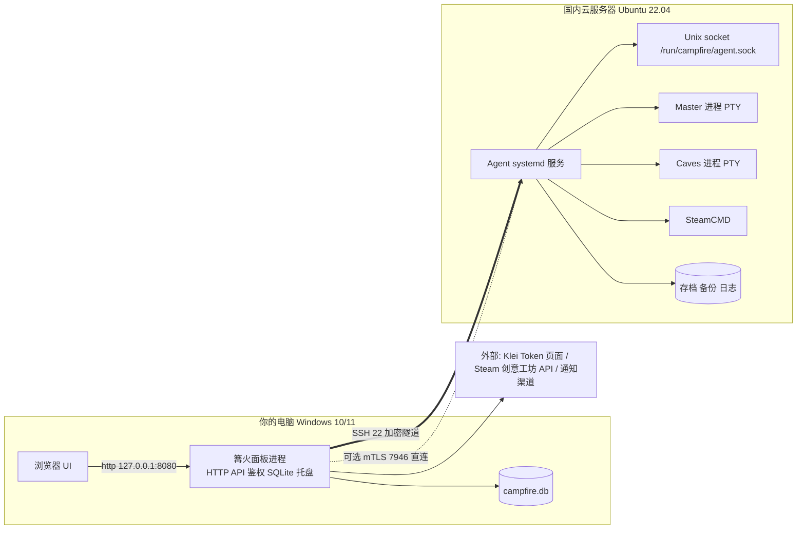
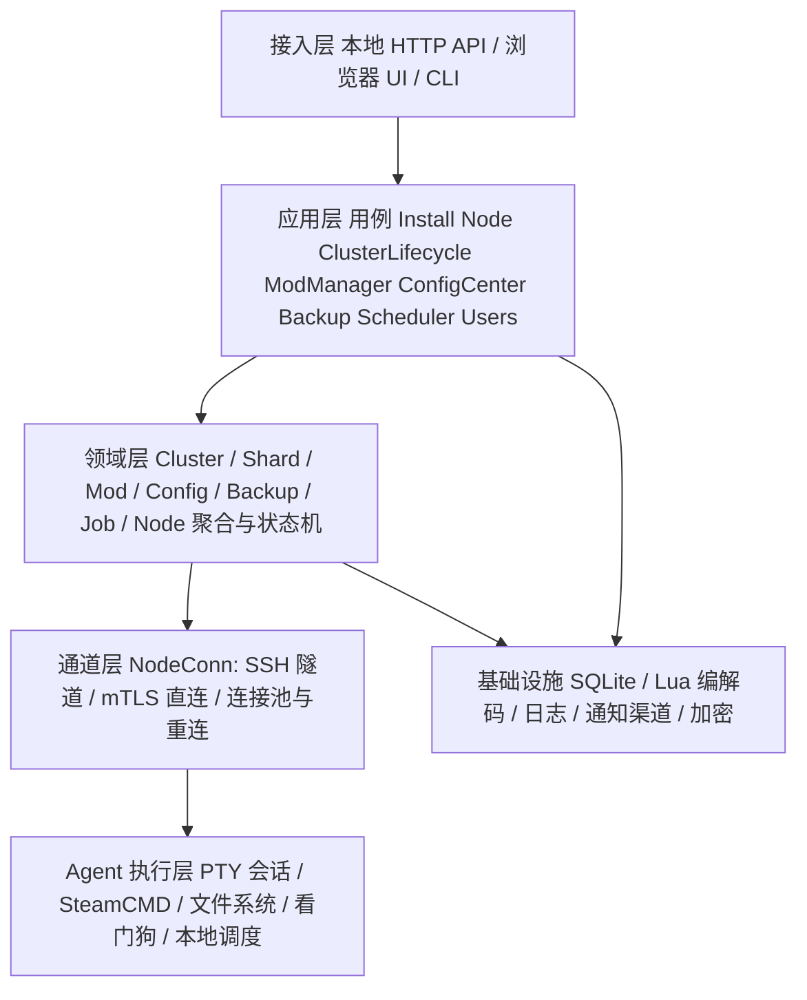
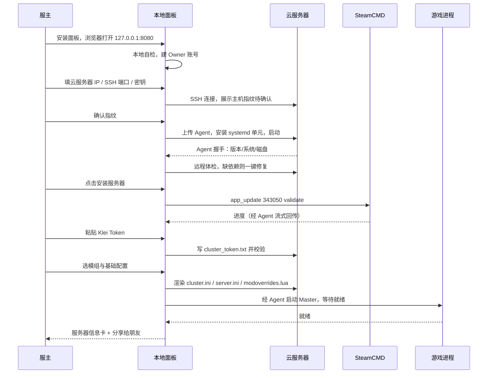
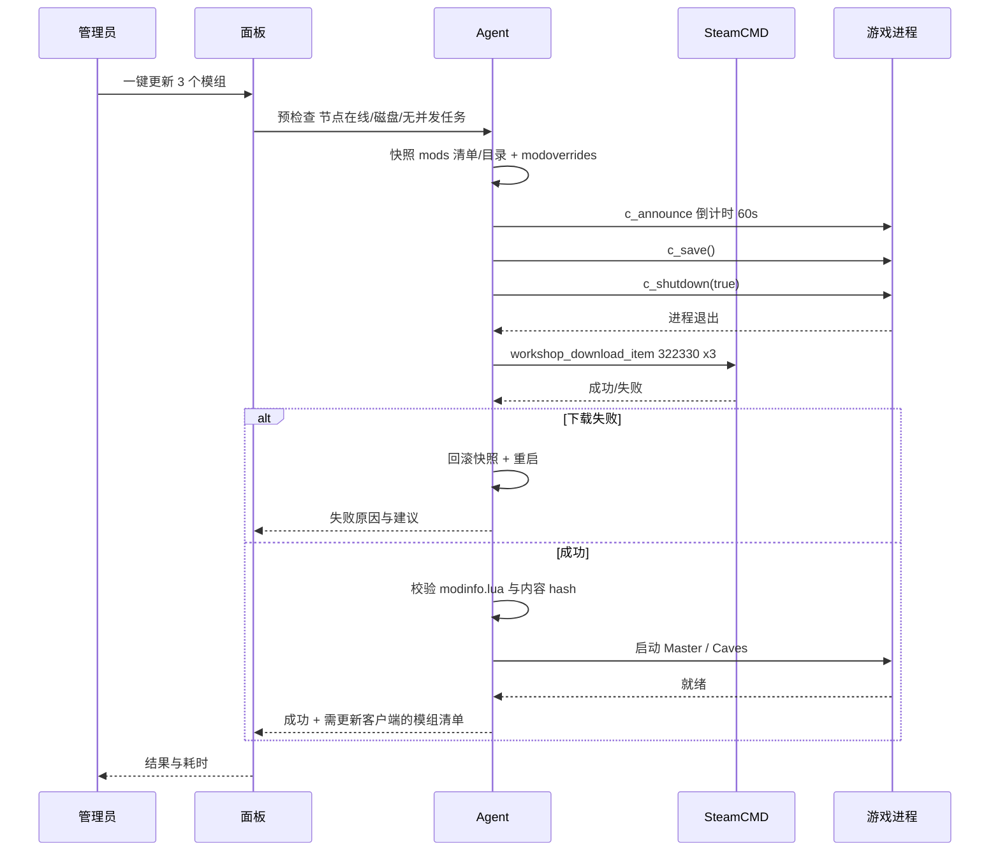
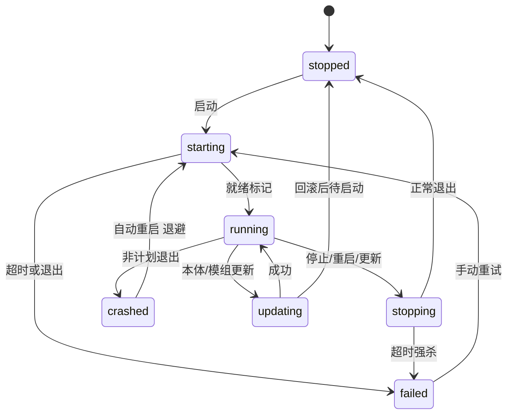
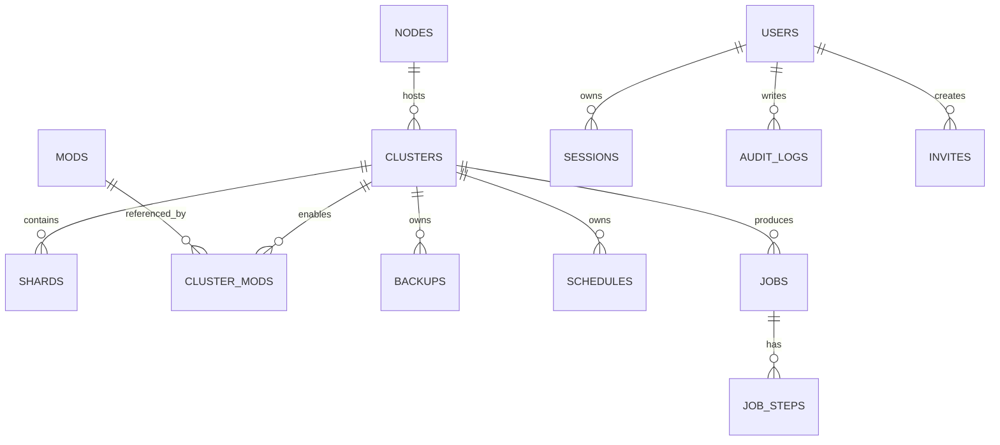

# 篝火 · 饥荒联机版（DST）云服务器管理平台 — 产品与技术设计方案

| 项 | 内容 |
|---|---|
| 文档版本 | **v2.11**（2026-11-02 根治 Klei 列表登记行冲突：重启改为控制台优雅关服 `c_shutdown(true)`，公共列表已恢复，见 §22.8；直连模式降为后备，见 §22.4） |
| 撰写日期 | 2026-10-30（v2.11 修订 2026-11-02） |
| 产品代号 | **篝火（Campfire）**，建议仓库名 `campfire-dst` |
| 目标形态 | **本地桌面控制台**（Windows 上运行的本地服务 + 浏览器 UI）+ 云服务器 **Agent** + CLI |
| 交付节奏 | v0.1 可用 → v1.0 完整 → v2.0 增强 |
| 适用对象 | 后续实现、测试、评审的唯一基准文档 |

> 一句话：**在自己电脑上打开一个网页，把国内云服务器从零装成带模组的饥荒专服；之后的开服、更新模组、改配置、踢人、备份回滚，全部在这里点完。**

**已确认的前提（2026-10-30 需求确认，两轮）**

| # | 决策 | 对方案的影响 |
|---|---|---|
| 1 | 服务器性质：**私服**（固定朋友圈） | 不做公开服务器列表、举报、防刷；白名单/密码访问是常态 |
| 2 | 云服务器：**阿里云 ECS，国内地域，Linux x86_64** | 见 §10.2 阿里云推荐配置；Steam 下载可能慢/失败 → 需要代理与离线方案 |
| 3 | 面板位置：**运行在自己的电脑上**（Windows 优先） | 必须做**远程 Agent** 与 SSH 通道；面板不做移动端 |
| 4 | 访问方式：**仅本机 `127.0.0.1`**（已确认不需要外网/穿透访问） | 不需要域名、证书、备案、HTTPS；局域网/公网/多用户模式降级为 **P1 预留** |
| 5 | 用户体系：**单用户（只有你自己）** | v1 只做本地口令 + 审计；RBAC 数据模型预留，多用户 UI 放 P1 |
| 6 | 微信小程序：**不做** | 删除移动端与小程序相关范围 |
| 7 | 规模：先 **1 台阿里云 ECS**，每台多个存档 | 数据模型与 UI 按"多节点"设计，v0.1 只验证 1 台 |
| 8 | 云服务器系统与 SSH：**Ubuntu 22.04 LTS（或 24.04）+ 22 端口 + 密钥对**（推荐，见 §10.2） | Agent 按密钥认证实现（同时支持密码兜底）；阿里云安全组开放游戏端口 |
| 9 | 当前阶段：**面板已开工**（2026-11-01 用户下达"开始做管理平台"指令，面板 0.1 已跑通，见 §16） | 本文档与 `platform/` 代码同步演进 |
| 10 | 实机验证（2026-11-01）：已在阿里云 ECS（华东1 / Ubuntu 22.04 / 2C4G）跑通 DST 安装、单分片开服、玩家进服、**22 个创意工坊模组一键更新**、每日备份、管理员配置 | 真实结论回填 §5.3.1 与附录 H；各项耗时、内存、踩坑均可直接用于面板实现 |

---

## 执行摘要（1 页速读）

**做的东西**：一个装在自己 Windows 电脑上的"饥荒专服遥控台"。它本身是个本地小服务（开机自启、托盘常驻），你在浏览器打开 `127.0.0.1:8080` 使用；它通过 SSH 连到你国内的云服务器，自动装好 Agent、SteamCMD 和 DST 服务器，之后所有运维都在这个网页里完成。

**五块核心能力**

1. **远程一键部署**：填云服务器 IP + SSH 账号 → 面板远程体检 → 装依赖/SteamCMD/DST → 创建存档 → 开服。全程有进度、可重试，不需要你手敲命令。
2. **模组中心**：粘工坊链接即装；`modinfo.lua` 参数自动变表单；**一键更新 = 存档 + 公告倒计时 + 停服 + 预下载 + 重启 + 失败自动回滚**（最有价值也最容易出事的一环，方案给了完整保障链）。
3. **运维自动化**：云侧 Agent 常驻看门狗（崩溃自愈）、定时备份/重启/更新、Webhook/邮件告警、日志与崩溃报告——**你电脑关机不影响服务器继续运行**。
4. **访问控制**：面板默认只监听 `127.0.0.1`（不需要域名、证书、备案）；账号体系先做你自己一个人，多用户与公网访问作为预留能力（P1），将来要开时再打开开关。
5. **数据安全**：破坏性操作前强制快照；恢复"先解包校验再原子替换"；删除进回收站；Token 与 SSH 凭据加密存储。

**技术一句话**：Go 单二进制，**同一份程序两种角色**——本地面板（Windows 托盘 + 内嵌 Web UI + SQLite）与云服务器 Agent（systemd 服务）；两者通过 **SSH 加密隧道**通信（默认不占云服务器额外端口）；DST 没有官方 RCON，所以由 Agent 用 **PTY 托管游戏进程**并向 stdin 发命令（marker 回显判定完成）；配置走"Lua ⇄ JSON"管线而不是正则改文件。

**排期**：M0 技术验证 4–6 天（5 个 spike）→ MVP 约 4 周（1 后端 + 1 前端）→ v1.0 补齐多节点/搜索/CLI。MVP 约 **95 人日**（1 后端 + 1 前端并行约 6.5 周，单人全职约 3.5 个月）。

**仍需你拍板**（详见 §13.2）：备份是否自动下载到本地、以后是否要管多台云服务器、面板是否也要 Mac/Linux、白名单是否默认开启。

**几个已可照做的默认结论**：阿里云选 **Ubuntu 22.04 LTS + 22 端口 + SSH 密钥对 + 通用型 2C4G 起**（6–8 人双分片选 4C8G，见 §10.2）；面板只跑本机、不需要备案域名；朋友不登录面板，v1 就你一个人用。

**最大风险**：① 本地电脑断网/休眠时面板失联（云侧 Agent 仍守护，重连即同步）；② 工坊不提供历史版本，"更新"只能靠快照回滚；③ `app_update validate` 会清掉模组清单，必须每次更新后自动重建。

---

## 0. 文档导读

- **第 1 章**：产品目标、场景、范围。
- **第 2 章**：DST 服务器基础模型与 **6 条硬约束**（全部架构的源头，先读 §2.5）。
- **第 3 章**：总体方案与技术选型，结论看 §3.1 拓扑图 + §3.2 选型表 + §3.3 通道设计。
- **第 4 章**：功能需求全集（FR-01 ~ FR-27）+ NFR + 访问方式/权限矩阵，实现时按此逐条勾选。
- **第 5–6 章**：核心流程 + 技术设计（远端通道、进程托管、模组更新、配置渲染、任务系统、安全）。
- **第 7–9 章**：数据模型、API 契约、界面信息架构。
- **第 10–12 章**：部署与网络、里程碑排期、风险与对策。
- **第 13–15 章**：待确认问题、开源项目对比、附录速查（配置字段 / 控制台命令 / 端口 / 文件清单）。

---

## 1. 项目概述

### 1.1 背景与痛点

自己开 DST 专服给朋友联机的真实流程是：买国内云主机 → 装 SteamCMD → 装 343050 → 手改 `cluster.ini` `server.ini` `modoverrides.lua` → 去 Klei 官网取服务器 Token → 放行一堆 UDP 端口 → 每次模组更新都要重新同步、改配置、重启。痛点集中且重复：

| 痛点 | 现状 | 后果 |
|---|---|---|
| 部署门槛高 | 教程分散，坑多：32 位依赖 `libcurl`、`validate` 会覆盖模组清单、端口不通、国内下载慢 | 新手 2–4 小时起步，多数人放弃 |
| 只能 SSH 操作 | 开机、改配置、看日志都要连服务器敲命令 | 手机/临时场景基本没法处理 |
| 模组维护烦 | 工坊更新后要手动同步，改模组参数要手写 Lua | 玩家客户端与服务端版本不一致，进不去服 |
| 无人值守差 | 崩溃不会自动拉起，更新必须手动停服 | 朋友来了进不去 |
| 存档风险 | 手动备份，回滚靠记忆敲 `c_rollback` | 世界丢失或误操作不可逆 |
| 多人协作差 | 共享 SSH 账号，谁改了什么不知道 | 误操作不可追溯，出事互相甩锅 |

### 1.2 产品定位

**装在自己电脑上的 DST 服务器遥控台**：把"部署云服务器 → 开服 → 维护 → 恢复"这条链路产品化，而不是再写一份教程。

- **是**：本地桌面控制台（浏览器 UI）+ 云服务器常驻 Agent + 操作审计。
- **不是**：公共服托管 SaaS（不做多租户计费、代充、账号托管）。
- **不是**：移动端/小程序（明确不做）。
- **不是**：游戏客户端 Mod 开发工具。

**三条关键形态决策**

| 决策 | 选择 | 理由 |
|---|---|---|
| 面板跑在哪 | **自己电脑** | 不用为面板单独买机器；数据与凭据留在本地；断网也不影响云上服务（Agent 自治） |
| 怎么连云服务器 | **SSH 加密隧道**（默认），Agent 监听 Unix socket | 不新增公网端口、不改安全组；复用云主机已有的 SSH 通道 |
| 谁在干活 | 面板编排，**Agent 执行** | 进程托管、看门狗、定时备份必须在云侧常驻，不能依赖你的电脑开机 |

### 1.3 目标用户与场景

| 角色 | 在哪用 | 关注点 | 典型操作 |
|---|---|---|---|
| 服主 Owner | 自己电脑 | 部署、稳定、数据安全、凭据管理 | 添加云服务器、部署 Agent、开服、更新、备份、管账号 |
| 管理员 Admin | 浏览器（局域网/公网，**P1 预留**） | 日常运营 | 开关服、发公告、加白名单、踢人、看日志 |
| 只读 Viewer | 浏览器 | 看状态 | 看在线人数、日志、任务记录 |
| 玩家 | 游戏客户端 | 能不能进、卡不卡 | 不需要面板账号；通过房名/密码或白名单进服 |

**四个核心剧本**

1. **S1 首次部署**：新买国内 2C4G Ubuntu 22.04 云服务器 → 自己电脑装面板 → 添加节点（IP + SSH 密钥）→ 面板远程体检并装好 SteamCMD 与 DST → 填 Token → 建存档 → 开服 → 复制服务器信息发群里。目标 20 分钟内完成（不含下载）。
2. **S2 周六晚更新**：面板首页提示「3 个模组有更新」→ 一键更新 → 自动存档 → 公告 60 秒倒计时 → 停服 → 预下载 → 重启 → 群里通知"重进一下"。
3. **S3 世界炸了**：面板看到「Caves 崩溃 3 次」→ 看崩溃报告 → 一键回滚到 2 小时前 → 自动停服/恢复/启动 → 通知。
4. **S4（P1 预留）朋友帮忙管理**：Owner 发邀请码 → 朋友在浏览器登录（局域网或公网）→ 以 Admin 身份开关服、踢人，所有操作留在审计里。

### 1.4 成功标准（可度量）

| 指标 | 目标值 |
|---|---|
| 新云服务器到"朋友能进服" | ≤ 20 分钟（不含 Steam 下载时间） |
| 模组一键更新成功率 | ≥ 99%，失败 100% 自动回滚到更新前状态 |
| 开/停/重启/备份 接口受理延迟 | P95 ≤ 3 秒（异步任务可追踪） |
| 崩溃后自动恢复 | ≤ 120 秒 |
| 面板/电脑关机后云侧服务 | 继续运行（看门狗与定时备份不受影响） |
| 重连后状态一致性 | 无需人工干预即恢复正确状态 |
| 面板导致存档丢失事故 | 0（破坏性操作前强制快照） |
| 面板本地常驻内存 | ≤ 200 MB（含内嵌前端与 SSH 连接池） |

### 1.5 范围界定

| 优先级 | 内容 |
|---|---|
| **P0 / MVP（v0.1）** | 本地面板安装（Windows 托盘/开机自启）、添加云服务器与 Agent 远程部署、远程环境体检与依赖修复、DST 安装、多存档（Master+Caves）、可视化配置、模组安装/参数/一键更新、本体更新、开停重启（公告倒计时）、控制台、玩家与三名单、备份恢复、定时任务（云侧）、看门狗、告警通知、日志、**单用户账号与审计**、仅本机访问（`127.0.0.1`，无需域名/证书/备案） |
| **P1（v1.0）** | 多节点管理（多台云服务器）、工坊关键词搜索、模组依赖/冲突提示、导入已有服务器、CLI、SSE 实时日志、面板与 Agent 自升级、**多用户 RBAC 与邀请**、**局域网/公网访问（HTTPS + 2FA + 限流）**、内网穿透集成指引、离线导入 Mods |
| **P2（v2.0）** | 对象存储备份、监控历史图表、世界地图/玩家轨迹、配置包导入导出、多语言、Windows 云服务器作为 Agent 宿主机 |
| **明确不做** | 微信小程序与任何移动端 App、客户端 Mod 开发、游戏内修改、代充/账号托管、多租户 SaaS、公开服务器列表/举报/防刷 |

---

## 2. 术语与 DST 服务器基础模型

> 这一章让"做面板的人"和"玩游戏的人"用同一套语言。实现细节以附录 A/C 为准。

### 2.1 关键概念

| 术语 | 含义 | 对应文件/目录 |
|---|---|---|
| 存档 / 实例 / Cluster | 一个独立的服务器世界，玩家看到的是"一个房间" | 云服务器 `~/.klei/DoNotStarveTogether/Cluster_X/` |
| 分片 / Shard | 同一存档的两个进程：**Master**（地上）与 **Caves**（洞穴） | `Cluster_X/Master/`、`Cluster_X/Caves/` |
| 节点 / Node | 一台被管理的云服务器，装有 Agent | `nodes` 表 |
| 面板 / Panel | 跑在你自己电脑上的控制台（本地服务 + 浏览器 UI + SQLite） | `%APPDATA%\campfire\` |
| Agent | 云服务器上常驻的守护服务，真正执行开停服、PTY 命令、看门狗、定时任务 | `/usr/local/bin/campfire` + systemd |
| 通道 | 面板到 Agent 的加密连接（默认 SSH 隧道，走 Unix socket） | 见 §3.3 |
| Token | Klei 账号的服务器凭证，等价于"用你的账号开服" | `cluster_token.txt`（**必须加密存储**） |
| 工坊 Mod | Steam 创意工坊物品，数字 ID；运行时目录前缀 `workshop-` | `mods/workshop-<id>/` |
| `cluster.ini` | 存档级配置：名称、密码、人数、PVP、tick | `Cluster_X/cluster.ini` |
| `server.ini` | 分片级配置：端口、是否为 Master | `Cluster_X/Master/server.ini` |
| `modoverrides.lua` | **分片级**"启用哪些 Mod + 每个 Mod 的参数" | `Cluster_X/Master/modoverrides.lua` |
| `dedicated_server_mods_setup.lua` | 安装目录级的"要下载哪些 Mod"清单 | `<install>/mods/dedicated_server_mods_setup.lua` |

### 2.2 目录结构（职责切分）

```
【你的电脑】
%APPDATA%\campfire\
├── campfire.db            # SQLite：账号、节点、配置元数据、任务、审计
├── master.key             # 加密主密钥（0600/ACL 保护）
├── logs\                  # 面板自身日志
└── downloads\             # Agent 与安装包缓存

【国内云服务器】
/opt/dst/                                # 服务器程序（SteamCMD 安装目录）
├── bin/  bin64/                         # 32 位 / 64 位可执行文件
├── data/                                # 游戏资源（databundles）
├── mods/                                # 模组目录（旧机制，仍参与 modoverrides 解析）
│   ├── dedicated_server_mods_setup.lua  # 启动时要下载的模组清单（每次本体更新会被重置！）
│   └── workshop-<id>/                   # 手放的副本：新版会被游戏自己删掉（见下方说明）
├── steamapps/workshop/content/322330/<id>/        # SteamCMD 下载落点（缓存、来源）
└── ugc_mods/<Cluster>/<Shard>/content/322330/<id>/  # ★ 新版真正加载的模组内容
    └── 同级 downloads/ temp/                       # 下载中转目录
/var/lib/campfire/                       # Agent 状态：任务队列、指标、日志索引
~/.klei/DoNotStarveTogether/             # 用户数据（可用 -persistent_storage_root 改）
└── Cluster_1/
    ├── cluster.ini
    ├── cluster_token.txt
    ├── adminlist.txt  whitelist.txt  blocklist.txt
    ├── Master/
    │   ├── server.ini
    │   ├── worldgenoverride.lua       # ★ 用户可写的世界生成参数（见 §2.2 校正说明）
    │   ├── leveldataoverride.lua      # 游戏生成的完整关卡定义，禁止手写（v2.3 实测校正）
    │   ├── modoverrides.lua
    │   └── save/session/              # 存档快照，c_rollback 用
    └── Caves/  ...
```

**启动命令**（每个分片一个进程，由 Agent 在云服务器上拉起）：

```bash
<install>/bin64/dontstarve_dedicated_server_nullrenderer_x64 \
  -console -cluster Cluster_1 -shard Master     # 洞穴把 Master 换成 Caves
```

> **注意（2026-11-01 实测校正，v2.2）**：`mods/workshop-<id>/` 已不再是新版 DST 的加载源。启动时游戏会把 SteamCMD 预先放到这里的副本删掉，改从 `ugc_mods/<Cluster>/<Shard>/content/322330/<id>/` 加载（日志原文见 §5.3.1）。**Agent 里"下载完同步到 `mods/workshop-<id>`"的做法必须改为"同步到 ugc 内容目录"**，否则表现为"下载明明成功、`ls mods/` 却是空的、只加载了极少数模组"。另外 `WorkingDirectory` 必须是 `<install>/bin64`（程序会自行 `cd ../data`，否则报 `Error, failed to change working directory to ../data` 并 `Error loading main.lua`）。

### 2.3 端口（每个存档一套，多存档需错开）

| 端口 | 协议 | 位置 | 用途 |
|---|---|---|---|
| 10999 | UDP | 云服务器 | Master 游戏端口（玩家连接用） |
| 10998 | UDP | 云服务器 | Caves 游戏端口 |
| 27016 / 27017 | UDP | 云服务器 | Steam 列表查询 `master_server_port` |
| 8766 / 8767 | UDP | 云服务器 | Steam 身份认证 `authentication_port` |
| 10889 | TCP 本机 | 云服务器 | Master/Caves 内部分片通信（**不暴露公网**） |
| 22 | TCP | 云服务器 | SSH：面板到 Agent 的主通道（**不需要额外端口**） |
| 7946 | TCP | 云服务器 | 仅"Agent 直连模式"使用，需 mTLS + 安全组放行（可选） |
| 8080 | TCP | 你的电脑 | 面板 Web UI（默认只监听 `127.0.0.1`） |

### 2.4 关键配置文件示例

```ini
; Cluster_1/cluster.ini
[GAMEPLAY]
game_mode = survival
max_players = 8
pvp = false
pause_when_empty = true
vote_kick_enabled = true

[NETWORK]
cluster_name = 我们的饥荒小窝
cluster_description = 有洞穴，模组见群公告
cluster_password = ******
tick_rate = 15
offline_cluster = false
lan_only_cluster = false

[MISC]
console_enabled = true
max_snapshots = 6
autosaver_enabled = true

[SHARD]
shard_enabled = true
bind_ip = 0.0.0.0
master_ip = 127.0.0.1
master_port = 10889
cluster_key = ******
```

```lua
-- Cluster_1/Master/modoverrides.lua（洞穴是另一份，内容可不同）
return {
  ["workshop-1207269058"] = { enabled = true, configuration_options = { ["language"] = "zh" } },
  ["workshop-378160973"] = { enabled = true, configuration_options = { } },
}
```

```lua
-- <install>/mods/dedicated_server_mods_setup.lua
ServerModSetup("1207269058")
ServerModSetup("378160973")
ServerModCollectionSetup("1234567890")   -- 可选：整合集订阅
```

### 2.5 六条硬约束（架构的决定因素）

| # | 约束（已核实） | 对设计的强制影响 |
|---|---|---|
| **C1** | DST **没有官方 RCON**，没有 telnet/rcon 协议；只能在 `console_enabled=true` 时向**进程 stdin** 写命令 | 必须由**云侧 Agent 托管进程**并持有 PTY；面板不能"直接连上服务器进程"，只能通过 Agent 中转；云侧必须常驻（不能依赖你的电脑开机） |
| **C2** | 控制台本质是 **Lua 执行环境**，返回只有 stdout 文本，无结构化输出 | 命令下发需"唯一 marker 回显 + 超时 + 单分片串行队列"，解析必须容错；跨网络后还要考虑 RTT 与断线 |
| **C3** | 创意工坊**不提供历史版本下载** | "更新模组"必须先快照 `mods/` + `modoverrides.lua`，失败整体回滚；无法锁旧版 |
| **C4** | `steamcmd app_update 343050 validate` 会**重置** `mods/dedicated_server_mods_setup.lua` | 每次本体更新后必须按数据库重新渲染该文件，否则重启后模组全丢 |
| **C5** | `modoverrides.lua` / `worldgenoverride.lua` 是 **Lua 源码**，且都是**分片级**（Master、Caves 各一份） | 禁止正则改 Lua：必须"Lua 解析 → JSON → 渲染"；配置按分片分别保存 |
| **C6** | Mod 分"纯服务端"与"所有客户端都要装"两类，参数由 `modinfo.lua` 的 `configuration_options` 定义 | 面板要展示"是否需要玩家安装"，更新后提示玩家重启客户端 |

> **两个易错点写进实现 checklist**：① **世界生成参数要写 `worldgenoverride.lua`，不要手写 `leveldataoverride.lua`**（v2.3 实测校正：后者是游戏内部生成的"完整关卡定义"，缺字段会让服务器直接崩溃 `Level data override is invalid!`，详见 §5.3.2）；② 踢人/封禁不是 `c_kick`/`c_ban`，而是 `TheNet:Kick(userid)` / `TheNet:Ban(userid)` / `TheNet:BanForTime(userid, 秒)`。

---

## 3. 总体方案

### 3.1 部署拓扑



**核心：面板只做"编排 + 记录"，Agent 做"执行 + 常驻守护"。** 因此：你的电脑关机、断网、换网络，云服务器照常跑；重新开机后连上 Agent 拉一次状态即可。

### 3.2 技术选型

| 层 | 选择 | 理由 |
|---|---|---|
| 语言 | **Go 1.22+** | 同一份代码可编出 Windows 面板与 Linux Agent；单二进制；进程/PTY/SSH 生态成熟；交叉编译简单 |
| 面板 UI | 内嵌 **Vue 3 + TypeScript + Naive UI**（`go:embed` 打包进 exe） | 免装运行时；浏览器访问；桌面优先布局 |
| 面板形态 | 本地 HTTP 服务 + **系统托盘**（`getlantern/systray`）+ 开机自启 + 单实例锁 | Windows 用户习惯；不占任务栏 |
| 数据库 | **SQLite（WAL）**，放在 `%APPDATA%\campfire` | 零运维、可备份为单文件、并发足够（单用户日常，多用户亦够） |
| 远端连接 | **`golang.org/x/crypto/ssh`**：密钥/密码认证、多路复用、`direct-streamlocal` 连 Unix socket | 不新增端口、不改安全组，复用云主机已有 SSH |
| Agent 通信 | 本地 **HTTP/JSON-RPC over Unix socket**（可复用到 TCP + mTLS） | 简单可调试（`curl --unix-socket`），无需引入 gRPC 依赖 |
| Agent 守护 | **systemd unit**（云侧）；systemd 自带的 `Restart=always` | 系统级可靠 |
| 进程托管 | Linux **PTY**（`creack/pty`） | 满足 C1/C2，命令与输出完整 |
| Lua 解析 | `gopher-lua` 沙箱（读）+ 自研确定性序列化器（写） | 满足 C5 |
| Steam 交互 | 调 `steamcmd` 子进程（不自研 Steam 协议） | 稳定、可 `validate` |
| 打包 | 面板：Windows 安装包（Inno Setup）或绿色 zip；Agent：Linux 单二进制 | 服主一条命令也能装 |
| 反向代理（P1 预留） | 内置 HTTPS（自签证书自动生成 / 可选 ACME） | v1 仅本机无需 TLS；P1 开放外网时必须 |
| 测试 | `go test` + 集成测试（真实 steamcmd + 本地 SSH 容器）+ Playwright E2E | 破坏性流程必须有测试 |

**平台支持矩阵**

| 角色 | v0.1 | v1.0 | 说明 |
|---|---|---|---|
| 面板 | Windows 10/11 x64 | + Linux/macOS 桌面 | 你的电脑是 Windows，优先做稳 |
| Agent | Linux x86_64（Ubuntu 22.04/24.04、Debian 12） | + CentOS Stream 9 | 云服务器主流系统 |
| 云服务器 | Linux | Windows Server（P2） | Windows 云服务器成本高、容器化差，后置 |

**为什么不在云服务器上装面板**：面板要管理 SSH 凭据与 Token，放在你本地更安全；也省一台机器的钱；而且你明确要"在自己电脑上远程管理"。

### 3.3 面板 ↔ Agent 通道设计（关键）

| 模式 | 连接方式 | 需要什么 | 适用 |
|---|---|---|---|
| **A. SSH 隧道（默认）** | 面板用 SSH 登录云服务器，经 `direct-streamlocal@openssh.com` 连到 `/run/campfire/agent.sock` | 只需 22 端口 + SSH 账号/密钥 | 99% 场景，零额外暴露 |
| **B. Agent 直连（可选）** | Agent 监听 `0.0.0.0:7946`，mTLS 双向证书 | 安全组放行 7946；面板首次经 SSH 下发客户端证书 | 多节点批量管理、SSH 被禁/改端口、无 SSH 的场景 |

**关键设计点**

1. **认证即 SSH 认证**：模式 A 不额外引入密钥体系，SSH 的强认证直接复用；面板记录并 pin 主机指纹（防中间人）。
2. **连接池 + 多路复用**：每个节点维持一个 `ssh.Client`，并发操作开多个 channel；闲置 5 分钟回收；断线自动重连（指数退避 1/2/5/10/30s）。
3. **Agent 自治**：看门狗、定时备份、日志轮转、指标采集由 Agent 自己的调度器执行，**不依赖面板在线**；任务状态落在 Agent 本地（`/var/lib/campfire/jobs`），面板重连后 `GET /state` 拉取。
4. **RPC 白名单**：Agent 只暴露枚举型操作（启动分片、下发白名单命令、打包备份…），**不接受任意 shell**；诊断命令需 Owner 角色 + 二次确认 + 审计。
5. **失败可解释**：SSH 失败分类型（DNS/超时/认证失败/主机指纹变化/Agent 未运行），各给排障提示。

### 3.4 分层架构



**关键：通道层与执行层都是接口**。面板只调用 `NodeConn`（`Execute(op, args)`），Agent 只实现 `Executor`。这样：SSH 换 mTLS、Linux 换 Windows 云主机、以后加"本地节点"（面板与服务器同机）都不改业务代码。

### 3.5 设计原则

1. **配置即数据**：数据库存 JSON，渲染成 Lua/INI，读回再解析成 JSON；只有"专家模式"允许直接编辑文本，保存前必须解析校验。
2. **一切写操作任务化**：接口立即返回 `job_id`，任务有状态机、进度、日志、可取消、可重试、幂等键。
3. **云端自治**：凡是"服务器自己该做的事"（守护、定时备份、日志轮转）都在 Agent 侧，不依赖面板在线。
4. **破坏性操作先快照**：停服、更新、恢复、删除存档前自动快照，失败自动回退。
5. **不做魔法**：面板执行的每一条远端命令、每一次文件改动都进操作记录，可回看、可复制。
6. **最小暴露**：面板 v1 只监听 `127.0.0.1`（无公网暴露面）；将来开放外网（P1）= HTTPS + 2FA + 限流 + 可选 IP 白名单；Agent 只监听 Unix socket；Token/SSH 凭据加密。
7. **失败可解释**：统一错误码 + 原始 stderr/日志上下文 + "建议动作"。

---

## 4. 功能需求

### 4.1 功能地图

| 域 | 编号 | 功能 | 优先级 |
|---|---|---|---|
| 部署域 | FR-01 | 本地面板安装与首次向导 | P0 |
| 部署域 | FR-02 | 云服务器节点接入与 Agent 生命周期 | P0 |
| 部署域 | FR-03 | 云服务器初始化、环境体检与 DST 安装 | P0 |
| 部署域 | FR-04 | 导入已存在的服务器 | P1 |
| 实例域 | FR-05 | 存档（Cluster）生命周期 | P0 |
| 实例域 | FR-06 | 分片与世界参数 | P0 |
| 实例域 | FR-07 | 服务器配置可视化 | P0 |
| 实例域 | FR-08 | 世界生成预设与高级覆盖 | P1 |
| 模组域 | FR-09 | 模组安装与库管理 | P0 |
| 模组域 | FR-10 | 模组参数可视化配置 | P0 |
| 模组域 | FR-11 | 模组一键更新与一致性保障 | P0 |
| 模组域 | FR-12 | 游戏本体一键更新 | P0 |
| 模组域 | FR-13 | 模组搜索、依赖与冲突检查 | P1 |
| 运营域 | FR-14 | 开服/停服/重启与公告倒计时 | P0 |
| 运营域 | FR-15 | 控制台与指令下发 | P0 |
| 运营域 | FR-16 | 玩家与三名单管理 | P0 |
| 运营域 | FR-17 | 备份、快照与回滚 | P0 |
| 运营域 | FR-18 | 定时任务（云侧） | P0 |
| 运营域 | FR-19 | 服务器信息分享 | P1 |
| 观测域 | FR-20 | 监控、健康检查与告警 | P0 |
| 观测域 | FR-21 | 日志中心 | P0 |
| 平台域 | FR-22 | 账号、认证与权限 | P0 |
| 平台域 | FR-23 | 多用户与团队协作（预留） | P1 |
| 平台域 | FR-24 | 审计与操作记录 | P0 |
| 平台域 | FR-25 | 访问控制与网络暴露（v1 仅本机） | P0 |
| 平台域 | FR-26 | API、CLI 与开放能力 | P1 |
| 平台域 | FR-27 | 系统设置 | P0 |

### 4.2 详细功能说明

#### FR-01 本地面板安装与首次向导 `P0`

**目标**：在 Windows 上安装一个"开机就有的小服务"，第一次打开就能把云服务器配好。

**功能点**
- 安装方式：① Windows 安装包（Inno Setup，含开始菜单/托盘/开机自启选项）；② 绿色 zip（解压即用）；③ 可选 `campfire.exe --service` 注册为 Windows 服务（不想常驻托盘时）。
- 首次启动：生成 `master.key` 与 SQLite；随机生成初始管理员密码并显示在控制台窗口/首次向导；自动用默认浏览器打开 `http://127.0.0.1:8080`；单实例锁（重复启动只激活已有窗口）。
- 向导五步：**本地自检 → 创建 Owner 账号 → 添加云服务器并测试 SSH → 远程部署 Agent 与环境 → 创建第一个存档并开服**。
- 每一步都有：进度、原始输出、失败原因与"重试/跳过/回看命令"；全程可用 `Ctrl+C` 中断并从头再来（幂等）。
- 托盘菜单：打开面板、查看状态（节点在线数/运行中存档）、开机自启开关、退出。
- 面板自升级：检查版本 → 下载 → 校验 sha256 → 替换 → 重启并保持数据。

**验收**
- 全新 Windows 10/11 + 一台干净 Ubuntu 22.04 云服务器，按向导 20 分钟内开服成功。
- 安装包不要求预装 Go/Node/数据库；杀软误报有说明文档。

#### FR-02 云服务器节点接入与 Agent 生命周期 `P0`

**目标**：把"云服务器"变成面板里的一台可管理节点。

**功能点**
- 添加节点：名称、主机（IP/域名）、SSH 端口（默认 22）、用户名（默认 root 或带 sudo 的账号）、认证方式（私钥文件/粘贴私钥/密码）、备注。
- 连接测试：DNS 解析、TCP 连通、SSH 握手、**主机指纹展示并要求确认**（首次信任，后续变更告警）、远程 `uname/os-release` 探测、磁盘与内存、是否已有 DST/SteamCMD。
- **远程部署 Agent**：经 SSH 上传二进制 → 校验 sha256 → 写入 `/usr/local/bin/campfire` → 安装 systemd unit（独立用户 `campfire`、`NoNewPrivileges`、限定可写目录）→ 启动 → 版本/能力握手 → 面板保存。
- Agent 升级：面板检测版本差异 → 一键升级（上传新版本 → 校验 → 原子替换 → 重启 → 健康检查 → 失败自动回退旧版本）。
- 节点状态：在线/离线/降级、Agent 版本、心跳时间、负载、Agent 日志查看；离线时给出原因（SSH 不可达/Agent 未运行/认证失败）。
- 凭据管理：SSH 私钥/密码、Token 均 AES-256-GCM 加密；界面只显示"已配置"；仅 Owner 可查看/修改。
- 多节点：v0.1 至少支持 1 台，但列表、切换、每台独立状态与操作必须可用（为 P1 多节点打底）。

**验收**
- 添加一台新服务器到"可开服"全流程无手工命令。
- 故意改错私钥/端口，向导给出准确的失败类型；主机指纹变化时拒绝连接并提示。

#### FR-03 云服务器初始化、环境体检与 DST 安装 `P0`

**目标**：把"装不上"的常见原因变成可自动修复的检查项，并完成服务器本体安装。

**功能点**
- 远程体检项：系统与架构、磁盘剩余（≥ 10GB）、内存（≥ 2GB，4GB 推荐）、**32 位运行库**（`lib32gcc-s1`、`libstdc++6:i386`、`libcurl4-gnutls-dev:i386`）、`steamcmd` 可用性、端口占用、目录写权限、时钟同步、到 Steam 的网络连通性、**安全组/防火墙端口是否放行**（无法直读云厂商安全组，用"自检 + 明确提示"策略）。
- 每项给出状态（通过/警告/失败）、原因、修复命令；可自动执行的项提供"一键修复"（Debian/Ubuntu 走 `apt`，记录执行输出）。
- SteamCMD：检测已有/下载安装（国内网络可配置代理与超时重试）/指定路径。
- DST 服务器：`app_update 343050 validate` 安装或校验；显示版本、磁盘占用、最后更新时间；**任何更新后自动重建 `mods/dedicated_server_mods_setup.lua`**（C4）。
- 端口放行清单：根据当前存档数生成"需要在云厂商安全组放行的 UDP 端口范围"，可复制；Windows 云服务器（P2）自动加防火墙规则。
- 一键导出诊断报告（脱敏）供求助。

**验收**
- 缺 32 位 libcurl 的机器被检出并给出可直接执行的修复命令；修复后体检全绿。
- 安全组未放行时明确提示"玩家将无法连接"，且不影响开服流程本身。

#### FR-04 导入已存在的服务器 `P1`

**功能点**
- 通过 Agent 扫描 `~/.klei/DoNotStarveTogether/` 下已有 `Cluster_*` 目录，列出名称、模组数、最后修改时间。
- 导入时只读解析 `cluster.ini`/`server.ini`/`modoverrides.lua` 写入数据库，**不改动原文件**（首次写操作前生成整目录快照）。
- 解析失败的字段保留原文并标记"未知项"，不丢弃（C5 的兼容要求）。

**验收**
- 手工按教程搭好的存档导入后，面板显示的模组与配置与文件一致；未识别的 Lua 内容在保存后仍保留。

#### FR-05 存档（Cluster）生命周期 `P0`

**功能点**
- 新建存档：自动分配目录 `Cluster_<n>`、分配端口（§6.8）、生成 `cluster.ini`/`server.ini`/`cluster_token.txt`、生成 `cluster_key`、可选是否启用洞穴（启用则同时创建 Master + Caves）。
- 列表：状态徽标（运行中/启动中/已停止/崩溃/更新中）、在线人数、地图与模式、最后备份时间、所属节点。
- 操作：启动、停止、重启、复制存档（改端口与新目录）、重命名、删除（输入存档名确认 + 强制快照 + 移入 `trash/`）。
- 归档/暂停：长期不玩时可"停服并归档"，保留存档不占进程。
- 每存档独立开关：`autostart`（节点开机自启）、`auto_restart_on_crash`、`auto_backup`。

**验收**
- 同一节点创建 3 个存档，端口互不冲突，可分别启停不互相影响。
- 删除存档后可在 7 天内恢复。

#### FR-06 分片与世界参数 `P0`

**功能点**
- 每存档展示分片卡片：Master / Caves，各自状态、PID、端口、内存占用、启动时间、所属节点。
- "仅地上"或"地上+洞穴"模式；洞穴可单独启停（提示影响玩家下洞）。
- 分片级参数：端口、`is_master`、分片名、内部 `master_ip/master_port`。
- 启动顺序保证：先 Master 后 Caves（Caves 依赖 Master 的内部端口）。

**验收**
- 停掉 Master 时 Caves 自动停止并给出原因；启动顺序正确。

#### FR-07 服务器配置可视化 `P0`

**功能点**
- 表单分组：基础（名称、描述、密码、最大人数、游戏模式、PVP、tick_rate）、网络（是否局域网、离线模式、`cluster_intention`）、进阶（`pause_when_empty`、投票踢人、自动存档、`max_snapshots`、`console_enabled` 锁定为开）。
- 每字段：标签、说明、类型、默认值、**取值范围校验**、是否需重启生效。
- 危险字段（`lan_only_cluster`、`offline_cluster`、`shard_enabled`）二次确认并解释后果。
- 修改后"待应用"提示；应用时按需重启（走 FR-14 的重启流程）。
- 修改前保留修订（`configs.revision`），支持一键回退；**多人同时编辑用乐观锁**（见 FR-23）。
- 国内/Windows 提示：端口、UDP 安全组、路径。

**验收**
- 修改名称/密码/人数后重启，玩家端看到新信息；非法值（人数 0、tick 5）被拒绝并提示范围。

#### FR-08 世界生成预设与高级覆盖 `P1`

**功能点**
- 预设选择：默认森林、洞穴等内置 preset，以及"资源丰富/偏生存/自定义"模板。
- 世界参数（`worldgenoverride.lua`）：资源生成、怪物密度、季节长度、世界大小等（按官方字段分组；**不要写 `leveldataoverride.lua`**，见 §5.3.2）。
- 生成时机：新建存档可选"随机生成/指定种子"；已有存档修改时明确提示"仅影响新生成的世界，需 `c_regenerateworld` 或重开"。
- 高级模式：直接编辑 Lua，保存前用 Lua VM 解析校验（C5）。

**验收**
- 选择"资源丰富"预设新建存档，资源密度符合预期；编辑非法 Lua 时保存被拒绝且定位到行。

#### FR-09 模组安装与库管理 `P0`

**功能点**
- **按 ID / 工坊链接安装**：粘贴链接或 ID → 面板调 `GetPublishedFileDetails` 取标题/作者/描述/大小/更新时间/是否服务端 → 确认安装。
- 安装动作（幂等，由 Agent 执行）：写 `dedicated_server_mods_setup.lua`（去重排序）→ 写各分片 `modoverrides.lua`（`enabled=true`）→ 预下载（SteamCMD `workshop_download_item 322330 <id>`，失败退化为"启动时自动下载"）→ 标记"需重启生效"。
- 选择生效分片：Master / Caves / 两者（默认两者；部分 Mod 仅地上有用）。
- 启用/禁用、卸载（禁用保留配置；卸载移除 override 与 setup 条目，模组文件按策略保留或清理）。
- 每个 Mod 展示：启用状态、生效分片、客户端是否必须安装（`all_clients_require_mod`）、是否有更新、参数修改时间、日志中的运行时报错（标红）。
- 排序字段仅用于面板展示与自定义输出顺序，**明确标注"不影响游戏内加载优先级"**（避免误导）。

**验收**
- 粘贴链接 → 60 秒内列表出现该 Mod 并可开服；重复安装不产生重复条目。
- 未填 Steam API Key 时按 ID/链接安装可用（`GetPublishedFileDetails` 匿名可调）。

#### FR-10 模组参数可视化配置 `P0`

**功能点**
- Agent 读取 `mods/workshop-<id>/modinfo.lua`，解析 `configuration_options`：`name`、`label`、`hover`、`options[{description,data}]`、`default` → 生成控件（下拉/滑块/开关/文本）。
- 无 `modinfo.lua` 或解析失败时退化为"原始 Lua 编辑"并明确提示。
- 配置按分片保存（`modoverrides.lua` 是分片级，C5），提供"两分片同步"开关。
- "恢复默认值"（取 `default`）。
- 参数变更提示：多数需重启且玩家重进；面板不承诺游戏内热重载。

**验收**
- 多参数 Mod（≥ 5 项）全部渲染成表单，保存后重启生效；类型错误被拦截。

#### FR-11 模组一键更新与一致性保障 `P0`

**核心流程（详见 §5.3）**
- **检测**：云侧定时任务比对各 Mod 的 `time_updated` 与本地记录，面板显示"可更新 N 个"。
- **一键更新**（单 Mod 或全部）：
  1. 前置检查（节点在线、磁盘、SteamCMD、无进行中写任务）；
  2. **快照** `mods/` 清单与各分片 `modoverrides.lua`（含模组目录副本/硬链接，用于内容回滚）；
  3. 公告 + 倒计时（0–300 秒，默认 60）；
  4. `c_save` → 停服（若运行中）；
  5. 重新渲染 `dedicated_server_mods_setup.lua`；
  6. 预下载/更新工坊内容（失败重试 2 次）；
  7. 校验：`modinfo.lua` 存在、目录非空、记录内容 hash；
  8. 启动 → 健康检查（进程存活 + 控制台 marker 回应）；
  9. 成功：更新记录；失败：**回滚快照并重启**，呈现错误码与 stderr。
- **更新后提示**：列出"玩家需要重启客户端"的 Mod（`all_clients_require_mod=true`）。
- **一致性报告**：服务端模组版本（`time_updated`/hash）与"建议玩家订阅"清单，可复制。

**验收**
- 制造一次下载失败（断网/无效 ID），流程回滚到更新前状态，服可正常启动。
- 更新期间服务端处于停服阶段，玩家不会拿到半成品状态。

#### FR-12 游戏本体一键更新 `P0`

**功能点**
- 显示当前版本与 Steam 最新版本（`app_info_print`/buildid 对比或公开接口）。
- 更新流程：快照 → 公告 → 停服 → `app_update 343050 validate` → **重渲染 setup 文件**（C4）→ 校验 bin64 可执行 → 启动 → 健康检查。
- 失败诊断内置：32 位依赖缺失、磁盘不足、`steamcmd` 被锁（并发任务）、网络超时（国内常见）。
- "仅检查不更新"；"更新后自动重启选中的存档"。

**验收**
- 一次完整更新后所有存档可正常启动，模组清单未丢失（专门回归用例）。

#### FR-13 模组搜索、依赖与冲突检查 `P1`

**功能点**
- **关键词搜索**：需要 Steam Web API Key（Owner 在设置里填写，加密存储）；无 Key 时明确提示"仅支持按 ID/链接添加"。
- 详情：标题、作者、订阅数、更新时间、大小、标签、描述、缩略图。
- **依赖检查**：解析 `modinfo.lua` 的 `dependencies`，缺失时"一键安装依赖"；以 Mod 名声明时做"名称 → ID"最佳匹配并标注"需人工确认"。
- **冲突提示**：已知冲突名单 + 日志中的 `attempt to index`/`duplicate` 报错启发式 → 只提示不阻断。
- 整合集导入（`ServerModCollectionSetup`）。

**验收**
- 搜索"Global Positions"能返回并一键安装；依赖缺失提示准确。

#### FR-14 开服 / 停服 / 重启与公告倒计时 `P0`

**功能点**
- 启动（Agent 执行）：检查配置合法性 → 先 Master 后 Caves → 等待就绪（stdout 就绪标志 + marker 回应）→ 状态置"运行中"。
- 停止：`c_save()` → 公告 → `c_shutdown(true)` → 等待退出（超时 30s 后 `SIGTERM`，再超时 `SIGKILL` 并告警"可能未存档"）。
- 重启：串行"停止 + 启动"，可带公告倒计时（60/30/10 秒三次公告）。
- **强制停止**：明确风险提示（可能丢进度），记录审计。
- 操作幂等：重复点击"停止"不产生并发任务。
- **面板离线也能操作**：任务由 Agent 执行；面板恢复后从 Agent 拉取结果与日志。

**验收**
- 停止在 30 秒内完成且存档已保存（重启后进度保留）。
- 连续点击 3 次启动只产生 1 个任务，其余返回同一 `job_id`。

#### FR-15 控制台与指令下发 `P0`

**功能点**
- 每分片一个终端视图：命令输入 + 输出流（SSE），支持历史。
- **指令白名单**（默认）：`c_announce`、`c_save`、`c_shutdown`、`c_rollback`、`c_regenerateworld`、`c_reset`、`c_listallplayers`、`c_findplayer`、`c_godmode`、`c_sethealth`、`c_sethunger`、`c_setsanity`、`c_spawn`、`c_give`、`c_despawn`、`c_countprefabs`、`TheNet:Kick`、`TheNet:Ban`、`TheNet:BanForTime`、`TheNet:Unban`。
- 危险指令（`c_regenerateworld`、`c_reset`、`c_shutdown`）二次确认；**任意 Lua** 仅"专家模式"（默认关闭）+ Owner + 审计下允许。
- 常用命令做成按钮：保存、公告、全服加血/回饱食、清空天气、回滚 N 天。
- 输出解析：`[CF:<uuid>]` marker 判定命令结束；超时提示"命令可能未执行，请查看日志"。
- 网络因素：面板与云之间 RTT 影响体感，命令往返显示耗时。

**验收**
- 发送 `c_announce("测试")` 后玩家看到公告；未白名单命令被拒绝并提示可用命令。

#### FR-16 玩家与三名单管理 `P0`

**功能点**
- 在线玩家：昵称、KUID、角色、加入时间、是否管理员（`c_listallplayers()` 解析 + 日志交叉校准）。
- 操作：踢出（`TheNet:Kick`）、封禁（`TheNet:Ban`）、限时封禁（`TheNet:BanForTime`）、解封。
- 名单：管理员 `adminlist.txt`、白名单 `whitelist.txt`、黑名单 `blocklist.txt`，按 KUID 编辑，支持批量粘贴导入、去重、删除；**私服场景白名单是主要访问控制手段**。
- 历史玩家：从日志聚合昵称/KUID/最后出现时间，一键加管理员/白名单。
- 玩家详情：近似游玩时长、最后在线、备注。

**验收**
- 踢人后 10 秒内掉线；加白名单需重启生效（面板标注"需重启"）。

#### FR-17 备份、快照与回滚 `P0`

**功能点**
- **备份**（Agent 执行）：手动 / 定时 / **操作前自动**。流程：`c_save` → 等待落盘 → 打包 `Cluster_X`（排除临时文件）→ 生成 `meta.json`（存档名、大小、hash、版本、模组清单）→ 存 `backups/<cluster>/<时间戳>.tar.zst`。
- **保留策略**：最近 7 天每日 1 份 + 最近 10 次手动 + 每周 1 份（可配置），超额自动清理。
- **恢复**：校验 tar 与 hash → 停服 → 当前目录移到 `pre-restore-<ts>` → 解包 → 启动 → 校验 → 通知；**先解包到临时目录再原子替换，失败不动现状**。
- **下载到本地电脑**：面板可把备份拉回本机（跨机迁移、异地留档）；也支持导入本地备份包恢复到节点。
- **游戏内回滚**（`c_rollback(n)`，受 `max_snapshots` 限制）与**文件级恢复**分别展示，并说明差异。
- 对象存储上传（P2）。

**验收**
- 建 3 天进度 → 备份 → 世界内破坏 → 恢复 → 进度回到备份点，配置与模组一致。
- 恢复中磁盘不足时中止且不改动现有存档。

#### FR-18 定时任务（云侧）`P0`

**功能点**
- 任务类型：定时备份、定时更新（本体/模组）、定时重启（带公告）、定时公告、清理旧日志/备份。
- **调度器运行在 Agent 侧**：面板设置后下发到云服务器，电脑关机也照常执行；执行结果在面板恢复后同步展示。
- Cron 表达式 + 可视化预设（每日 04:00、每周一 05:00）；"仅在有玩家时跳过"开关。
- 执行历史、下次执行时间、失败告警；同一任务不重叠执行。

**验收**
- 配置"每日 04:00 备份，保留 7 天"，连续 8 天后最旧备份被清理（期间面板可关机）。

#### FR-19 服务器信息分享 `P1`

**功能点**
- 生成"服务器信息卡"：房间名、密码（可隐藏/一键复制）、连接说明、模组清单、当前在线。
- 复制项：IP:端口、房名、密码；Steam 邀请链接说明。
- 只读分享页（`/s/<token>`）：给朋友看状态与在线人数，**不暴露管理入口与 Token**；私服场景默认关闭，可手动开启。

**验收**
- 分享链接打开可看到实时状态，无敏感信息。

#### FR-20 监控、健康检查与告警 `P0`

**功能点**
- **云侧看门狗**（Agent 常驻）：轮询分片进程与 marker 健康探测（默认 30 秒），异常自动重启（退避 1/2/5/10/30 秒，1 小时内最多 5 次，超限停止并告警）。
- 资源监控：CPU、内存、磁盘（存档/备份/日志占比）、网络；单存档内存曲线（P2 图表，P0 只显示当前值）。
- 业务指标：在线人数、崩溃次数、更新状态、最近备份时间。
- 告警事件：启动失败、崩溃、连续崩溃、备份失败、磁盘 > 90%、更新失败、Token 失效、**节点离线**。
- 通知渠道：Webhook（企业微信/钉钉/飞书/QQ 机器人/TG/Bark）、邮件（SMTP）；事件订阅可勾选；"测试发送"。
- 面板自检：`/healthz`（DB/磁盘/NodeConn 可用性）。

**验收**
- 手动 `kill -9` Master 进程，120 秒内自动恢复并发送告警（面板关机时也要能恢复，告警在面板恢复后补发）。

#### FR-21 日志中心 `P0`

**功能点**
- 按节点/存档/分片查看：实时流（SSE）、尾部 N 行、关键词搜索、时间范围过滤。
- 分类标记：玩家进服/离服、`c_` 命令、模组报错（`[Mod]`、`modmain`、Lua 堆栈）、崩溃（`Segmentation fault`、`Out of memory`、`Exception`）。
- 一键提取"本次崩溃报告"（崩溃前 200 行 + 环境信息），可复制/下载。
- 日志轮转（Agent 侧）：按天切割，保留 N 天（默认 14）。
- 面板操作日志与游戏日志分开。

**验收**
- 搜索某玩家昵称能定位到进服/离服两类事件；面板离线期间的日志补齐可见。

#### FR-22 账号、认证与权限 `P0`

**功能点**
- 首次启动生成 Owner 账号与随机密码，强制首登修改；关闭公开注册。
- 认证：用户名 + 密码（**Argon2id**）+ **TOTP 2FA**（默认关闭；P1 开放局域网/公网时强制）；失败限流与锁定（5 次/5 分钟锁 15 分钟）。
- 会话：access token 15 分钟 + HttpOnly `SameSite=Lax` refresh cookie（7 天）；会话列表可查看与踢下线；改密失效全部会话。
- 角色：数据模型预留 **Owner / Admin / Viewer** 三档（后端逐接口校验照做）；**v1 只有 Owner（你自己）**，界面不出现"用户管理"，P1 再启用多用户（见 FR-23）。
- 后端逐接口校验，不依赖前端隐藏。
- 加密：`cluster_token`、SSH 凭据、Steam API Key、SMTP 密码用 **AES-256-GCM**，主密钥 `master.key`（ACL 保护）或环境变量；UI 不回显明文。

**验收**
- 错误密码 5 次锁定 15 分钟；开启 2FA 后无验证码无法登录；数据库无明文 Token。

#### FR-23 多用户与团队协作（预留）`P1`

> **本轮确认：朋友暂不登录面板，先由你一人管理。** 因此 v1 不实现本 FR 的界面与邀请流程，只保留：数据库 `users`/`sessions` 表结构与 `role` 字段、后端权限校验点、审计里的"操作人"字段——这样 P1 启用时不用改表、不用改接口。以下功能点为 P1 规格。

**目标**：朋友也能帮忙管理，但权限与操作边界清晰、可追溯。

**功能点**
- 邀请制：Owner 生成一次性邀请链接/邀请码（24 小时有效），被邀请人设置密码并绑定 2FA 后获得指定角色。
- 用户列表：角色、最后登录、在线会话、状态；可改角色、禁用、删除（删除前检查是否唯一 Owner）。
- **权限矩阵**（后端强制）：

| 能力 | Owner | Admin | Viewer |
|---|---|---|---|
| 开服/停服/重启/公告/踢人 | ✅ | ✅ | ❌ |
| 模组安装/更新/配置修改 | ✅ | ✅ | ❌ |
| 备份/恢复/删除存档 | ✅ | 备份✅ / 恢复❌ / 删除❌ | ❌ |
| 节点增删、Agent 部署升级 | ✅ | ❌ | ❌ |
| 查看 Token/SSH 凭据 | ✅ | ❌ | ❌ |
| 用户管理与角色变更 | ✅ | ❌ | ❌ |
| 查看日志/状态/任务 | ✅ | ✅ | ✅ |
| 修改系统设置（端口池/通知等） | ✅ | 部分 | ❌ |

- **并发协作**：配置编辑用乐观锁 `revision`，冲突时提示"该配置已被 XX 修改，请刷新后重试"；同一存档写操作排队并显示"XX 正在操作"。
- 操作归属：任务与审计显示操作人；通知里带操作人。
- 安全：可强制"高危操作需 Owner 复核"（P1）。

**验收**
- 两浏览器同时编辑同一配置，后提交者收到冲突提示；Viewer 调写接口返回 403。

#### FR-24 审计与操作记录 `P0`

**功能点**
- 记录所有写操作：账户、时间、IP/UA、操作类型、目标（节点/存档/分片/模组）、参数摘要、结果、耗时、关联 `job_id`。
- 可检索、可导出 CSV；保留 180 天。
- 危险操作（删档、强制停止、任意 Lua、改 Token、改节点凭据）单独标红。

**验收**
- 任一写操作都能在审计里找到对应执行动作与结果。

#### FR-25 访问控制与网络暴露 `P0`

**本轮确认：面板只在自己电脑上用，不需要外网访问。**

**功能点（v1 实现范围）**
- 固定只监听 `127.0.0.1:8080`；设置里"局域网/公网"入口置灰并标注"P1（暂未启用）"。
- 启动检测端口占用（顺延并提示）、单实例锁；校验 `Origin`/`Host`，只允许本机来源（防 DNS rebinding / 跨站请求）。
- 登录：本地口令（Argon2id）+ 失败限流与锁定；2FA 默认关闭（单人 + 本机，不需要）。
- 节点侧暴露面：Agent 只听 Unix socket；默认不启 mTLS 直连；云服务器安全组只开游戏端口 + SSH。

**P1 预留（本轮不做）**
- 访问模式：局域网（`0.0.0.0` + Windows 防火墙入站规则）、公网（必须 HTTPS + 2FA + 限流 + 可选 IP 白名单）。
- 连接方案指引：路由器端口映射、内网穿透（frp / cloudflared / Tailscale）；HTTPS 自签证书或 ACME（需备案域名）。
- 多人登录所需加固：验证码、登录成功/失败通知、IP 白名单、安全响应头（CSP）。

**验收**
- v1：非本机来源访问 8080 被拒绝；未登录接口 401；20 次错误口令后锁定 15 分钟。
- P1 验收（届时）：开启公网模式未配置 HTTPS 时拒绝保存。

#### FR-26 API、CLI 与开放能力 `P1`

**功能点**
- 全部功能以 REST API 暴露（面板即 API 客户端），`/api/v1`、JSON、统一错误码（§8）。
- CLI `campfire`：`node list`、`status`、`start/stop/restart <cluster>`、`mods update`、`backup`、`logs -f`、`console <shard>`——复用同一 API。
- 开放能力：Webhook 出站事件（开服/崩溃/备份完成/更新完成）、只读分享页。
- OpenAPI 3 文档自动生成（`/api/v1/openapi.json` + Swagger UI）。

**验收**
- CLI 完成"停服 → 备份 → 启动"三步与面板操作等价。

#### FR-27 系统设置 `P0`

**功能点**
- 路径与端口：节点安装目录、存档根目录、备份目录、本地面板端口、端口池范围与冲突检测。
- Steam：API Key（加密）、下载代理、并发下载数（默认 1，SteamCMD 单例）。
- 通知渠道配置与测试。
- 界面：语言、时区、主题、深色模式。
- 维护：导出/导入配置（不含密钥）、清理缓存、SQLite 备份、重启面板、查看 Agent 版本矩阵。
- 关于：版本、许可证、更新检查、诊断包下载。

**验收**
- 改端口池后新建存档使用新端口段；导出配置可在另一台电脑导入（密钥需重填）。

### 4.3 非功能需求（NFR）

| 编号 | 类别 | 要求 |
|---|---|---|
| NFR-1 | 性能 | 面板空闲 CPU < 2%；本地 API P95 < 200ms；10 存档下页面首屏 < 1.5s；SSE 日志延迟 < 1s |
| NFR-2 | 容量 | 单节点 10 个双分片存档（4C8G）；面板 SQLite < 200MB；备份总量可配置上限 |
| NFR-3 | 可靠性 | **面板崩溃/关机/断网不影响云侧**：Agent 继续守护、定时备份照跑；重连后状态一致；Agent 自身崩溃由 systemd 拉起 |
| NFR-4 | 数据安全 | 破坏性操作前强制快照；Token/SSH 凭据/密钥加密；备份可校验（sha256）；删除走回收站 |
| NFR-5 | 安全 | v1 仅本机监听（无公网暴露面）；公网访问（P1）强制 HTTPS+2FA+限流；SSH 主机指纹校验；Agent 仅 Unix socket；命令/路径白名单；审计 |
| NFR-6 | 兼容 | 面板：Windows 10/11 x64（主），Linux/macOS 桌面（可选）；Agent：Ubuntu 22.04/24.04、Debian 12（主），CentOS Stream 9（P1），Windows Server（P2） |
| NFR-7 | 可维护 | 两个单二进制（面板/Agent）+ SQLite；结构化日志；配置有 schema；错误码可查 |
| NFR-8 | 可测试 | 核心流程单测 + 集成测试（真实 steamcmd 用 1 个 mod 验证；SSH 用容器）；关键 UI 有 E2E |
| NFR-9 | 可扩展 | 通道层与执行层接口化；新增节点类型/连接方式不改业务；模组/通知渠道插件式注册 |
| NFR-10 | 成本 | 云侧只多占 Agent 常驻约 50MB 内存；面板本地 200MB；不额外买机器 |
| NFR-11 | 移动端 | **不做**。仅要求 1024px 以上桌面浏览器体验完整；窄屏可用但不承诺完整功能 |
| NFR-12 | 国际化 | 界面中英双语（P2），文案外置；日志与错误码英文 |

### 4.4 访问方式与权限矩阵（重要）

**本轮确认：只用"仅本机"这一种访问方式。**

| 访问方式 | 监听 | 证书 | 要求 | 版本 | 适用 |
|---|---|---|---|---|---|
| **仅本机（v1 唯一启用）** | `127.0.0.1:8080` | 无需 | 本地口令 | **P0** | 自己电脑用 |
| 局域网 | `0.0.0.0:8080` | HTTP（可选自签 HTTPS） | 强口令 + 建议 2FA | P1 预留 | 朋友在同一网络/远程桌面 |
| 内网穿透 | `127.0.0.1` + 隧道 | 由隧道提供 | HTTPS + 2FA 强制 | P1 预留 | 外出时访问家里电脑 |
| 公网直连 | `0.0.0.0:443` | 必须 HTTPS | HTTPS + 2FA + 限流 + 可选 IP 白名单 | P1 预留 | 长期多人远程管理 |

**权限（v1）**：只有 Owner（你自己）一个账号，拥有全部权限；FR-23 的三角色矩阵作为 P1 规格保留在代码校验层，界面不暴露。所以 v1 的"权限"问题简化为一点：**本地口令要守住**（防室友/家人误开你的电脑就看到 Token）。

---

## 5. 核心流程

### 5.1 首次部署（从零到开服）



### 5.2 新建存档并开服

1. 校验（节点在线、磁盘、端口冲突、Token 已配置、SteamCMD 可用）。
2. 分配 `Cluster_<n>`（最小未占用编号）与端口组（§6.7）。
3. 渲染 `cluster.ini`（含随机 `cluster_key`）、`Master/server.ini`、`Caves/server.ini`、空 `modoverrides.lua`。
4. 写 `mods/dedicated_server_mods_setup.lua`（该存档所有启用 Mod）。
5. 预下载 Mod（可跳过，启动时自动下载）。
6. Agent 启动 Master → 健康检查 → 启动 Caves → 健康检查。
7. 状态置"运行中"，写审计，发通知（可选）。

> 所有步骤由面板下发、Agent 执行；面板中途断开时任务在云侧继续，重连后同步。

### 5.3 模组一键更新（最核心、最易出错）



**分片状态机（每个分片独立，任务层编排）**



**关键保障**
- 快照内容：`mods/` 目录清单（id、mtime、hash）、各分片 `modoverrides.lua`、`dedicated_server_mods_setup.lua`、版本记录；**并保留模组目录的硬链接副本**，否则回滚只是回滚配置，内容仍是新版（C3 的代价）。
- 磁盘预估：更新前检查 `需下载大小 × 2`。
- 并发控制：Agent 侧全局 SteamCMD 互斥 + 单存档写锁；面板侧同存档任务排队。
- 幂等：`job.idempotency_key = cluster:update-mods:hash(ids)`，重复请求返回已有任务。
- 断线安全：任务状态在 Agent 持久化，面板断线不中断；重连后同步结果。

### 5.3.1 实测校正：模组内容到底落在哪（2026-11-01，阿里云 + 22 个模组跑通）

这一节是**真机跑出来的结论**，和网上多数老教程不一致，实现时必须按这里来。

**现象**：SteamCMD 报告 22 项全部下载成功，脚本也把内容同步到了 `<install>/mods/workshop-<id>`，但 `du -sh mods/` 只有 34 MB、目录里只剩一个模组，服务器只加载了 2 个模组。

**原因**（服务器日志原文）：

```
[Workshop] ItemQuery pending to delete mod from /mods/ folder
           due to it being UGC and not RemoteStorage with ID: 1185229307
[Workshop] ItemQuery deleting 21 pending mods marked to delete
[Workshop] ItemQuery downloading 21 pending mods marked to download
[Workshop] DownloadPublishedFile [0] 1185229307
[Workshop] OnDownloadPublishedFile [1] 1185229307
```

即：新版 DST 把 SteamCMD 放进 `mods/` 的副本识别为"UGC 内容"，**开服时主动删掉**，改由自己的 Steam 客户端下载到

```
<install>/ugc_mods/<Cluster>/<Shard>/content/322330/<id>/
```

再从那里加载。所以"下载成功但 mods/ 是空的"不是失败，是加载源变了。

**修正后的更新流程（已跑通，单存档 22 模组）**

1. 生成 `<install>/mods/dedicated_server_mods_setup.lua`（`ServerModSetup("<id>")` / `ServerModCollectionSetup("<id>")`）；
2. `steamcmd +force_install_dir <install> +login anonymous +workshop_download_item 322330 <id> validate`，内容落到 `<install>/steamapps/workshop/content/322330/<id>/`（22 项共 1.8 GB，首次约 15 分钟；内容已在本地时 `validate` 只需几十秒）；
3. `rsync -a --delete` 同步到 `<install>/ugc_mods/<Cluster>/<Shard>/content/322330/<id>/`（**属主必须是运行游戏的账号**）；
4. 写 `<Cluster>/<Shard>/modoverrides.lua`（分片级，每个分片各一份）；
5. 备份存档 → `systemctl restart` → 等待日志 `Online Server Started on port: 10999`（22 个模组约 90–150 秒）。

**踩过的坑（写进 Agent 的失败分支）**

| 坑 | 表现 | 处理 |
|---|---|---|
| 目录属主是 root | `rsync: mkstemp ... failed: Permission denied (13)` | `chown -R dst:dst` 后再同步 |
| 用 `du mods/` 判断成败 | mods 目录只有 34 MB、仅 1 个模组 | 改为判断 ugc 内容目录数量 + 日志 `Registering Mod workshop-<id>` 条数 |
| 启动期 Workshop 超时 | `DownloadServerMods timed out with no response from Workshop...` | 下载仍在后台继续，不要据此判定失败；等 `OnDownloadPublishedFile` 推进 |
| 只跑一次就以为生效 | 服务已启动但新下载的模组没加载 | 下载完成后必须**再重启一次**才会加载新内容 |
| 客户端漏订 | 朋友卡加载或被踢 | 逐模组读 `modinfo.lua` 的 `all_clients_require_mod`，生成"朋友必订清单" |
| 把 `add` 做成"加一个就下载+重启" | 逐个加 22 个模组 → 22 次全量下载与重启 | 清单与执行分离：先改清单，再一次性 `update` |
| `systemctl` 单元 WorkingDirectory 写成安装根 | `Error, failed to change working directory to ../data` + `Error loading main.lua` | WorkingDirectory 必须是 `<install>/bin64` |

**容量实测**（阿里云 2C4G、单 Master 分片、22 个模组）：模组内容 1.8 GB、安装后磁盘占用 ~29 GB（含 4.4 GB 游戏本体与备份）；常驻内存约 **2.6 GB / 3.5 GB**，必须配 swap（建议 4 GB），开洞穴双分片建议直接上 4C8G。


### 5.3.2 实测校正：世界生成参数要写 `worldgenoverride.lua`（2026-11-01，开洞穴时踩坑）

**背景**：给已跑通的单分片存档开启洞穴（`shard_enabled = true` + `Caves/`），同时要改 5 条世界生成规则（草蜥蜴/多枝树再生/野火/火狗/水晶秃鹫全部 `never`）。

**踩坑**：按网上教程手写了 `Master/leveldataoverride.lua`（`override_enabled` + `settings` 结构），服务器**立刻崩溃并反复重启**：

```
[string "scripts/shardindex.lua"]:347: Level data override is invalid!
```

**原因**（`scripts/shardindex.lua` 源码原文注释）：

```lua
-- leveldataoverride is for GAME USE... worldgenoverride is for USER USE
```

- `leveldataoverride.lua` 是游戏**自己生成**的完整关卡定义，合法性校验在 `shardindex.lua:336-369`，要求 `id/name/desc/location/overrides` 全套字段，缺一个就报上面的错；
- 玩家可写的是 **`worldgenoverride.lua`**，读取入口 `GetWorldgenOverride`（`shardindex.lua:411`），合法字段只有 `overrides` / `preset` / `settings_preset` / `worldgen_preset` / `override_enabled`（校验函数 `SanityCheckWorldGenOverride`，`shardindex.lua:370`）。

**正确写法**（Master / Caves 各一份，分片级）：

```lua
return {
    override_enabled = true,
    overrides = {
        grassgekkos = "never",              -- 草蜥蜴（森林+洞穴）
        twiggytrees_regrowth = "never",     -- 多枝树再生（只停再生，不控初始生成）
        wildfires = "never",                -- 野火（仅森林）
        summerhounds = "never",             -- 火狗（仅森林）
        mutated_buzzard_gestalt = "never",  -- 水晶秃鹫（仅森林）
    },
}
```

**生效方式**：设置只在**生成世界时**读一次。改完必须删掉对应分片的 `save/` 重新生成（或换新存档），日志会出现
`Found a worldgen override file...` → `sanity-checking`（无 WARNING）→ `Loaded and applied world gen overrides from ../worldgenoverride.lua`，之后 `shardindex` 里能看到这些键。

> **⚠️ 洞穴分片必须有洞穴预设（v2.6 实测，最贵的一个坑）**：Caves 分片只写 `overrides` 而不写 `preset` 时，游戏会用 `GetDefaultWorldOptions(game_mode)` 得到**森林默认关卡**，于是"进洞穴"看到的是另一片地上世界（详见 §18）。所以洞穴分片必须写 `preset = "DST_CAVE"`（或 `DST_CAVE_PLUS` / `TERRARIA_CAVE`），地上分片必须写地上预设（`SURVIVAL_TOGETHER` 等）。更隐蔽的是：**森林世界被存进 Caves 分片后，游戏会在世界保存时把 forest 的 `task_set="default"`、`start_location="default"`、`roads="default"` 写回该分片的 `worldgenoverride.lua`** —— 之后再怎么设洞穴预设，生成都会用森林任务集并无限 PANIC。判断与清洗办法见 §18.3。

**键名怎么查**：解包 `<install>/data/databundles/scripts.zip`，看 `scripts/map/customize.lua`（键名 + `world = {"forest","cave"}` 决定生效分片）与 `scripts/worldsettings_overrides.lua`（取值如何落到 TUNING）。中英文对应关系查 `scripts/strings.lua`（如 `MUTATED_BUZZARD_GESTALT = "Crystal-Crested Buzzards"` 就是"水晶秃鹫"）。

**双分片要点**（都已实测跑通）

| 项 | 做法 |
|---|---|
| `cluster.ini` | `[SHARD] shard_enabled = true`、`master_ip = 127.0.0.1`、`master_port = 10889`、`cluster_key = <任意字符串>` |
| `Master/server.ini` | `is_master = true`、`name = Master`、`id = 1`、`server_port = 10999`、`master_server_port = 27016`、`authentication_port = 8766` |
| `Caves/server.ini` | `is_master = false`、`name = Caves`、`id = 2`（**必须与 Master 不同**）、`server_port = 10998`、`master_server_port = 27017`、`authentication_port = 8767` |
| 进程 | 两个 systemd 单元（`dst-server` / `dst-server-caves`），同一 `User=dst`，`WorkingDirectory=<install>/bin64`，`-shard Master` / `-shard Caves` |
| 模组 | 分片各自的 `modoverrides.lua` 都要写；ugc 内容目录 `<install>/ugc_mods/<Cluster>/{Master,Caves}/content/322330/<id>/` 两份都要同步 |
| 就绪判据 | Master 日志 `World 2(Caves) is now connected`；Caves 日志 `[Shard] secondary shard is now ready!` + `World 1(Master) is now connected`；两个端口 10999 / 10998 监听 |
| 启动顺序 | 先后无所谓，但**冷启动时两边都会先打印 `Skipping portal[...] (no available shard [Caves] connected)`**，这是建立连接前的正常现象，连接完成后门户才完成绑定 |
| 容量 | 双分片常驻约 **2.9 GB / 3.5 GB**（2C4G 实测），swap 必须；4C8G 更稳 |

**地面洞口与"下洞穴"**：世界数据里地面入口是 `cave_entrance`（**闭合形态**，拿镐子挖开 → `OnWork` 生成 `cave_entrance_open`，掉落石头/燧石）；分片连上后 `worldmigrator` 会把对应门户绑定到 `linkedWorld = 2`。用 `journalctl | grep 'Validating portal'` 可看到每个门户状态：`active` / `disabled` / `inactive`（`disabled` = 世界可用但入口本身还封着，属正常）。


### 5.4 游戏本体更新

同 5.3，但 `app_update 343050 validate` 后**必须重渲染 setup 文件**（C4），再启动；失败最常见原因是 32 位依赖缺失（引导到 FR-03 的修复）。国内网络失败率高时，提示配置代理或改用离线镜像。

### 5.5 备份、恢复与回滚

| 操作 | 触发点 | 执行位置 | 失败处理 |
|---|---|---|---|
| 备份 | 手动/定时/操作前 | Agent | 保留旧备份，不删任何东西 |
| 下载备份到本地 | 手动 | 面板 → 本地 | 断点不续传，重下即可 |
| 恢复备份 | 手动 | Agent | 先解包临时目录再原子替换，失败不动现状 |
| 游戏内回滚 | 手动 `c_rollback(n)` | Agent | 超范围会重置世界（UI 强警告） |
| 删除存档 | 手动 | Agent | 移入 `trash/`，7 天内可恢复 |

### 5.6 崩溃自愈

Agent 看门狗检测到进程退出（非任务触发的 `stopping`）→ 记录退出码与最后日志 → 若 `auto_restart_on_crash` 且退避未超限 → 重启 → 连续 5 次失败则停止并告警（避免对坏存档无限重启）。**面板离线时同样生效**，告警在面板恢复后补发。

### 5.7 玩家进入、踢出与封禁

进入：控制台/日志出现认证记录 → Agent 更新在线列表缓存 → 面板刷新。
踢出：`TheNet:Kick(userid)`；封禁：`TheNet:Ban(userid)` 或 `TheNet:BanForTime(userid, 秒)`；同时写 `blocklist.txt`（面板自动双写，保证重启后仍生效）。

### 5.8 面板离线与恢复（本地部署特有）

| 场景 | 云侧行为 | 面板恢复后 |
|---|---|---|
| 面板进程崩溃 | 游戏与看门狗照常 | 重启面板，自动重连并同步 |
| 电脑关机/休眠 | 全部照常（含定时备份） | 开机后重连，拉取离线期间的任务与告警 |
| 家庭网络断/换网 | 全部照常 | SSH 重连（指数退避） |
| SSH 不可达（改端口/封禁） | 全部照常 | 显示离线原因与排障清单；可用 mTLS 直连模式兜底 |
| Agent 崩溃 | systemd 自动拉起 | 展示重启记录与 Agent 日志 |

---

## 6. 技术设计

### 6.1 代码结构（Go 单仓，双角色）

```
campfire/
├── cmd/
│   ├── campfire/            # 面板（默认单元）与 CLI 子命令
│   └── campfire-agent/      # 云服务器 Agent
├── internal/
│   ├── api/                 # HTTP 路由、DTO、错误码
│   ├── auth/                # 会话、2FA、RBAC、邀请
│   ├── domain/
│   │   ├── node/            # 节点聚合、连接状态
│   │   ├── cluster/         # 存档聚合、分片状态机、校验
│   │   ├── mod/             # modinfo 解析、工坊元数据
│   │   ├── config/          # ini/lua 编解码与 schema
│   │   └── backup/
│   ├── channel/             # 面板↔Agent: ssh 隧道 / mTLS / 连接池 / 重连
│   ├── agent/               # Agent 服务端：RPC 路由、鉴权、状态上报
│   ├── exec/                # 执行能力: pty 会话、steamcmd、文件、备份、看门狗
│   │   ├── linuxpty/
│   │   └── winpty/          # P2：Windows 云主机
│   ├── jobs/                # 面板侧任务编排 + Agent 侧任务执行与持久化
│   ├── store/               # SQLite + 迁移 + 查询
│   ├── notify/              # webhook/邮件
│   ├── web/                 # 内嵌前端静态资源（go:embed）
│   ├── sysinfo/             # 体检、依赖检测、端口扫描
│   └── pkg/lua/             # lua 沙箱解析 + 确定性序列化
├── web/                     # 前端源码 Vue3
├── deploy/                  # windows 安装包脚本、systemd unit、caddy 模板、install.sh
└── docs/
```

**双角色**：`campfire` 与 `campfire-agent` 共享 `internal/exec`、`internal/pkg/lua`、`internal/agent` 的 RPC 协议定义；建议做成**同一个二进制**的两个入口（`campfire --role=panel|agent`），减小分发与版本漂移。

### 6.2 进程托管与命令通道（Agent 侧，满足 C1/C2）

**会话模型**
- 每个分片一个 `ShardSession`：`cmd`、`pty`、stdin 写入器、stdout 环形缓冲（最近 2000 行 + 完整日志落盘）。
- 启动参数：`-console -cluster <Cluster_X> -shard <Master|Caves>`；`-persistent_storage_root /var/lib/campfire/storage`（避免依赖用户 home）、`-conf_dir DoNotStarveTogether`。
- 环境：专用用户 `campfire`、`LC_ALL=C`（避免本地化输出干扰解析）、`TZ` 按设置。

**命令下发协议（marker 协议）**

```
Agent 写入:  c_announce("服务器将在 60 秒后重启")\n
Agent 写入:  print("[CF:8f3a-<uuid>]")\n
读取输出直到出现 "[CF:8f3a-<uuid>]" 或超时（默认 5s；c_save 30s；c_regenerateworld 120s）
```

- 单分片**串行队列**（channel + worker），保证命令不交错；并发请求排队。
- 输出做 ANSI 转义清洗与 CRLF 归一；原始字节落盘。
- 白名单在写入前校验（§6.9）。
- 若进程由外部启动（无法 attach）：降级"日志只读"，提示由面板重启接管。

**就绪判定**：stdout 出现已知就绪标志 + 一次 marker 回显成功；都失败则超时 90 秒判 `failed`。
**停止**：`c_save` → 公告 → `c_shutdown(true)` → 等 30s → `SIGTERM` → 10s → `SIGKILL` 并标记"可能未保存"。

### 6.3 配置渲染管线（满足 C5）

```
磁盘 Lua/INI ──解析──► JSON（DB）──表单编辑/API──► JSON ──渲染──► 磁盘 Lua/INI
                      ▲                                  │
                      └──── 未知字段原样保留 ────────────┘
```

- **读**：`gopher-lua` 沙箱执行文件（禁用 `io`/`os`/`require`，限制步数与内存），拿 `return {}` 的 table → JSON；ini 用保留注释与未知段的解析器。
- **写**：确定性序列化（键序固定、缩进 2 空格、Unicode 不转义），写前写后各解析一次做 round-trip 校验。
- **Schema**：`field_key → {type, enum, min, max, restart_required, danger, doc}`，API 与 UI 共用。
- **兼容**：数据库存"规范 JSON + 原始文本"两份，未知字段回填，防止升级丢配置。
- **专家模式**：直接编辑原文，解析失败拒绝并给行号；写前自动快照。

> 渲染发生在 **Agent 侧**（文件在云服务器上）；面板只传 JSON 与 revision。

### 6.4 SteamCMD 集成（Agent 侧）

- **单例串行队列**（同目录不能并发）；全局互斥 + 任务超时（安装/更新 15 分钟，单 Mod 5 分钟）。
- 命令模板：

```bash
steamcmd +force_install_dir <install> +login anonymous +app_update 343050 validate +quit
steamcmd +login anonymous +workshop_download_item 322330 <id> validate +quit
```

- 下载落点：`+force_install_dir <install>` 时内容在 `<install>/steamapps/workshop/content/322330/<id>/`（**不是** steamcmd 自身目录）。
- **同步落点必须是 UGC 目录**：`<install>/ugc_mods/<Cluster>/<Shard>/content/322330/<id>/`，并 `chown` 给运行账号。理由见 §5.3.1：新版 DST 会删除 `mods/workshop-<id>` 的 UGC 副本并按 UGC 目录加载，同步到旧的 `mods/` 路径等于白做。
- 加载校验：重启后看日志 `Registering Mod workshop-<id>` 的条数是否等于清单数量，以及是否出现 `ModIndex: Load sequence finished successfully` + `Online Server Started on port: ...`。
- **任何** `app_update` 后触发 `renderModsSetup()`（C4）。
- 失败重试 2 次（退避 3s/10s），仍失败上抛可读错误（含 stderr 最后 50 行）。
- **国内网络**：支持 `https_proxy`/`socks5`、超时与重试参数；文档给出"直连失败改用代理 / 离线导入 mods"方案；提示更换下载区域。

### 6.5 工坊元数据与更新检测

| 需求 | 接口 | 认证 | 备注 |
|---|---|---|---|
| 按 ID 批量查详情 | `ISteamRemoteStorage/GetPublishedFileDetails/v1`（**POST**，`itemcount` + `publishedfileids[0..n]`） | **匿名可用** | 批量 ≤ 100 |
| 关键词搜索 | `IPublishedFileService/QueryFiles/v1` | **需要 API Key** | 无 Key 时降级（FR-13） |
| 更新检测 | 对比 `time_updated` | 匿名 | Agent 定时任务，缓存 TTL 6h |

- 落库 `mods` 表 + `raw_json` 原样保存（字段演进免疫）；速率限制 1 请求/秒，失败退避。

### 6.6 任务系统（跨面板与 Agent 两级）

```
面板 job（用户可见历史、审计、进度）
   └─ 下发 → Agent job（执行状态机、步骤日志、可取消，持久化在 /var/lib/campfire/jobs）
```

- 状态机：`pending → running → succeeded | failed | canceled`；步骤级进度。
- 并发：面板侧 per-cluster 排队；Agent 侧 per-cluster 互斥 + 全局 steamcmd 锁。
- 取消：面板 → Agent `cancel` → 杀子进程 → 标记 `canceled` 并记录"已产生副作用"。
- 断线：面板记录 `last_synced_job_seq`；重连时 `GET /jobs?since=` 补齐。
- 重试：仅幂等类型（更新、备份、下载）允许自动重试；"启动"不自动重试。

### 6.7 端口分配与防火墙

**分配规则**（存档序号 `i`，从 0 开始，跳过已占用）：

| 用途 | Master | Caves |
|---|---|---|
| 游戏端口 | `10999 + 2i` | `10998 + 2i` |
| Steam 查询 | `27016 + 2i` | `27017 + 2i` |
| Steam 认证 | `8766 + 2i` | `8767 + 2i` |
| 内部分片 | `10889 + 2i` | 同 Master |

- 默认池 `10998–11018`（约 10 个双分片存档）；超出时提示调整端口池。
- 冲突检测：Agent 侧 `ss -lunp` + 数据库已分配表双重校验。
- 防火墙：Agent 检测 `ufw`/`firewalld` 状态并给命令；**云厂商安全组无法代改**，面板生成"需放行的 UDP 端口清单"并可复制；开机/新建存档后再次提醒。
- 面板端口：`127.0.0.1:8080`（默认）；外网访问见 FR-25。

### 6.8 备份格式与存储

```
/var/lib/campfire/backups/Cluster_1/
├── 20261030-040000-auto.tar.zst
├── 20261030-040000-auto.meta.json   # 存档名/版本/模组清单/sha256/大小/触发方式
└── ...
```

- 压缩：`tar` + `zstd -3`（10 万格世界约 20–60MB → 5–20MB）。
- 一致性：先 `c_save()` 并等待落盘，再打包。
- 恢复原子性：解包到 `restore-tmp/` → 校验结构（必须含 `cluster.ini`）→ 交换目录 → 失败换回。
- 保留策略：`keep_daily=7, keep_manual=10, keep_weekly=4`，每天清理一次。
- 本地留档：面板可 `download` 备份到 `%APPDATA%\campfire\backups`（可选自动同步最近 N 份）。
- 异地：P2 支持 S3/OSS/WebDAV。

### 6.9 安全设计

| 面 | 措施 |
|---|---|
| 本地面板 | 默认 `127.0.0.1`；单实例锁；面板进程以当前用户运行（非管理员），只写自己的数据目录 |
| 认证 | Argon2id、密码策略（≥ 10 位）、登录限流与锁定、初始密码强制修改；TOTP 2FA 默认关闭（单用户本机场景不需要，P1 开放公网时强制） |
| 会话 | access JWT 15min + refresh cookie（HttpOnly/Secure/SameSite=Lax）、改密失效、会话列表可踢 |
| 授权 | 数据模型预留 RBAC（Owner/Admin/Viewer）后端逐接口校验；v1 只有 Owner；节点凭据仅 Owner |
| 密钥 | Token/SSH 私钥/API Key/SMTP 密码 AES-256-GCM；主密钥 `master.key` ACL 保护；日志与 API 永不回显 |
| 远端通道 | SSH 主机指纹 pin（变更拒绝）；优先密钥认证；Agent 只听 Unix socket（0600，`campfire` 用户）；mTLS 模式须显式开启 |
| Agent 权限 | 独立系统用户；systemd 加固（`NoNewPrivileges`、`ProtectSystem=strict`、限定可写目录）；RPC 白名单，不接受任意 shell |
| 命令注入 | 控制台命令白名单 + 危险指令二次确认；**不拼接 shell**（`exec` 直接传参数组）；任意 Lua 需专家模式 |
| 路径穿越 | 所有路径 `filepath.Clean` + 前缀校验；解包校验条目名（zip-slip） |
| 公网暴露（P1 预留） | 现为仅本机监听，无公网暴露面；将来开放时：HTTPS 强制、2FA 强制、限流、可选 IP 白名单、登录通知、安全响应头（CSP） |
| 升级 | 面板与 Agent 自升级校验 sha256；失败回退旧版本；版本不匹配时面板提示但保持兼容期 |
| 数据 | 删除走回收站；操作审计；备份可校验 |

### 6.10 可观测性

- 结构化日志（`zerolog` JSON）：`level, ts, module, node, cluster, shard, job, msg`。
- 指标：面板 `/metrics` + Agent `/metrics`（本地 socket）：进程数、在线人数、任务成功率、备份大小、磁盘余量、API 延迟直方图。
- 健康：`/healthz`、`/readyz`（DB 可写、磁盘 > 5%、节点通道可用）。
- 事件总线：`cluster.started`、`shard.crashed`、`backup.done`、`mods.updated`、`node.offline` → 通知与审计订阅。

### 6.11 执行层与平台差异

| 能力 | Linux Agent（v0.1） | Windows Agent（P2） |
|---|---|---|
| 进程托管 | `pty.Start` + 进程组 | `CreateProcess` + ConPTY + Job Object |
| 守护 | systemd unit | Windows 服务 |
| 路径 | `/opt/dst`、`/var/lib/campfire/storage` | `C:\dst`、`%ProgramData%\campfire` |
| 防火墙 | 检测 + 给命令 | `netsh advfirewall` 自动放行 |
| 二进制 | `dontstarve_dedicated_server_nullrenderer_x64` | `...nullrenderer.exe` |
| 风险 | 低 | 路径空格、编码（GBK 控制台）、管理员权限 |

**实现顺序**：v0.1 只做 Linux Agent；接口（`Executor`）先定稿，Windows Agent 后补。

### 6.12 容量与性能模型

| 项目 | 估算 |
|---|---|
| Master 进程内存 | 1.2–2.0 GB（模组多、世界大时更高） |
| Caves 进程内存 | 1.2–1.8 GB |
| Agent 常驻 | 40–80 MB |
| 面板常驻（本地） | 80–200 MB（含 SSH 连接池） |
| 单存档磁盘 | 程序 3–5 GB + 存档 50–300 MB + 备份 20MB×N |
| 网络 | 8 人 < 1 Mbps 上行；面板↔云仅控制流量（KB 级），但日志流式回传按需开启 |

**规格建议**：1–2 人玩 → 2C4G；6–8 人双分片 → 4C8G；10+ 人 + 多存档 → 8C16G。

### 6.13 面板 ↔ Agent 通道实现细节

| 项 | 设计 |
|---|---|
| 连接 | `ssh.Dial` 到 `host:22`，认证优先 `publickey`（ed25519/rsa），可选 `password`；`HostKeyCallback` 比对数据库内指纹 |
| RPC 传输 | 模式 A：`client.Dial("unix", "/run/campfire/agent.sock")` 得到 `net.Conn`，其上跑 HTTP/1.1 + JSON；模式 B：TLS 1.3 + 双向证书直连 `:7946` |
| 复用 | 每节点一个 `ssh.Client`，并发操作各开 channel；`MaxChannel` 按需；空闲 5 分钟回收 |
| 超时 | 连接 10s、单 RPC 30s（长任务用"提交 + 流式进度"而非长请求）、备份下载走独立 channel |
| 重连 | 指数退避 1/2/5/10/30s，上限 30s；连续失败标记节点离线并告警 |
| 流式 | Agent 侧 `text/event-stream` 经通道回传日志/进度；面板转发给浏览器 |
| 版本协商 | 握手返回 `agent_version` 与 `capabilities[]`；面板按能力降级（例如旧 Agent 不支持某 RPC 时禁用对应 UI） |
| 安全 | 通道内 RPC 仍需 Bearer token（Agent 启动时生成，面板经 SSH 读取）；防"能 SSH 就能为所欲为"的滥用面 |
| 排障 | 面板内置"通道自检"：DNS → TCP → SSH 握手 → 认证 → Agent 进程 → socket → RPC ping，逐跳给结果 |

---

## 7. 数据模型



| 表 | 关键字段 | 说明 |
|---|---|---|
| `nodes` | id, name, host, ssh_port, ssh_user, auth_type, credential_enc, host_key_fingerprint, conn_mode(ssh_tunnel/mtls), agent_version, agent_token_enc, os, arch, status, last_seen_at, install_dir, storage_root, steamcmd_path, notes | 一台云服务器一行；凭据加密 |
| `clusters` | id, node_id, dir_name, display_name, game_mode, max_players, password_enc, visibility(public/friends/offline), cluster_key_enc, token_enc, status, autostart, auto_restart, auto_backup, created_at, deleted_at | 一个存档一行 |
| `shards` | id, cluster_id, kind(master/caves), server_port, steam_master_port, steam_auth_port, is_master, status, pid, started_at, crash_count | 端口唯一索引 |
| `configs` | id, cluster_id, shard_id(nullable), kind(cluster_ini/server_ini/worldgenoverride), data_json, raw_text, revision, updated_by, updated_at | 修订可回退；乐观锁 |
| `mods` | workshop_id(PK), title, creator, description, tags_json, time_created, time_updated, file_size, subscriptions, server_only, all_clients_require, raw_json, fetched_at | 工坊元数据缓存 |
| `cluster_mods` | id, cluster_id, shard_id(nullable 表示两分片), workshop_id, enabled, config_json, sort_order, update_available, pinned_hash, updated_at | 分片级参数（C5） |
| `mod_schemas` | workshop_id, schema_json, source_hash, fetched_at | `configuration_options` 缓存 |
| `backups` | id, cluster_id, kind(manual/scheduled/pre-op/rollback/import), path, size_bytes, sha256, meta_json, created_at, note, local_copy_path | |
| `jobs` | id, type, node_id, cluster_id, status, progress, steps_json, error_json, idempotency_key, created_by, created_at, started_at, ended_at, agent_job_id | 面板侧镜像 |
| `job_steps` | job_id, idx, name, status, started_at, ended_at, output_ref | |
| `schedules` | id, cluster_id, type(backup/update/restart/announce/cleanup), cron, options_json, enabled, last_run_at, next_run_at, last_error | 实际调度在 Agent |
| `players` | id, kuid, nickname, cluster_id, first_seen_at, last_seen_at, playtime_sec, is_admin, is_whitelisted, is_blocked, note | 日志与三名单聚合 |
| `users` | id, username, password_hash, totp_secret_enc, role, must_change_password, failed_attempts, locked_until, created_at, last_login_at, disabled_at | |
| `sessions` | id, user_id, refresh_token_hash, ua, ip, expires_at, revoked_at | 会话列表与踢下线 |
| `invites` | id, code_hash, role, created_by, expires_at, used_by, used_at | 一次性邀请 |
| `notifications` | id, channel(webhook/email), name, config_enc, events_json, enabled | |
| `audit_logs` | id, user_id, node_id, action, target_type, target_id, detail_json, ip, ua, result, created_at | 保留 180 天 |
| `settings` | key, value, updated_at | 全局设置（端口池、Steam Key 加密等） |
| `metrics_samples` | ts, node_id, cluster_id, shard_id, cpu, rss, players | P2 采样 |

**设计要点**
- 所有实体带 `node_id`（或经 cluster 关联），天然支持多节点。
- 时间统一 UTC 存储，展示按用户时区。
- 软删除（`deleted_at`）+ 回收站目录，双重保险。
- 迁移用 `golang-migrate`/内嵌版本表，启动自动升级。

---

## 8. API 设计

**约定**：`http://127.0.0.1:8080/api/v1`，JSON，`Authorization: Bearer <access_token>`；写操作默认 202 + `job_id`；分页 `?page=&page_size=`；错误体 `{code, message, hint, trace_id}`；幂等头 `Idempotency-Key`。

### 8.1 认证与用户

| 方法 | 路径 | 说明 | 权限 |
|---|---|---|---|
| POST | `/auth/login` | 登录（可带 TOTP） | 公开 |
| POST | `/auth/refresh` `/auth/logout` | 刷新 / 登出 | cookie |
| GET | `/auth/me` | 当前用户 | 登录 |
| POST | `/auth/totp/setup` `/auth/totp/verify` | 2FA 绑定 | 登录 |
| POST | `/auth/invite/accept` | 接受邀请并设密码 | 公开（带邀请码） |
| GET/POST | `/users` | 用户列表 / 创建 | Owner |
| PATCH/DELETE | `/users/{id}` | 改角色 / 禁用 / 删除 | Owner |
| POST | `/users/invite` | 生成一次性邀请 | Owner |
| POST | `/users/{id}/reset-password` | 重置密码 | Owner |
| GET | `/sessions` DELETE `/sessions/{id}` | 会话列表 / 踢下线 | Owner（自己会话所有人可见） |
| GET | `/audit-logs` | 审计查询 | Owner |

### 8.2 节点与部署

| 方法 | 路径 | 说明 | 权限 | 异步 |
|---|---|---|---|---|
| GET/POST | `/nodes` | 节点列表 / 添加 | Owner | - |
| PATCH/DELETE | `/nodes/{id}` | 修改 / 移除（不删服务器数据） | Owner | - |
| POST | `/nodes/{id}/test-connection` | 逐跳连通自检 | Owner | - |
| POST | `/nodes/{id}/bootstrap` | 远程部署 Agent（上传/安装/启动） | Owner | 是 |
| POST | `/nodes/{id}/agent/upgrade` | Agent 升级 | Owner | 是 |
| GET | `/nodes/{id}/agent/logs` `/nodes/{id}/health` | Agent 日志 / 健康 | 登录 | - |
| GET | `/nodes/{id}/checks` | 远程环境体检 | 登录 | - |
| POST | `/nodes/{id}/fix-deps` | 一键修复依赖 | Owner | 是 |
| POST | `/nodes/{id}/install-server` | 安装/更新 SteamCMD + DST 包 | Owner | 是 |
| GET | `/setup/status` `/setup/checks` | 初始化状态 / 本地自检 | 公开(未初始化) | - |

### 8.3 存档、配置与模组

| 方法 | 路径 | 说明 | 权限 | 异步 |
|---|---|---|---|---|
| GET/POST | `/clusters` | 存档列表 / 新建 | 登录 / Owner+Admin | - / 是 |
| GET/PATCH/DELETE | `/clusters/{id}` | 详情 / 修改 / 删除 | 登录 / Owner | - |
| POST | `/clusters/{id}/actions/{start\|stop\|restart\|force-stop\|save\|announce\|update-server}` | 生命周期 | Owner+Admin | 是 |
| GET | `/clusters/{id}/shards` | 分片状态 | 登录 | - |
| GET/PUT | `/clusters/{id}/config/cluster` | `cluster.ini` | 登录 / Owner+Admin | - |
| GET/PUT | `/clusters/{id}/shards/{sid}/config/server` | `server.ini` | 同上 | - |
| GET/PUT | `/clusters/{id}/shards/{sid}/config/world` | `worldgenoverride.lua` | 同上 | - |
| GET | `/clusters/{id}/config/history` | 配置修订 | 登录 | - |
| GET | `/world-presets` | 世界预设 | 登录 | - |
| GET | `/mods/search?q=` | 工坊搜索（需 Key） | 登录 | - |
| POST | `/mods/resolve` | ID/链接解析详情 | 登录 | - |
| GET/POST | `/clusters/{id}/mods` | 列表 / 安装 `{workshop_id, shards}` | 登录 / Owner+Admin | - / 是 |
| PATCH/DELETE | `/clusters/{id}/mods/{wid}` | 启停/参数/分片 / 卸载 | Owner+Admin | 是 |
| POST | `/clusters/{id}/mods/check-updates` | 检测更新 | 登录 | 是 |
| POST | `/clusters/{id}/mods/update` | 一键更新 `{ids?, announce_seconds}` | Owner+Admin | 是 |
| GET | `/clusters/{id}/mods/consistency` | 一致性报告 | 登录 | - |

### 8.4 运维、观测与系统

| 方法 | 路径 | 说明 | 权限 | 异步 |
|---|---|---|---|---|
| GET | `/clusters/{id}/players` | 在线玩家 | 登录 | - |
| POST | `/clusters/{id}/players/{kuid}/{kick\|ban\|unban}` | 踢/封/解 | Owner+Admin | 是 |
| GET/PUT | `/clusters/{id}/lists/{kind}` | admin/whitelist/blocklist | 登录 / Owner+Admin | - |
| GET/POST | `/clusters/{id}/backups` | 列表 / 立即备份 | 登录 / Owner+Admin | - / 是 |
| POST | `/backups/{id}/restore` | 恢复 | Owner | 是 |
| GET | `/backups/{id}/download` | 下载到本地电脑 | Owner | 流 |
| POST | `/clusters/{id}/rollback` | 游戏内回滚 `{days}` | Owner | 是 |
| GET | `/jobs` `/jobs/{id}` | 任务列表 / 详情 | 登录 | - |
| POST | `/jobs/{id}/cancel` | 取消 | 创建者/Owner | - |
| GET | `/jobs/{id}/events` | SSE 进度 | 登录 | 流 |
| GET | `/clusters/{id}/logs?shard=&tail=&grep=` | 日志尾部/搜索 | 登录 | - |
| GET | `/clusters/{id}/logs/stream` | SSE 实时日志 | 登录 | 流 |
| POST | `/clusters/{id}/shards/{sid}/console` | 执行命令 `{cmd}` | Owner+Admin | 是 |
| GET/POST/PATCH/DELETE | `/schedules` | 定时任务 | Owner+Admin | - |
| GET/POST/PATCH/DELETE | `/notifications` | 通知渠道 | Owner | - |
| POST | `/notifications/{id}/test` | 测试发送 | Owner | - |
| GET/PUT | `/settings` | 系统设置 | Owner（部分项 Admin 可读） | - |
| GET | `/access` PUT `/access` | 访问模式（本机/局域网/公网） | Owner | - |
| GET | `/healthz` `/readyz` `/metrics` | 健康与指标 | 本机/登录 | - |
| GET | `/openapi.json` | OpenAPI 文档 | 登录 | - |
| GET | `/public/servers/{share_token}` | 只读分享页数据 | 公开 | - |

**示例：一键更新模组**

```http
POST /api/v1/clusters/c_01/mods/update
Authorization: Bearer ...
Idempotency-Key: upd-20261030-001
Content-Type: application/json

{ "ids": [1207269058, 378160973], "announce_seconds": 60 }
```

```http
202 Accepted
{ "job_id": "job_9f2c", "status": "pending",
  "steps": ["precheck","snapshot","announce","save","stop","download","verify","start","healthcheck"] }
```

**错误码**

| code | 含义 | hint 示例 |
|---|---|---|
| `AUTH_REQUIRED` / `AUTH_INVALID` | 未登录 / 凭证错误 | 重新登录 |
| `TOTP_REQUIRED` | 需要两步验证 | 输入动态码 |
| `FORBIDDEN_ROLE` | 角色不足 | 需要 Owner 权限 |
| `NODE_OFFLINE` | 节点（云服务器）不可达 | 用"通道自检"逐跳排障 |
| `SSH_AUTH_FAILED` | SSH 认证失败 | 检查密钥/用户名 |
| `HOSTKEY_CHANGED` | 主机指纹变化 | 确认是否重装系统后再信任 |
| `AGENT_NOT_RUNNING` | Agent 未运行 | 一键重启 Agent |
| `AGENT_VERSION_MISMATCH` | Agent 版本过旧 | 升级 Agent |
| `CLUSTER_LOCKED` | 有进行中的写任务 | 等待或取消任务 |
| `SHARD_NOT_RUNNING` | 分片未运行 | 先启动服务器 |
| `STEAMCMD_FAILED` | SteamCMD 返回非零 | 检查网络/代理/磁盘/依赖 |
| `DEPENDENCY_MISSING` | 缺 32 位运行库 | 执行给出的 apt 命令 |
| `PORT_CONFLICT` | 端口被占用 | 换端口段或检查进程 |
| `DISK_FULL` | 磁盘不足 | 清理备份或扩容 |
| `MOD_NOT_FOUND` | 工坊物品不存在/已下架 | 核对 ID |
| `LUA_PARSE_ERROR` | 配置无法解析 | 定位行号 |
| `TOKEN_INVALID` | Klei Token 无效 | 重新获取 |
| `BACKUP_CORRUPT` | 备份校验失败 | 选择其他备份 |
| `CONFIG_CONFLICT` | 配置已被他人修改 | 刷新后重试 |

---

## 9. 界面信息架构

### 9.1 页面清单（桌面优先，最小宽度 1024px）

| 页面 | 核心内容 |
|---|---|
| 首次向导 | 5 步：本地自检 → 建 Owner → 加云服务器 → 远程部署 → 建存档开服 |
| 登录 | 本地口令登录（v1 单人，无注册、无邀请码页；2FA 开关保留在设置里但不启用） |
| 总览 Dashboard | 节点状态条（在线/离线）、存档卡片、全局待办（可更新/备份失败/磁盘告警）、最近事件流 |
| 节点管理 | 节点列表、连接自检、Agent 版本、安装目录、体检、一键修复、Agent 日志 |
| 存档详情 | Tab：概览 / 配置 / 世界 / 模组 / 玩家 / 备份 / 日志 / 控制台 / 定时任务 |
| 模组中心 | 已安装（更新徽标）、安装、搜索、一致性报告 |
| 任务中心 | 运行中与历史、每步状态与日志 |
| 日志 | 节点/分片选择、实时流、搜索、崩溃报告导出 |
| 设置与安全 | 本地口令修改、审计日志、访问模式（置灰标注 P1）、通知渠道、系统设置 |
| 通知与设置 | 渠道、系统设置、关于 |

### 9.2 关键页面草图（低保真）

```
┌────────────────────────────────────────────────────────────────┐
│ 篝火   总览  节点  任务  日志  设置          服主 ▾            │
├────────────────────────────────────────────────────────────────┤
│ 节点  上海-1  ● 在线  10.0.0.12  Agent v1.2.0  负载 34%        │
│ ⚠ 3 个模组有更新  [一键更新]     ⚠ 备份失败 1 次  [查看]       │
│                                                                │
│ ┌──────────────────┐ ┌──────────────────┐ ┌────────────────┐  │
│ │ 我们的饥荒小窝    │ │ 洞穴测试档        │ │ + 新建存档      │  │
│ │ ● 运行中 3/8人    │ │ ○ 已停止          │ │                │  │
│ │ 地上+洞穴 8h12m   │ │ 仅地上            │ │                │  │
│ │ [停止][重启][…]   │ │ [启动][更多]      │ │                │  │
│ └──────────────────┘ └──────────────────┘ └────────────────┘  │
│                                                                │
│ 服务器资源: CPU 34%  内存 5.1/8G  磁盘 61%   [环境体检]        │
│ 最近事件: 04:00 自动备份完成 · 昨天 22:10 玩家"阿明"进入        │
└────────────────────────────────────────────────────────────────┘
```

```
节点连接自检（排障用）
┌───────────────────────────────────────────────┐
│ 上海-1  10.0.0.12:22                          │
│ ✅ DNS 解析        10.0.0.12                  │
│ ✅ TCP 连通        12ms                       │
│ ✅ SSH 握手        OpenSSH_8.9                │
│ ✅ 主机指纹        已信任 (SHA256:9f2c…)      │
│ ✅ Agent 进程      v1.2.0 运行中              │
│ ✅ Socket          /run/campfire/agent.sock   │
│ ✅ RPC 往返        38ms                       │
│                                        [关闭] │
└───────────────────────────────────────────────┘
```

```
模组更新确认
┌───────────────────────────────────────────────┐
│ 即将更新 3 个模组                              │
│  · Global Positions   (2.1MB, 3 天前)         │
│  · Insight            (1.4MB, 今天)           │
│  · 更多动作           (0.8MB, 今天)           │
│                                               │
│ 将自动: 存档 → 公告 60s → 停服 → 下载 → 重启   │
│ 失败会自动回滚到更新前状态                     │
│                                               │
│ 公告秒数 [60▾]   ☑ 完成后通知我                │
│              [取消]  [开始更新]                │
└───────────────────────────────────────────────┘
```

### 9.3 交互约定

- 危险操作（删除、强制停止、regenerateworld、改节点凭据）红色按钮 + 输入名称/勾选确认。
- 所有异步操作统一进"任务中心"，右上角全局任务指示器。
- 节点离线时：顶部横幅提示 + 相关按钮置灰（除了"重连/自检"），避免误以为操作成功。
- 实时日志默认自动滚动，用户上滚即暂停，出现"回到最新"按钮。
- 空状态给"下一步动作"（例：没加节点 → "添加第一台云服务器"）。
- 冲突提示：配置被他人修改时提示刷新，不静默覆盖。

---

## 10. 部署与网络

### 10.1 本地面板安装（你自己的电脑）

| 方式 | 说明 |
|---|---|
| Windows 安装包（推荐） | Inno Setup：安装到 `%LOCALAPPDATA%\Programs\campfire`、注册启动项可选、创建开始菜单与托盘图标、自动打开浏览器 |
| 绿色 zip | 解压运行 `campfire.exe`，数据目录可配置 |
| 可移植模式 | `--data-dir` 指向 U 盘/同步盘（注意 SQLite 多端并发风险，不推荐） |

- 数据目录：`%APPDATA%\campfire\`（`campfire.db`、`master.key`、`logs\`、`downloads\`、`backups\`）。
- 端口：默认 `127.0.0.1:8080`；被占用时自动顺延并提示。
- 开机自启：启动项/任务计划（默认可选）。
- 卸载：保留数据目录询问；提供"清除所有数据"二次确认。

### 10.2 云服务器准备（阿里云 ECS 推荐配置）

**推荐清单**（按"先 1 台、6–8 人双分片"给基线；价格以阿里云购买页为准）

| 项 | 推荐 | 理由 / 备注 |
|---|---|---|
| 产品 | **阿里云 ECS 云服务器**（首选；轻量应用服务器也能跑，但安全组/带宽/快照限制多，后续换机麻烦） | ECS 的安全组、弹性公网 IP、快照更规范 |
| 地域 | 离你和朋友最近的国内地域（华东1 杭州 / 华东2 上海 / 华北2 北京 / 华南1 深圳） | UDP 延迟直接决定手感；同地域朋友延迟最低 |
| 镜像 | **Ubuntu 22.04 LTS 64 位**（24.04 LTS 亦可） | 32 位运行库（multilib）易装、Klei 官方教程以 Ubuntu 为基准；**不建议** Alibaba Cloud Linux / CentOS（32 位包麻烦） |
| 规格 | 2–4 人：**2 vCPU 4 GiB**（通用型 g7/g8i）；6–8 人双分片：**4 vCPU 8 GiB** | DST 吃单核性能与内存；**突发性能实例（t5/t6）算力受限，不建议**长期跑双分片 |
| 系统盘 | **ESSD 云盘 60 GiB**（最低 40 GiB） | 程序 3–5 GB + 模组 + 存档 + 备份 |
| 带宽 | **固定带宽 5 Mbps**（或按量峰值 5 Mbps） | 8 人游戏流量 < 1 Mbps，余量给下载/日志回传 |
| 公网 IP | 分配公网 IPv4（按固定带宽或按流量计费）；长期用建议**绑定 EIP** | 朋友直连需要；EIP 换机/重装不换 IP |
| 登录 | **SSH 密钥对**（阿里云控制台创建并绑定），禁用密码登录 | 面板保存私钥（AES 加密）；面板也支持密码登录兜底 |
| 安全组 入方向 | **UDP 10998–11018、27015–27020、8766–8770**（0.0.0.0/0）；**TCP 22 仅你的出口 IP** | 端口按存档数增减；**不需要**放行 8080（面板在你本机） |
| 快照 | 开自动快照策略（每周 1 次，保留 2–4 份） | 系统级兜底，与面板备份互补 |
| 计费 | 长期在线选包年包月；只在晚上开可"按量付费 + 节省停机模式" | 省停机模式不收计算费，但重启稍慢、公网 IP 会变（用 EIP 固定） |

**控制台操作顺序**

1. 创建 ECS 实例：选地域 → Ubuntu 22.04 → 规格（g7 2C4G）→ 系统盘 60 GiB ESSD → 带宽 5 Mbps → 选/建安全组；
2. 创建密钥对并绑定实例，下载私钥 `.pem`（面板里导入这一个文件就够）；
3. 安全组入方向加两条：UDP 10998–11018 / 27015–27020 / 8766–8770（来源 0.0.0.0/0），TCP 22（来源填你家的公网 IP）；
4. （可选）开通自动快照；
5. 把**公网 IP + 私钥**填进面板 → 面板远程部署 Agent 与 DST。之后你不需要再登录阿里云控制台（除非换机/重置）。

> **说明**：轻量应用服务器（Lightweight）也能用，但它默认防火墙只放行常用端口、带宽峰值受限、且内网/快照能力弱——如果你已经买了轻量，插进面板也能跑，只是放行 UDP 端口段要在它的"防火墙"里逐条加。

#### 买完之后要准备的信息（面板"添加节点"时填写）

| 信息 | 必填 | 示例 | 从哪拿 |
|---|---|---|---|
| 公网 IP | ✅ | `47.98.xxx.xxx` | 阿里云控制台 → 实例详情页 |
| SSH 端口 | ✅ | `22`（默认不用改） | 实例详情 / 安全组 |
| SSH 用户名 | ✅ | `root`（阿里云 Ubuntu 镜像默认） | 首次连接时用 |
| 登录凭据 | ✅ | 私钥 `.pem` 文件；或一次性密码 | 控制台创建密钥对时下载的 `.pem` |
| 系统与架构 | 建议确认 | `Ubuntu 22.04 LTS 64 位` | `cat /etc/os-release`、`uname -m` |
| 安全组状态 | ✅ | UDP 10998–11018 / 27015–27020 / 8766–8770 已放行；TCP 22 限来源 IP | 控制台 → 安全组 → 入方向 |
| Klei 游戏 Token | ✅ | 一长串字符（约 30+ 位） | accounts.klei.com → 游戏 → 服务器 → 新增服务器并复制 |
| 服务器设置 | ✅ | 房间名、密码、最大人数、开不开洞穴、游戏模式 | 你自己定 |
| 你的 Steam 64 位 ID | 建议 | `7656119xxxxxxxxxx` | Steam 个人资料 / 好友链接，用于管理员与白名单 |
| 已存在存档 | 可选 | 要导入的 `Cluster_x` 目录或备份包 | 旧服务器或本地 |
| 地域 / 带宽 / 规格 | 可选 | 华东1、5 Mbps、2C4G | 写进服务器信息卡备案 |

**安全注意（三条就够）**

1. **私钥只留在本机**：`.pem` 放到自己电脑的固定目录（如 `E:\gamedeepseek\secrets\`），面板/脚本直接读本机文件——**不需要**把密钥内容粘贴到任何网站、聊天或截图里；要交接时只给"文件路径"。
2. **TCP 22 只对自己家的出口 IP 开放**；密码登录可留作兜底，但优先密钥。
3. **Klei Token 等同服务器控制权**，不要贴到公开场合；面板会以加密形式保存（§6.9）。

### 10.3 网络与访问

**v1：面板只在本机，不涉及任何公网入口**——不需要域名、证书、备案、Windows 防火墙改动。

| 场景 | 做法 | 版本 |
|---|---|---|
| 只在自己电脑用（v1 唯一场景） | 默认 `127.0.0.1:8080` | **P0** |
| 以后想让朋友/自己局域网访问 | 开启局域网模式 + Windows 防火墙放行 8080（强制强口令 + 2FA） | P1 预留 |
| 以后想外出访问家里电脑 | 内网穿透（frp / cloudflared / Tailscale），隧道自带加密 | P1 预留 |
| 以后想公网多用户 | HTTPS + 域名（国内云主机 80/443 需 ICP 备案；无备案用自签证书 + 非标端口） | P1 预留 |

**玩家怎么连你的服务器**（与面板无关）：

- 面板生成"服务器信息卡"：`公网 IP`、`端口 10999`（洞穴自动）、房间名、密码/白名单说明；
- 玩家在游戏里 `~` 键输入 `c_connect("IP", 10999)`，或在"浏览服务器"里加服务器；
- 面板侧要确认安全组已放行 UDP 端口，且服务器状态为"运行中"。

**国内网络提示**：SteamCMD 下载可能慢或失败 → 面板支持代理（HTTP/SOCKS5）；也可在本地下载后上传（P1 提供"离线导入 Mods 包"）。

### 10.4 备份与容灾

| 备份对象 | 位置 | 频率 | 恢复方式 |
|---|---|---|---|
| 存档数据 | 云服务器 `/var/lib/campfire/backups` | 定时/操作前 | 面板一键恢复 |
| 存档副本 | 本地电脑 `%APPDATA%\campfire\backups` | 可配置同步最近 N 份 | 面板导入 |
| 面板数据库 | 本地（升级前自动） | 每次升级 | 面板内置"数据库备份/恢复" |
| Agent 状态 | 云服务器 `/var/lib/campfire` | 随系统备份 | 重装 Agent 不影响游戏数据 |

### 10.5 升级与迁移

- 面板自升级：检查 → 下载 → 校验 sha256 → 备份 SQLite → 替换 → 重启 → 健康检查失败自动回退。
- Agent 升级：面板推送 → 原子替换 → 重启 → 握手校验 → 失败回退旧版本；兼容期至少支持上一版本。
- 换电脑：导出配置（不含密钥）→ 新电脑导入 → 重填 SSH 与 Token → 节点重新信任指纹。
- 换云服务器：面板"导出存档包" → 新节点部署 → 导入 → 自动分配端口。

---

## 11. 实施计划

### 11.1 里程碑

| 里程碑 | 周期 | 交付物 | 验收标准 |
|---|---|---|---|
| **M0 技术验证** | 4–6 天 | 5 个 spike：① SSH 连接 + Agent 上传/安装/socket RPC；② Agent 侧 PTY 下发 `c_announce` 并读到 marker；③ steamcmd 装 343050 + 下载 1 个模组；④ Lua 读写 `modoverrides` round-trip；⑤ 面板断线后 Agent 继续看门狗、重连同步 | 5 项全部跑通并记录踩坑；不通过则调整方案（如改用 mTLS 直连） |
| **M1 MVP（v0.1）** | 4 周 | 本地面板（托盘/开机自启/向导）、节点管理与远程部署、体检与 DST 安装、存档 CRUD、配置表单、模组安装/参数/更新、本体更新、开停重启、控制台、玩家与三名单、备份恢复、定时任务、看门狗、通知、日志、**单用户账号 + 审计**、仅本机访问 | 真实 Windows + 真实阿里云 ECS 跑通 S1–S3 三个剧本；更新失败回滚用例通过 |
| **M2 v1.0** | +2–3 周 | 多节点、工坊搜索、依赖检查、导入已有存档、CLI、SSE 实时日志、面板/Agent 自升级、**多用户 RBAC + 邀请**、**局域网/公网访问（HTTPS + 2FA）**、内网穿透指引、离线导入 Mods | 两台云服务器统一管理；导入教程搭建的存档零丢失；开公网后 2FA 强制生效 |
| **M3 v2.0** | +2–3 周 | 对象存储备份、监控图表、世界地图/玩家轨迹、配置包、多语言、Windows 云主机支持 | 按需取舍 |

### 11.2 任务拆解与人日估算

| 模块 | 内容 | 人日 |
|---|---|---|
| 基础设施 | 项目骨架、SQLite、迁移、日志、配置、单用户鉴权、RBAC 数据模型（预留）、会话 | 8 |
| 本地面板 | 安装包、托盘、开机自启、单实例、内嵌前端、自升级 | 6 |
| 节点与通道 | SSH 连接池、主机指纹、Agent 上传安装、socket RPC、断线重连、自检 | 10 |
| Agent 执行层 | 远程体检、依赖修复、SteamCMD、PTY 会话、marker 协议、看门狗、定时调度 | 14 |
| 配置中心 | ini/lua 解析渲染、schema、表单 API、乐观锁 | 7 |
| 模组中心 | 元数据、安装/卸载、参数、更新流程、一致性、回滚 | 11 |
| 备份 | 打包、校验、恢复、保留策略、下载到本地 | 5 |
| 任务系统 | 面板/Agent 两级任务、步骤、取消、SSE、断线同步 | 6 |
| 玩家/控制台 | 命令白名单、在线解析、三名单 | 4 |
| 监控通知 | 看门狗策略、指标、webhook/邮件、离线补发 | 4 |
| 前端 | 框架、9 个页面、实时流、桌面布局 | 14 |
| 测试/打包/文档 | E2E、安装脚本、文档、安装包签名 | 8 |
| **合计** | MVP | **约 95 人日**（1 后端 + 1 前端 ≈ 6.5 周；单人全职 ≈ 3.5 个月） |

### 11.3 建议节奏

1. 第 1 周：评审本文档 + 做 M0 五个 spike（**先验证 SSH/Agent 通道与 PTY 控制台**，这两项决定方案成立与否）。
2. 第 2–4 周：M1 主干并行（后端按模块推进，前端先做总览/节点/存档/模组更新四页）。
3. 第 5–7 周：真实环境联调 + 四个剧本验收 + 修复。
4. 之后按 M2/M3 排期。

### 11.4 完成定义（DoD）

- 功能符合对应 FR 的验收条目；
- 破坏性操作有快照与回滚测试；
- API 有 OpenAPI 描述与错误码；
- 关键流程有自动化测试（至少：更新失败回滚、本体更新后 setup 重建、恢复备份不改现状、断线重连状态一致）；
- 文档（本文件 + README）同步更新。

---

## 12. 风险与对策

| # | 风险 | 概率 | 影响 | 对策 |
|---|---|---|---|---|
| R1 | 无 RCON，stdin 通道在崩溃/卡死时不可用 | 中 | 高 | PTY + 超时 + 强杀兜底；状态机区分计划内/外退出；降级为日志只读 |
| R2 | 工坊无历史版本，更新无法回退内容 | 高 | 中 | 更新前复制模组目录（硬链接）+ 配置快照；UI 明确"只能回滚到快照时刻" |
| R3 | `app_update validate` 覆盖模组清单 | 高 | 高 | 每次更新后强制重建 setup 文件 + 回归用例 |
| R4 | 本地电脑关机/休眠/断网导致面板失联 | 高 | 中 | Agent 自治（看门狗/定时任务/任务状态持久化）；重连同步；UI 明显提示离线 |
| R5 | SSH 不可达（改端口/封 IP/密钥失效/安全组） | 中 | 高 | 通道自检逐跳排障；提供 mTLS 直连兜底模式；文档给出救援步骤 |
| R6 | Klei Token 泄漏导致账号被滥用 | 中 | 高 | 加密存储、永不回显、审计；文档教育 |
| R7 | 32 位依赖缺失导致启动失败 | 高 | 中 | 体检提前拦截 + 一键修复 |
| R8 | 国内 Steam 下载慢/失败 | 高 | 中 | 代理配置、离线导入 Mods、重试与超时提示 |
| R9 | 存档损坏/跨版本不兼容 | 低 | 高 | 操作前快照、恢复原子替换、升级前备份、保留回退二进制 |
| R10 | 将来开放公网/多用户后暴露面扩大（v1 无此风险） | 低 | 中 | v1 仅本机；P1 开放时强制 HTTPS+2FA+限流+可选 IP 白名单+登录告警 |
| R11 | Agent 权限过大被利用（能 SSH 即能操作） | 中 | 中 | Agent 独立用户 + systemd 加固 + RPC 白名单 + socket 0600 + 审计 |
| R12 | 误操作（误删档/误停服） | 中 | 中 | 危险操作二次确认 + 快照 + 审计 + 写操作排队（v1 单用户，无多人冲突） |
| R13 | 模组兼容性导致更新后开服失败 | 中 | 中 | 健康检查 + 自动回滚 + 崩溃报告定位到具体 Mod |
| R14 | Windows 安装包被杀软误报 | 中 | 低 | 代码签名（可选）、提供哈希与源码构建说明 |
| R15 | 国内域名备案限制 HTTPS | 高 | 低 | v1 不通公网，无需备案；P1 开放公网时自签证书 + 非标端口 |
| R16 | 需求蔓延（想做成 SaaS/移动端） | 中 | 中 | §1.5 已界定非目标；新需求走变更记录 |
| R17 | 阿里云单机单点故障（宿主机故障/误操作/欠费） | 低 | 高 | 自动快照 + 面板备份下载到本地 + 换机恢复流程（§10.5）；余额与到期提醒 |


---

## 13. 已确认决策与剩余待定问题

### 13.1 已确认（2026-10-30，两轮）

| # | 决策 |
|---|---|
| 1 | 私服（固定朋友圈），不做公开服能力 |
| 2 | 云服务器：**阿里云 ECS**，国内地域，Linux |
| 3 | 面板运行在自己电脑（Windows 优先），远程管理云服务器 |
| 4 | 面板**只在本机使用**（`127.0.0.1`），暂不需要局域网/公网/内网穿透 |
| 5 | **单用户**（先由你一人管理）；多用户与 RBAC 作为 P1 预留 |
| 6 | 云服务器系统与登录：**Ubuntu 22.04 LTS + SSH 22 端口 + 密钥对**（推荐配置见 §10.2） |
| 7 | 不做微信小程序，不做移动端 |
| 8 | 先改文档、不开始编码，动工需另行确认 |

### 13.2 仍待确认

| # | 问题 | 建议默认 | 影响 |
|---|---|---|---|
| Q4 | 备份要不要自动下载到你电脑？ | 手动 + 最近 3 份自动 | 影响磁盘与同步实现 |
| Q5 | 以后是否要管理多台云服务器？ | 先 1 台，UI 支持多台 | 影响 M2 范围 |
| Q6 | 面板是否也要在 Mac/Linux 上跑？ | 先只做 Windows | 影响打包与测试 |
| Q7 | 白名单是否默认开启？ | 默认开启（私服） | 影响新人加入流程 |
| Q8 | 阿里云实例规格按哪个来？ | 2C4G（2–4 人）；6–8 人双分片升 4C8G | 影响容量模型与体验验证 |

> 已解决：原 Q1（系统/SSH）→ 见 §10.2 推荐；Q2（朋友是否登录）→ 不登录，单用户；Q3（外网访问）→ 不需要。

---

## 14. 与现有开源项目的关系

| 项目 | 技术栈 | 优点 | 不足（相对本方案） |
|---|---|---|---|
| `qinming99/dst-admin` | Java / JDK8 | 功能全、中文社区大 | 绑定老版本 Ubuntu、维护停滞、有历史 CVE（命令执行） |
| `lcy0828/dst-admin-go` | Go + Vue3 + Docker | 轻量、多机多房间、定时备份 | 强依赖 Docker；配置/Lua 可视化与模组参数编辑较弱 |
| `miracleEverywhere/dst-management-platform` | Go + Gin + Vue3/Vuetify | 多房间、用户权限、可视化配置、桌面端 | 体量大、学习成本高 |
| `mathielo/dst-dedicated-server` | Shell + Docker | 极简、稳定 | 无面板 |

**结论**：不 fork，自研核心（通道、进程托管、配置渲染、模组更新、任务系统），**借鉴**它们的页面信息架构与踩坑记录。我们的差异点很明确：**本地面板 + 远程 Agent 架构、模组一键更新可回滚、以及"电脑关机服务器照跑"的自治设计**，这几项现有项目都没有。

---

## 15. 附录

### A. 配置字段速查

**`cluster.ini`**

| 段 | 字段 | 类型 | 默认 | 说明 |
|---|---|---|---|---|
| GAMEPLAY | `game_mode` | enum | survival | survival / endless / wilderness |
| GAMEPLAY | `max_players` | int | 6 | 建议 6–12，实际受性能限制 |
| GAMEPLAY | `pvp` | bool | false | |
| GAMEPLAY | `pause_when_empty` | bool | true | 空服暂停 |
| GAMEPLAY | `vote_kick_enabled` | bool | true | |
| NETWORK | `cluster_name` / `cluster_description` / `cluster_password` | str | | 名称/描述/密码 |
| NETWORK | `tick_rate` | int | 15 | 15–60，越高越平滑越吃 CPU |
| NETWORK | `offline_cluster` | bool | false | 离线模式（不在列表可见） |
| NETWORK | `lan_only_cluster` | bool | false | 仅局域网 |
| NETWORK | `cluster_intention` | enum | cooperative | cooperative / competitive / social / madness |
| MISC | `console_enabled` | bool | true | **必须为 true**（C1） |
| MISC | `max_snapshots` | int | 6 | 决定 `c_rollback` 可回滚范围 |
| MISC | `autosaver_enabled` | bool | true | |
| SHARD | `shard_enabled` | bool | true | 是否启用分片（洞穴） |
| SHARD | `bind_ip` | str | 0.0.0.0 | |
| SHARD | `master_ip` / `master_port` | str/int | 127.0.0.1 / 10889 | 仅供分片内部通信 |
| SHARD | `cluster_key` | str | 随机 | 分片间认证，面板自动生成 |

**`server.ini`**：`[SHARD] is_master/name/id`（洞穴 `id` 必须与地上不同）、`[NETWORK] server_port`、`[STEAM] master_server_port/authentication_port`、`[ACCOUNT] encode_user_path`。

**`modoverrides.lua`**（每个分片一份）

```lua
return {
  ["workshop-1207269058"] = {
    enabled = true,
    configuration_options = { ["language"] = "zh", ["show_players"] = true },
  },
}
```

**`modinfo.lua` 关键字段**：`name`、`description`、`author`、`version`、`api_version`、`client_only_mod`、`all_clients_require_mod`、`server_only_mod`、`priority`、`dependencies`、`configuration_options[]`（每项 `name/label/hover/options[{description,data}]/default`）。

### B. 控制台指令速查（已按实际可用性修正）

| 用途 | 指令 |
|---|---|
| 公告 | `c_announce("文本")` |
| 存档 | `c_save()` |
| 关服 | `c_shutdown(true)` 保存后关；`c_shutdown(false)` 不保存 |
| 回滚 | `c_rollback(n)` 回退 n 个快照（受 `max_snapshots` 限制） |
| 重生成世界 | `c_regenerateworld()` / `c_reset()` |
| 玩家列表 | `c_listallplayers()` |
| 查找玩家 | `c_findplayer("昵称")` |
| 踢人 | `TheNet:Kick(userid)` |
| 封禁 | `TheNet:Ban(userid)`；限时 `TheNet:BanForTime(userid, 秒)` |
| 解封 | `TheNet:Unban(userid)` |
| 调试/管理 | `c_godmode()`、`c_sethealth(1)`、`c_sethunger(1)`、`c_setsanity(1)`、`c_spawn("prefab")`、`c_give("item", n)`、`c_despawn(inst)`、`c_countprefabs("prefab")` |

> 不存在 `c_kick`/`c_ban`（常见教程错误）；控制台是否可执行取决于 `console_enabled`。

### C. 文件清单

**云服务器（Agent 读写）**

```
<install>/mods/dedicated_server_mods_setup.lua     # 读+写（C4 每次更新重建）
<install>/mods/workshop-<id>/                      # 读（modinfo.lua）
<install>/steamapps/workshop/content/322330/<id>/  # SteamCMD 下载落点
<storage>/Cluster_X/cluster.ini                    # 读+写
<storage>/Cluster_X/cluster_token.txt              # 写（DB 加密存储，明文仅落此处，0600）
<storage>/Cluster_X/{adminlist,whitelist,blocklist}.txt  # 读+写
<storage>/Cluster_X/Master|Caves/server.ini        # 读+写
<storage>/Cluster_X/Master|Caves/modoverrides.lua  # 读+写
<storage>/Cluster_X/Master|Caves/worldgenoverride.lua   # 读+写（leveldataoverride.lua 只读，游戏生成）
<storage>/Cluster_X/Master|Caves/save/             # 只读（备份打包）
/usr/local/bin/campfire-agent                      # Agent 二进制
/etc/systemd/system/campfire-agent.service         # systemd 单元
/run/campfire/agent.sock                           # Agent RPC socket（0600）
/var/lib/campfire/{jobs,backups,logs,state}/       # Agent 状态、备份、日志
```

**本地电脑（面板读写）**

```
%APPDATA%\campfire\campfire.db     # SQLite
%APPDATA%\campfire\master.key      # 加密主密钥（ACL 保护）
%APPDATA%\campfire\logs\           # 面板日志
%APPDATA%\campfire\backups\        # 从云下载的备份
%APPDATA%\campfire\downloads\      # Agent/安装包缓存
```

### D. 端口表

| 端口 | 协议 | 位置 | 用途 |
|---|---|---|---|
| 10999 / 10998 | UDP | 云服务器 | Master / Caves 游戏 |
| 27016 / 27017 | UDP | 云服务器 | Steam 查询 |
| 8766 / 8767 | UDP | 云服务器 | Steam 认证 |
| 10889 | TCP 本机 | 云服务器 | 分片通信（不暴露） |
| 22 | TCP | 云服务器 | SSH（面板↔Agent 主通道） |
| 7946 | TCP | 云服务器 | 可选 mTLS 直连 |
| 8080 | TCP | 你的电脑 | 面板 Web UI（默认 loopback） |

### E. 参考资料

- Klei 官方：Dedicated Server 命令行参数指南 `support.klei.com/hc/en-us/articles/360029556192`
- Klei 官方：服务器 Token 获取 `accounts.klei.com/account/game/servers?game=DontStarveTogether`
- Klei 论坛：Linux 专服快速搭建（依赖与 libcurl 问题）
- Steam Web API：`ISteamRemoteStorage/GetPublishedFileDetails/v1`（匿名 POST 可用）；`IPublishedFileService/QueryFiles/v1`（需 API Key）
- Go 库：`golang.org/x/crypto/ssh`、`creack/pty`、`getlantern/systray`、`gopher-lua`
- 参考项目：`qinming99/dst-admin`、`lcy0828/dst-admin-go`、`miracleEverywhere/dst-management-platform`、`mathielo/dst-dedicated-server`

> 注：文中"已核实"的技术事实来自 2026-10-30 的网络资料交叉验证，端口/路径以 Klei 官方文档与多个托管商文档为准；实现前建议在目标系统上再跑一遍 M0 spike 确认。

### F. 术语表

| 术语 | 说明 |
|---|---|
| Shard | 分片，Master（地上）/ Caves（洞穴） |
| KUID | Klei 用户 ID，形如 `KU_xxxxxxx` |
| PTY | 伪终端，用于与交互式进程通信 |
| marker 协议 | 用唯一串回显判断命令是否执行完 |
| 快照 | 本方案中指"配置 + 模组清单 + 可选模组目录"的一致性备份 |
| 幂等键 | 防止重复提交产生重复任务的标识 |
| 通道 | 面板到 Agent 的加密连接（默认 SSH 隧道） |

### G. 变更记录

| 版本 | 日期 | 变更 | 作者 |
|---|---|---|---|
| v1.0 | 2026-10-30 | 初稿：需求全集 + 技术方案 + 排期 + 风险（面板部署在云服务器、含小程序） | 待填 |
| v2.0 | 2026-10-30 | 按需求确认重写：改为**本地 Windows 面板 + 远程 Agent**；确认私服/国内机器/多用户/公网访问；删除小程序与移动端；新增节点与通道设计（§3.3/§6.13）、访问控制（FR-25）、多用户（FR-23）、断线恢复（§5.8）；FR 重编号为 FR-01~FR-27；人日调整至约 100 | 待填 |
| v2.1 | 2026-10-30 | 第二轮确认：**阿里云 ECS + Ubuntu 22.04 + 22 端口 + 密钥对**（§10.2 重写为阿里云推荐配置与操作步骤）；**单用户**（FR-23 降为 P1 预留、FR-22/FR-25 改为单人口径）；**仅本机访问**（FR-25/§4.4/§6.9/§10.3 重写，不需要域名/证书/备案/穿透）；NFR-5、范围界定、M1/M2 里程碑、R10/R12/R15、§13 同步调整；新增 R17 单点故障；人日 100→95 | 待填 |
| v2.2 | 2026-11-01 | **真机跑通模组一键更新**（阿里云 ECS + 22 个创意工坊模组）。新增 **§5.3.1 实测校正：加载源是 `ugc_mods/.../content/322330/<id>`，`mods/workshop-<id>` 会被游戏删除**，含日志原文、修正后的 5 步流程、7 类踩坑与容量实测；§2.2 目录结构、§2.2 启动命令后的注意事项、§6.4 SteamCMD 落点与校验同步修正；新增 **附录 H：服务器侧 `dst-mods` 参考实现**；前提表新增第 10 条实机验证记录 | 待填 |
| v2.3 | 2026-11-01 | **真机跑通"开洞穴双分片 + 世界生成设置"**。新增 **§5.3.2 实测校正：世界生成参数必须写 `worldgenoverride.lua`，手写 `leveldataoverride.lua` 会让服务器崩溃 `Level data override is invalid!`**（含源码注释与合法字段、5 条规则写法、生效方式、键名查法）；新增双分片部署要点表（cluster.ini / 两分片 server.ini / 两个 systemd 单元 / 分片级 modoverrides / ugc 双份同步 / 就绪判据 / 启动顺序 / 容量）与"地面洞口闭合需挖开"说明；C5 约束、§2.2 目录、§8 API、附录 G 的 `leveldataoverride` 表述同步修正 | 待填 |
| v2.4 | 2026-11-01 | **面板 0.1 真机跑通**，新增 **§16 实现状态**（两个二进制的产物表、通道、已实现功能表、§16.1 "重活复用 dst-mods、Agent 只保证配置正确"的设计决定、§16.2 面板侧 6 条踩坑：known_hosts 全类型/LF、KLEI 魔数头、Steam 数字字段是字符串、工坊查询必须缓存、RPC 超时、modinfo 描述清洗）；前提表第 9、10 条更新为"面板已开工"与实测记录；"附：下一步建议"改为已完成项 + 玩家管理/单模组更新/托盘自启三个待做项 | 待填 |
| v2.5 | 2026-11-01 | **面板 0.2：多世界 + 创建世界 + 世界规则目录自动生成 + 单模组更新 + 模组详情**（真机验证）。新增 **§17 实现状态**：多世界注册表与目录/单元命名、创建世界四步（设置/地上/洞穴/创建）、端口槽位分配（必须落在安全组范围）、新世界首启动重下模组的根因与 `acf + downloads` 复制修复、世界规则/生成目录从 `customize.lua` + `chinese_s.po` 自动生成（14 组/214 项/5 风格，含"取第一次定义"与 `autodetect`/`world={}` 两个解析坑）、单模组更新与模组详情接口、界面结构与深链接、真机验证记录；§17.6 单模组更新使"下一步建议"第 3 项标为完成 | 待填 |
| v2.6 | 2026-11-02 | **修复"进洞穴却进了新的地上世界"**。新增 **§18**：根因（Caves 分片 `worldgenoverride.lua` 缺 `preset` → `shardindex.lua` 回落到 `GetDefaultWorldOptions(game_mode)` 的森林默认关卡；且森林世界存进 Caves 后，游戏 `mainfunctions.lua:997 UpdateWorldGenOverride` 会把 forest 的 `task_set="default"` 等写回文件，之后洞穴生成用森林任务集 → `PANIC: missing required prefab [moon_altar_rock_glass]` 死循环）；修复（`normalizePreset` 分片类型校验、`writeWorldgenOverride` 永不写空预设、`worldgenGet` 暴露 `preset_valid/save_type_match/preset_hint`、重新生成支持单分片 + 生成前预检 + 生成后按 `shardindex location` 后验、`sanitizeCaveOverrides` 清洗森林 location 泄漏键、UI 红色告警卡与一键修正、单分片重新生成按钮）；真机验证记录（`task_set=cave_default`、`location="cave"`、PANIC=0、旧 poisoned 文件自动清洗后再生成成功） | 待填 |
| v2.7 | 2026-11-02 | **地上世界 / 洞穴分片设置彻底分开**（用户报告"两页共用同一套预设/参数"）。新增 **§19**：`customize.lua` 的 `world` 字段解析规则（forest 98 / cave 40 / both 38 / **global 38 = 无 world 字段的全局项**）、`scope`/`phase`/`shards` 三字段、`filterOverridesForShard` 写入过滤（地上页的野火/季节不再被写进洞穴，反之亦然，`worldgen.set` 返回 `dropped`）、页面三段式（世界生成·生成后锁定 / 世界规则·运行时可改 / 全局规则·森林主控自动同步到洞穴）、地上/洞穴各用各的预设与设置集；实测地上页 174 项、洞穴页 78 项、双向泄漏 0、保存 `wildfires`/`autumn` 到洞穴返回 `{"dropped":["autumn","wildfires"],"ok":true}` | 待填 |
| v2.8 | 2026-11-02 | **服务器控制台（stdin 通道）+ 一次性清理多枝树**。取证：「多枝树再生=无」只是 `TWIGGYTREE_REGROWTH_TIME_MULT=0`（只影响砍后长不长），初始数量来自房间定义 `DLCrooms.lua`，游戏无密度开关，「树（所有）」也不含 twiggytree。新增 **§20**：`/usr/local/bin/campfire-shard-run` 包装器（`tail -F cmd \| server -console`）、Agent `bootstrapConsole` 自动迁移 systemd 单位、`POST /api/console/exec`（marker `CFM-/CFD-` + `server_log.txt` offset 增量回读、过滤回显行、25s 超时）、世界生成页「清理多枝树（一次性）」按钮（`c_removeall("twiggytree")` + `c_save()`）；实测清理 775 棵 → `c_countprefabs` = 0、存档已写、两分片 `active` | 待填 |
| v2.9 | 2026-11-02 | **分片重连修复 + 历史存档 / 一键回档**。用户报「卡顿 + 洞穴又没生成 + 存档只留一份」。取证：洞穴世界其实已生成（`World generated on build 761239 ... using seed: 475286812`、`location="cave"`），真正原因是上次重新生成后 Master 的 Klei 列表注册行残留（`E_ROWID_EXIST` 527 次），secondary shard 无法发现 master（`tcpdump -i lo udp port 10889` 只见 master→`127.0.0.1:34533` 单向包、Caves 的 hello 无人应答）。新增 **§21**：`bringUpCluster` 固化「停两片 → 启地上 → 等 `Server registered via geo DNS` → 启洞穴 → 等 `World 2(Caves) is now connected`」，接入重新生成/回档/重启；历史存档每分片保留 2 份 + 面板「历史存档 · 回档」表格 + 一键回档（`pre-restore-*` 兜底、空快照清理）；实测 14:17–14:20 回档成功、握手正常。卡顿排查：服务器 CPU idle 89–92%、swap 0、无慢帧日志 → 非服务器瓶颈 | 待填 |
| v2.10 | 2026-11-02 | **Klei 列表登记行冲突（`E_ROWID_EXIST`）→ 分片会话建立失败；处置为「直连模式」**。用户报「重新生成后 job 卡在等注册、洞穴又连不上」。取证：新 Master 每 4–5 秒 `E_ROWID_EXIST` 累计 500+、静置 150s 无效、轮询 12 分钟仍不释放；换新 Token 后 32 秒注册成功、双分片 1 分钟内握手，但同 Token 再重启又撞行 → 登记行以 Token 身份为键、过期时间 >12 分钟。处置：`cluster.ini [NETWORK] offline_cluster = true` 不登记公共列表 → Master 30s、洞穴 60s 就绪，彻底绕开登记行（代价：浏览器列表搜不到，朋友用 `c_connect("203.0.113.10", 10999)` 进服）。代码加固：`bringUpCluster` 只对真在跑的分片发 stop（去重任务日志）、停服后静置 30 秒、识别直连模式（等 `Sim paused` 而不是 `Online Server Started on port:`）、`waitRegistered` 15 分钟耐心等待 + 撞行中文提示与进度播报。新增 **§22** | 待填 |
| v2.11 | 2026-11-02 | **根治 `E_ROWID_EXIST`：重启改成控制台优雅关服（`c_shutdown(true)`）**。用户问「不能搜索吗」→ 先给方案（Tier2 验证优雅关服 / Tier1 恢复列表）后执行。实测：`c_shutdown(true)` 会存档并向 Klei 注销列表行，重启 **33–35 秒**即 `Server registered via geo DNS`、`E_ROWID_EXIST` 计数 0（同一 Token、连续两次）；而 `systemctl stop`（SIGTERM）不会注销行，就是撞行根源。代码：新增 `gracefulStopShard()`，`bringUpCluster` 改为「先优雅关服（控制台不可用退回 systemctl stop）→ 等 5 秒 → 起地上 → 等注册 → 起洞穴 → 等握手」；`waitRegistered()` 保留兜底。已删掉 `offline_cluster` 恢复公共列表（直连模式降为后备）。新增 **§22.8** | 待填 |

### H. 服务器侧参考实现：`dst-mods`（v2.2 新增）

面板的"模组管理"（FR-08/FR-11/FR-12）在 M1 要移植成 Go，但**流程已经在真机上用 Python 跑通**，可直接当基线。源码：本地 `E:\gamedeepseek\tools\dst-mods.py`；服务器安装位置：`/usr/local/bin/dst-mods`（root 执行，内部用 `runuser -u dst` 落盘，最后 `chown dst:dst`）。

**命令**

| 命令 | 作用 |
|---|---|
| `dst-mods list` | 列出清单（ID / 工坊标题 / 本地版本 / 是否有新版本） |
| `dst-mods check` | 只查更新（对比 Steam API 的 `time_updated`），不改动 |
| `dst-mods status` | 服务状态、是否有人在线、启用/已安装数量 |
| `dst-mods add <ID> [--collection]` | 加入清单并执行一次更新 |
| `dst-mods remove <ID>` | 移出清单并清理内容 |
| `dst-mods enable/disable <ID>` | 启用/停用（保留内容） |
| `dst-mods update [--no-restart] [--force]` | 重写 setup → 下载 → 同步 → 写 overrides → 备份 → 重启 → 等开服 |

**清单文件 `/home/dst/mods.list`**（与面板数据库解耦，便于人工救急）

```
mod:378160973
collection:123456789
mod:2623277832:disabled     # 行尾 :disabled 表示停用但保留
```

**实现要点（移植时照抄）**

1. `update` 每次都**重写** `dedicated_server_mods_setup.lua`——`app_update validate` 会把它还原（C4）。
2. 下载完 `rsync -a --delete` 到 **ugc 内容目录**，不是 `mods/`（§5.3.1）。
3. `modoverrides.lua` 用大括号配平解析后重写，**保留已存在的 `configuration_options`**（否则每次更新都会把玩家调好的参数清空）。
4. 有人在线时拒绝重启：解析 `journalctl` 里 `Sim unpaused` / `Sim paused` 的先后顺序判断；`--force` 才继续（对应 §5.3 的倒计时广播，面板版还要加 `c_announce`）。
5. 重启等待：以 `--since <重启时刻>` 查日志，直到出现 `Online Server Started on port:` 才判定成功，超时 480 秒。
6. **加多个模组不要循环 `add`**：`add` 内部会跑完整更新，22 个模组 = 22 次全量下载+重启；正确姿势是改清单后一次 `update`。

**踩过的工具链坑（与 DST 无关，但会浪费时间）**

- PowerShell `Set-Content -Encoding UTF8` 会写 **BOM**，使 `#!/usr/bin/env python3` 失效，报 `sh: STEAMCMD: not found` → 用 `[IO.File]::WriteAllText(..., UTF8Encoding($false))`。
- `pkill -f 'xxx'` 会匹配到 SSH 自身的远程命令行导致**把连接杀掉** → 用显式 PID。
- 移动网络 SSH 会间歇 `Connection timed out` → 脚本要可重入，重试即可，别据此判定服务器故障。
- 国内 STEAMCMD 下载单会话串行约 20–25 分钟/1.8 GB；内容已缓存时 `validate` 只需几十秒。

**实测一条完整链路**（22 模组，内容已缓存）：`update` ≈ 3 分钟（下载校验 ~40s + 同步 ~10s + 备份 ~3s + 重启到开服 ~90–150s）。


---

## 16. 实现状态（v2.4 实测，2026-11-01）

M0 的工程骨架 + 面板 0.1 已在本机与阿里云 ECS 上跑通，代码在 `E:\gamedeepseek\platform\`（Go 单仓，两个二进制）：

| 组件 | 产物 | 说明 |
|---|---|---|
| 面板 | `platform/bin/campfire-panel.exe` | Windows 本机，只监听 `127.0.0.1:8717`，内嵌 HTML/CSS/JS（`go:embed`），配置持久化到 `%APPDATA%\campfire\panel.json` |
| Agent | `platform/bin/campfire-agent-linux` | 云服务器 systemd 服务 `campfire-agent`，监听 `/run/campfire/agent.sock`（`root:campfire 0660`），`Restart=always` |

**通道**：面板用 `golang.org/x/crypto/ssh` 连 `ops@<IP>:22`，再 `client.Dial("unix", "/run/campfire/agent.sock")`（direct-streamlocal），按行 JSON-RPC 收发。**SSH 主机密钥校验必须覆盖服务器全部密钥类型**——见 §16.2 第 1 条。

**已实现的功能（真机验证）**

| 模块 | 状态 |
|---|---|
| 概览 | 两个分片运行状态/端口/重启次数、内存/磁盘/swap 水位、模组数、是否有人在线、游戏 build、一键重启分片 |
| 模组管理 | 列表（名称/ID/版本/体积/订阅数/是否"朋友必装"）；启用/停用；**逐模组设置**（读 `modinfo.lua` 的 `configuration_options` → 写 `modoverrides.lua` → 重启）；移除；**一键更新全部**（复用服务器上的 `dst-mods`，Job 流式日志） |
| 从 Steam 工坊添加 | 粘贴工坊链接/ID → `ISteamRemoteStorage/GetPublishedFileDetails` 取标题/简介/体积/更新时间/订阅数 → 预览 → 添加并安装；合集用 `GetCollectionDetails` 展开 |
| 世界生成 | 按分片（地上 Master / 洞穴 Caves）编辑 `worldgenoverride.lua`；设置按 `worlds` 过滤（`forest` / `cave`）；与默认值相同的不写入；重新生成世界会先备份、再把旧 `save` 改名保留 |
| 日志 | 按分片 tail `journalctl` |

**接口**：`/api/{health,overview,mods,mods/update,mods/enable,mods/config,mods/install,mods/remove,workshop,workshop/lookup,worldgen,worldgen/regenerate,service/restart,logs,jobs/<id>}`（详见 `platform/README.md`）。

### 16.1 面板与 Agent 的分工（重要设计决定）

**重的活不重写**：steamcmd 下载、`rsync` 到 `ugc_mods`、备份、`systemctl restart` 仍由服务器上已验证的 `/usr/local/bin/dst-mods`（Python）执行；Agent 只负责"清单与配置的正确性"（`mods.list`、`modoverrides.lua`、`worldgenoverride.lua`、`modinfo.lua` 解析、Job 与日志），通过子进程调用 `dst-mods` 并把输出流进任务日志。

理由：这套流程 11-01 已在真机跑通（含 22 模组冲突排障、`leveldataoverride` 崩溃修复），先用它把面板做出来，Go 端口化留到后续——**先把"能用"做出来，再谈"干净"**。

### 16.2 面板侧踩坑（实现时注意）

1. **`known_hosts` 要覆盖所有主机密钥类型**：Ubuntu 的 sshd 先出示 `ecdsa-sha2-nistp256`，而 Go 的 `knownhosts` 只认同类型条目——只写 `ssh-ed25519` 必然报 `ssh: handshake failed: knownhosts: key mismatch`（OpenSSH 客户端没事，因为它会挑 ed25519）。生成：
   ```bash
   ssh ops@<IP> 'sudo bash -c '"'"'for f in /etc/ssh/ssh_host_*_key.pub; do echo "<IP> $(cat $f)"; done'"'"'' > known_hosts
   ```
   并且文件必须是 **LF、无 BOM**。
2. **DST 会在 Lua 配置前写 `KLEI     1 ` 魔数头**，解析 `worldgenoverride.lua`/`modoverrides.lua` 前必须跳过（`internal/luaconf.stripKleiHeader`）。
3. **Steam Web API 的数字字段是字符串**（`file_size`/`time_updated`/`subscriptions`），直接 unmarshal 到 int64 会报 `cannot unmarshal string into ... of type int64` → 用 `flexInt64`。
4. **工坊查询要缓存**：国内网络访问 `api.steampowered.com` 偶发 `unexpected EOF` 或 20 秒无响应，模组列表若每次实时查会卡到 `/api/mods` 超时 → Agent 侧存 `workshop-cache.json`（6 小时间隔 + 缓存版本号，格式变化时强制失效），列表只读缓存，查不到才联网。
5. **RPC 读超时不要设太长**：隧道 dead 时会把 HTTP 请求一起挂住；当前 100 秒，并在失败时丢弃连接重连。
6. 模组 `modinfo.lua` 的 `description` 经常是 Lua 代码碎片，`stripBBCode` 之后还要做"像不像人话"的判断，否则 UI 会显示 `string_format` 之类的垃圾。

---

## 17. 实现状态（v2.5：多世界 + 创建世界 + 世界规则目录，2026-11-01）

v2.4 的"一个集群写死"升级为**多世界管理**：世界列表、创建向导、按世界切换、删除备份，全部在真机验证过。

### 17.1 多世界模型

| 概念 | 实现 |
|---|---|
| 世界注册表 | `/home/dst/.campfire/clusters.json`：`{version, active, clusters:[{name,title,dir,ports,units,created_at}]}`；文件丢了也能从磁盘目录重新发现 |
| 一个世界 = 一套 | `<cluster>/cluster.ini` + `<shard>/server.ini` + 两个 systemd 单元 + `<install>/ugc_mods/<cluster>/<shard>/` |
| 目录命名 | 老世界沿用 `MyDediServer` + `dst-server`/`dst-server-caves`；新世界用 `dst-<slug>-master` / `dst-<slug>-caves`，slug 由世界名转小写生成 |
| 并发 | **同一时间只跑一个世界**（2C4G 只够一份）；启动新世界会先停掉其它世界，Job 日志会写明原因 |
| 删除 | 先 `tar` 备份到 `/home/dst/backups/<name>-removed-<stamp>.tar.gz`，再删目录与 systemd 单元 |

### 17.2 创建世界（对应示例图的四步）

1. **设置**：世界名（`^[A-Za-z0-9_-]{3,20}$`，同时作为目录名）、描述、**游戏风格**（轻松 `relaxed` / 无尽 `endless` / 生存 `survival` / 荒野 `wilderness` / 暗无天日 `lightsout`，取自 `forest.lua` 的 `AddPlaystyleDef`，带官方中文说明）、最多玩家、PvP、是否开洞穴、密码。
2. **地上规则**（`WorldgenSettings`，filter `world=forest`）。
3. **洞穴规则**（filter `world=cave`；只有开洞穴时才出现）。
4. **创建**：写 `cluster.ini` / `server.ini` / `worldgenoverride.lua` → 复制 `cluster_token.txt`、`adminlist.txt`、`whitelist.txt`、`blocklist.txt` → 装两个 systemd 单元并 daemon-reload → **同步模组**（可选）→ 注册 → 可选立即启动。

落盘结果（真机核对）：

```lua
-- QaWorld/Master/worldgenoverride.lua
return {
    override_enabled = true,
    overrides = { grassgekkos = "never", summerhounds = "never", wildfires = "never" },
    preset = "SURVIVAL_TOGETHER",
}
```

### 17.3 端口槽位（踩过的坑）

端口**必须**落在阿里云安全组已放行的范围，否则朋友连不上：

| 用途 | 安全组范围 | 分配方式 |
|---|---|---|
| 游戏（Master/Caves） | UDP `10998–11018` | 从 11000 起取一对空闲 |
| Steam 查询 | UDP `27015–27020` | 从 27015 起取一对空闲 |
| Steam 认证 | UDP `8766–8770` | 从 8766 起取一对空闲 |
| 分片内部 | `127.0.0.1:10889+` | 递增，不需要放行 |

v2.4 曾用 `MasterPort+16017` / `MasterPort-2233` 推算，会算出 `10997 / 27014 / 8764` 这类**安全组没放行**的端口——现在改为显式"槽位分配"，老世界没有记录时才回退旧公式。

### 17.4 新世界首启动会重下模组（重要）

DST 判断"模组是否下载过"看的是 `ugc_mods/<cluster>/<shard>/` 下的 Steam 记录（`appworkshop_322330.acf` + `downloads/`）。新世界只有 `content/` 的话，启动日志会：

```
[Workshop] ODPF failed entirely: 37
DownloadServerMods timed out with no response from Workshop...
```

然后只注册 0–2 个模组。修法：`syncToCluster` 每个分片开始前，若目标缺 `acf`，从已有世界的同分片目录 `rsync` 复制 `appworkshop_322330.acf` 与 `downloads/`，并记日志"已复制 <世界>/<分片> 的 Steam UGC 记录（新世界不再重复下载模组）"。修完重建世界：9 个模组全部注册、`ModIndex: Load sequence finished successfully`、`World generated ... using seed: 941408531`。

### 17.5 世界规则 / 世界生成目录：从游戏脚本自动生成

不再手写目录（v2.4 是 48 项手抄），改为脚本生成 `internal/agent/worldgen_catalog.json`（`go:embed` 打包）：

- 数据源：本机 Steam 客户端 `Don't Starve Together/data/databundles/scripts.zip` 里的 `scripts/map/customize.lua`（分组、键名、默认值、`world`、选项集）、`scripts/languages/chinese_s.po`（中文）、`scripts/map/levels/forest.lua` + `caves.lua`（游戏风格与预设 ID）。
- 脚本：`platform/tools/gen_worldgen_catalog.py`，产出 **14 个分组 / 214 个设置项 / 5 个游戏风格 / 7 个预设**：
  - 世界规则（`WORLDSETTINGS_GROUP`）：全局 13、活动 13、冒险家 17、敌对生物 22、世界 17、生物 11、资源 14、资源再生 16、冒险家(其他) 10；
  - 世界生成（`WORLDGEN_GROUP`）：世界 15、全局 1、敌对生物以及刷新点 14、生物以及刷新点 18、资源 33。
- 标签解析规则（源码证实）：分组标题 `STRINGS.UI.SANDBOXMENU.WORLDSETTINGS_*`；设置项标签 `STRINGS.UI.CUSTOMIZATIONSCREEN[string.upper(name)]`（`settingslist.lua:308`）；选项文本来自 `desc` 指向的选项集。
- **两个易错点**（v2.5 修复）：
  1. `frequency_descriptions` / `worldgen_frequency_descriptions` 用 `local` 先声明、再在 `if IsNotConsole()` 的两个分支里赋值，**后面那支（else，主机分支）选项被注释掉一半**——解析必须取**第一次出现**的定义，否则"野火"只有一个选项、无法选"从不"。
  2. 选项集不止 `*_descriptions` 命名（如 `autodetect`），正则不能只匹配后缀；`world={...}` 在源码里常写成 `world={"forest"}`（无空格），正则要写成 `world\s*=\s*\{...\}`。
- 前端按 `worlds` 过滤：地上页只显示 `forest`（或两者都可用），洞穴页只显示 `cave`；没有 `choices` 的条目（`task_set` 生物群落、`start_location` 出生点）渲染成文本框而不是下拉。

### 17.6 模组：单个更新 + 详情页

| 功能 | 接口 | 行为 |
|---|---|---|
| 单模组更新 | `POST /api/mods/updateOne {cluster,id,restart}` | 只 `workshop_download_item` 这一个 → 同步全部到两个分片 → 写 overrides → 备份 → （可选）重启；Job 日志逐行可见 |
| 一键更新全部 | `POST /api/mods/update` | 与 v2.4 相同的全量流水线 |
| 模组详情 | `POST /api/mods/detail {cluster,id}` | `modinfo.lua` + 工坊元数据（标题/作者/简介/tags/订阅/体积/更新时间/更新时间戳）+ 每个分片是否启用 + 设置项当前值 + 工坊页面地址 |
| 图片代理 | `GET /api/image?url=` | 面板本机直连 Steam 图片会慢/失败，改由 Agent 侧拉取（域名白名单 + 8 MB 上限 + 25 秒超时） |

真机日志示例（单模组更新）：

```
更新单个模组 workshop-2623277832 …
下载成功: workshop-2623277832
steamcmd: 下载成功 1 项，失败/错误标记 0 处
已同步 9 个模组到 2 个分片的 ugc 目录
备份存档 backup done: /home/dst/backups/MyDediServer-20261101-164307.tar.gz (9.8M)
```

### 17.7 界面

- 顶栏 5 个标签：概览 / 世界 / 模组 / 世界生成 / 日志，右侧是世界切换器（`Xomoyo · 运行中`）与 Agent 在线状态。
- 抽屉（drawer）复用：创建世界向导（4 步：设置/地上/洞穴/创建）与模组详情。
- 深链接：`?mod=<id>#mods` 打开模组详情、`?newworld=1#worlds` 打开创建向导（截图与分享都靠它）。
- 截图见 `platform/shots/`：`worlds.png`、`wizard.png`、`wizard-master.png`、`wizard-caves.png`、`mods.png`、`mod-detail.png`、`worldgen.png`、`overview.png`。

### 17.8 真机验证记录（2026-11-01）

| 场景 | 结果 |
|---|---|
| 世界列表 | 识别出 `MyDediServer`（标题 Xomoyo、10999/10998、Steam 27016/8766、running、active） |
| 创建世界 `TestWorld` | 写 5 个配置文件 + 2 个单元 + 同步 9 模组；启动后 `11000/11001/27019` 监听、`World generated ... seed: 941408531`、Caves `seed: 728528392`、9 模组全部注册 |
| 删除世界 | `存档已备份到 /home/dst/backups/TestWorld-removed-20261101-162947.tar.gz` + 单元与目录清理 |
| 创建世界 `QaWorld`（带自定义规则） | `worldgenoverride.lua` 正确落盘（`grassgekkos/summerhounds/wildfires = never`）；`shard_enabled=true`、`master_port=10890`、Caves `server_port=11001`、`master_server_port=27020` |
| 恢复原世界 | `dst-server` 就绪 10999 / `dst-server-caves` 就绪 10998，模组 9/9 |
| 单模组更新 | Job 完成，1 项下载、9 个模组同步到 2 分片、备份 9.8 MB |

---

## 18. 故障修复：进洞穴却进了新的地上世界（v2.6，2026-11-02）

### 18.1 现象（用户报告）

用平台重新生成世界后进服，走到地面洞口下去，**没有进入洞穴，而是又加载出一片新的地上世界**，而且那片"地上世界"的洞穴也不可用。用户判断：平台生成世界时把洞穴分片当成地上世界生成了，且世界生成规则里"洞穴 / 世界"混在一起。

### 18.2 取证（服务器侧，2026-11-02 10:41 前后）

| 证据 | 内容 |
|---|---|
| `Caves/worldgenoverride.lua` | **没有 `preset`**，只有 `grassgekkos="never"`、`twiggytrees_regrowth="never"` |
| `Caves/server_log.txt` | `Not applying level data overrides.` → `# Generating SURVIVAL Mode Level`（生成的是地上世界） |
| `Caves/save-20261102-104121/shardindex` | `options.location="forest"`、`id="SURVIVAL_TOGETHER"` → **旧的洞穴存档本来就是森林世界**，即 bug 从 11-01 开洞穴那天起就存在（今天只是又生成了一遍森林） |
| `Master/server_log.txt` | `contained worldgen preset SURVIVAL_TOGETHER` → `Generating SURVIVAL Mode Level`（地上正常） |

### 18.3 根因机制（读游戏源码确认）

1. `shardindex.lua:411 GetWorldgenOverride` 读 `../worldgenoverride.lua`。**没写 `preset` 时 → `cb(nil,nil)` → `SetServerShardData` 用 `GetDefaultWorldOptions(GetLevelType(game_mode or DEFAULT_GAME_MODE))`（`shardindex.lua:520`）**，即游戏风格的默认关卡 = **森林**。所以洞穴分片缺预设 = 一片新的地上世界。
2. 有洞穴预设时，`levels.GetDataForWorldGenID(DST_CAVE)`（`levels.lua:414`）会 `MergeLocationWorldGen` 合并 cave location 的世界生成默认值：`task_set="cave_default"`、`start_location="caves"`、`layout_mode="RestrictNodesByKey"`、`wormhole_prefab="tentacle_pillar"`、`roads="never"`（`scripts/map/locations.lua`）。**干净文件 + 洞穴预设，洞穴就一定是洞穴。**
3. 第二层坑（更隐蔽）：**森林世界被存进 Caves 分片后，游戏会在世界保存时把森林的 location 键写回该分片的 `worldgenoverride.lua`**。写文件的是 `mainfunctions.lua:997 UpdateWorldGenOverride`（内容为 `override_enabled=true` + `worldgen_preset`/`settings_preset` + `overrides = save.map.topology.overrides`，文件带 `KLEI 1` 魔数头），过滤条件是"与当前 location 默认值不同才保留"（`customize.lua:953 GetOptionsWithLocationDefaults`）—— 森林的 `task_set="default"`、`start_location="default"`、`roads="default"` 与 cave 默认值不同，于是被保留、写回。
4. 之后即使补上 `preset="DST_CAVE"`，这些残留键仍会覆盖 location 默认值：`level.lua:92 assert(self.overrides["task_set"] ~= nil)` 拿到 `"default"` → **用森林任务集去生成"洞穴"** → 生成月亮岛房间 → `Checking Required Prefab moon_altar_rock_glass ... (0 found)` → `PANIC: missing required prefab [moon_altar_rock_glass]!` → `An error occured during world gen we will retry!` 无限重试（实测 PANIC 124+ 次，存档目录里连 `shardindex` 都生成不出来）。

> 结论一句话：**"洞穴分片缺预设"是第一次错；"森林的 location 键被写回洞穴分片的 override 文件"是让它修不好的第二次错。** 平台两层都要守。

### 18.4 代码修复（`platform/`）

| 文件 | 改动 |
|---|---|
| `internal/proto/proto.go` | `Preset` 增加 `cave` 标记；`WorldgenState` 增加 `world_type` / `expected_preset` / `preset_valid` / `preset_hint` / `save_world_type` / `save_type_match` / `caves_enabled` |
| `internal/agent/catalog.go` | 洞穴预设（`DST_CAVE` / `DST_CAVE_PLUS` / `TERRARIA_CAVE`）标 `Cave: true`，前端不再靠 `/CAVE/` 正则猜 |
| `internal/agent/worldgen.go` | `normalizePreset`：空预设补默认（Caves→`DST_CAVE`，Master→`SURVIVAL_TOGETHER`），类型不符直接中文报错；`writeWorldgenOverride` 开头强制 `normalizePreset`（**从此不可能写出没有预设的文件**）；`worldgenGet` 返回上述校验字段与中文 `preset_hint`（无文件 / 未启用 / 无预设 / 预设类型不符 / 磁盘存档类型不符 / 残留森林键）；`worldgenRegenerate(ctx, job, cluster, shard)` 支持**单分片**重新生成，生成前预检（文件缺失/未启用/无预设/预设类型不符都直接中止、不碰存档），生成后读 `shardindex` 的 `location` **后验**；新增 `sanitizeCaveOverrides`：对 Caves 分片丢弃值等于森林 location 默认值的键（`task_set="default"`、`start_location="default"`、`roads="default"`、`layout_mode="LinkNodesByKeys"`、`wormhole_prefab="wormhole"`），GET 时提示、保存与重新生成时自动清除 |
| `internal/agent/clusters.go` | 创建世界时也对地上/洞穴预设做 `normalizePreset` 预校验 |
| `internal/agent/agent.go` | `worldgen.regenerate` 参数增加 `shard`（空=全部分片） |
| `internal/panel/web/app.js` | 预设过滤改用 `p.cave`；世界生成页：Caves tab 仅在开启洞穴时出现；未设置预设时下拉显示"（未设置 · 会回落到地面默认关卡）"；`!preset_valid \|\| !save_type_match` 时显示红色告警卡（含 `preset_hint`、「改为 `DST_CAVE` 并保存」按钮、期望/磁盘存档类型）；按钮拆成「保存设置」「重新生成地上世界」「重新生成洞穴」「重新生成全部（地上+洞穴）」 |

### 18.5 界面变化

世界生成页现在对"配置不对"是**显式红灯**，而不是静默生成：

- 洞穴分片没预设 → 红卡：「分片 Caves 没有配置世界预设：游戏会回落到默认关卡（地上世界）…」+ 一键改成 `DST_CAVE`；
- 预设类型不符 → 红卡提示应改成哪个；
- 磁盘存档类型与分片不符（例如 Caves 里躺着 forest 存档）→ 红卡直接说明"需要按正确预设重新生成"；
- 文件里残留森林键 → 提示"残留了 N 个地上世界的生成键（…），保存或重新生成时会自动清除"；
- 「重新生成洞穴」只动 Caves 分片，**不会**再把地上进度一起清掉（这正是这次事故里最伤的地方）；
- 深链接：`?shard=Caves#worldgen` 直接打开洞穴分片的世界生成页（`?shard=Master` 对应地上），便于排障与截图。

### 18.6 真机验证（2026-11-02，服务器 `203.0.113.10`）

| 时间 | 动作 | 结果 |
|---|---|---|
| 11:44 | 补 `preset=DST_CAVE` 后重新生成 | 预设已生效（日志 `contained worldgen preset DST_CAVE`），但文件里仍带 forest 泄漏键 → 参数块 `task_set=default` → 月亮岛 → **PANIC 无限重试** |
| 11:52 | 显式核对文件内容（只留预设 + 2 条规则）后启动 Caves | `K: task_set V: cave_default`、`World generated on build 761239 with save version: 5.27, using seed: 10240021`、`[Shard] secondary shard is now ready!`、**PANIC=0**、`shardindex location="cave"` |
| 11:58 | 手动构造"旧 poisoned 文件"（带 3 个森林键）→ 平台 GET + `POST /api/worldgen/regenerate {shard:"Caves"}` | GET：`preset_valid=True`、`save_type_match=True`、`preset_hint="…残留了 3 个地上世界的生成键（roads、start_location、task_set），保存或重新生成时会自动清除。"`；Job：`已清除 洞穴 分片残留的地上世界生成键：roads、start_location、task_set` → 备份 13 MB → 生成 `seed: 386416700` → `校验通过：Caves 存档类型 location=cave（洞穴世界）` → `完成：洞穴分片已按当前设置重新生成，其它分片未改动。` |
| 12:00 | 终态检查 | `dst-server` / `dst-server-caves` / `campfire-agent` 全部 active；load 0.66；内存 2740/3559 MB；Master seed 14861351（地上）、Caves seed 386416700（洞穴）；两个 `worldgenoverride.lua` 已是游戏改写的 `KLEI` 形式，预设分别 `SURVIVAL_TOGETHER` / `DST_CAVE`，无森林泄漏键；Master 日志 `[SyncWorldSettings] Resyncing master world option ...` 说明两分片已同步 |

### 18.7 当前世界状态与回退路径

- **地上（Master）**：当前是 `2026-11-02 10:41` 由平台重新生成的那一份；再往前的地上进度在 `Master/save-20261102-104121`（另有 `/home/dst/backups/` 的历史备份）。要回到 11-01 那个长期游玩的世界，从备份恢复即可。
- **洞穴（Caves）**：当前是 11:58 生成的正牌洞穴世界（`location="cave"`）。历史存档都保留：`Caves/save-20261102-104121`（错误生成的森林世界）、`save-20261102-114444`、`save-20261102-115839`。
- **备份**：`/home/dst/backups/MyDediServer-20261102-115839.tar.gz`（13 MB，最近一次重新生成前）。

### 18.8 注意事项与遗留

1. 游戏**只在世界保存时**重写 `worldgenoverride.lua`；之后看到它是 `KLEI 1 return { worldgen_preset=... }` 形式是正常的，只要预设是 `DST_CAVE*` 就安全，平台会把残留的森林键清掉。
2. "世界生成成功"不等于"可以下洞"：洞穴入口有 12 个，其中一部分是闭合的 `cave_entrance`（塌陷口），需要用**镐子挖开**才能通行 —— 这是游戏机制，不是故障。
3. 内存 2740/3559 MB（双分片 + 9 个工具模组，约 77%）：再加 Cherry Forest / 登仙 / UM 这类内容模组前，建议先把实例升到 **4C8G**（经济型 e 实例的 CPU 还是共享算力）。
4. 本次事故的部署侧教训：Windows 上交叉编译 Agent 必须显式 `GOOS=linux GOARCH=amd64`（`go build` 不设 GOOS 会产出 Windows 二进制，装上去 `systemctl` 报 `status=203/EXEC` / `Exec format error`）。

---

## 19. 地上世界 / 洞穴分片设置彻底分开（v2.7，2026-11-02）

### 19.1 用户报告

> 「平台的洞穴页面和地上世界页面还是有问题他们两个还是共用同一个预设，你要做个区分」

用户同时给了一份 276 行的《DST 森林 & 洞穴分片 世界生成与世界规则完整参数手册》。手册里最重要的一条是**分两类设置**：

| 类别 | 生效时机 | 内容 |
|---|---|---|
| **世界生成设置**（World Generation） | 建图时一次性运算，**存档生成后永久锁定、游戏内不可改** | 地形/群系/资源点位/巢穴/特殊结构布局 |
| **世界规则设置**（World Settings） | 运行时动态规则，主机随时可改 | 季节、袭击、刷新频率、伤害倍率、资源再生、死亡复活、事件开关 |

以及"哪些项归哪一片"：森林有四季/野火/青蛙雨/月裂隙/龙蝇等地上独有项；洞穴有地震/蠕虫袭击/洞穴裂隙/暗影暴动/远古等洞穴独有项；**死亡复活/季节/节日这些是全局项，由森林主控、运行时同步给洞穴**（洞穴没有昼夜、没有四季）。

### 19.2 根因（平台侧）

平台的设置目录本身是从游戏 `customize.lua` 自动生成的（14 组 / 214 项），数据没问题；问题出在**前端过滤条件太宽松**：

```js
// 旧代码（app.js，两处）
s => !s.worlds || s.worlds.length === 0 || s.worlds.includes(world)
```

- 214 项里有 **38 项没有 `world` 字段**（`autumn`/`winter`/`spring`/`summer`、`day`、`specialevent`、节日 `year_*`、`spawnmode`、`ghostenabled`、`portalresurection`、`ghostsanitydrain`、`resettime`、`beefaloheat`、`krampus`、死亡惩罚类等）—— 它们被 `!s.worlds` 直接放行，于是**洞穴页也显示了整个季节/节日/死亡复活列表**；
- 另有 38 项是 `world={"forest","cave"}`（两片通用），两页都出现；
- 结果：地上页 174 项、洞穴页 152 项，**看起来就是同一套参数**，只有预设下拉不同；而且页面没有把"生成项（锁定）"和"规则项（可改）"分开，用户根本分不清哪些要重新建图。

### 19.3 归类规则（照游戏 `customize.lua` 的 `world` 字段）

`agent` 加载内嵌目录时给每个设置项算出三个字段，前端只认这三个字段，不再自己猜：

| 字段 | 取值 | 规则 |
|---|---|---|
| `scope` | `forest` | `world={"forest"}` → 只在地上页 |
| | `cave` | `world={"cave"}` → 只在洞穴页 |
| | `both` | `world={"forest","cave"}` → 两页都出现，各写各的分片配置 |
| | `global` | **没有 `world` 字段** → 全局规则，由森林（地上）主控、运行时同步到洞穴，**只在地上页显示** |
| `phase` | `generation` | 组 `kind=worldgen`：地形/资源/巢穴等，生成后锁定 |
| | `rules` | 组 `kind=settings`：季节/袭击/BOSS/再生等运行时规则 |
| `shards` | `["forest"]` / `["cave"]` / 两者 | 前端按当前分片过滤，后端按它做写入校验 |

统计（当前游戏 build 761239）：forest 98 项、cave 40 项、both 38 项、global 38 项。
所以地上页 174 项（含 37 项全局规则）、洞穴页 **78 项**（cave 40 + both 38）—— 两页彻底不同。

### 19.4 代码改动

| 文件 | 改动 |
|---|---|
| `internal/proto/proto.go` | `WorldgenSetting` 增加 `scope` / `phase` / `shards` 三个字段 |
| `internal/agent/catalog.go` | 新增 `settingScope(kind, worlds)`（按 `world` 字段判 forest/cave/both/global，`kind` 判 generation/rules）；新增 `settingApplies` / `shardWorldName` / `catalogSettingByKey` / `filterOverridesForShard`；`worldgenCatalogData()` 加载时为每项填好 scope/phase/shards |
| `internal/agent/worldgen.go` | `writeWorldgenOverride` 在清洗"森林 location 泄漏键"之前先按分片过滤（`filterOverridesForShard`）：地上页的野火/季节不会被写进洞穴，洞穴的地震也不会被写进地上；被丢弃的键返回给调用方。`worldgenSet` 改为返回 `(dropped, err)` |
| `internal/agent/clusters.go` | 创建世界时按分片过滤两片 overrides，丢弃项写进 job 日志（「洞穴忽略 N 项不属于该分片的设置：…」） |
| `internal/agent/agent.go` | `worldgen.set` 返回 `{"ok":true,"dropped":[…]}` |
| `internal/panel/web/app.js` | 新增 `settingSections/settingGroupsHtml/settingPanelsHtml`：页面按「世界生成设置 · 生成后锁定」→「世界规则设置 · 运行时可改」→「全局规则 · 森林主控 · 自动同步到洞穴」三段渲染；地上页与洞穴页各用各的设置集；预设下拉标题改为「地上预设 / 洞穴预设」，提示"只写进<分片>"；保存后若被过滤会 toast 列出被忽略的项 |

未知键（模组设置、以后游戏新增的选项）一律保留，不因面板不认识就丢掉。

### 19.5 界面结构

| 分片页 | 预设下拉 | 页面分节 |
|---|---|---|
| 地上世界 | 标准生存 / 经典生存 / 生存（更多）/ 泰拉瑞亚 | 世界生成设置（世界大小、道路、生物群落、天体裂缝、怪物巢穴、资源…）→ 世界规则设置（野火、火狗、青蛙雨、BOSS…）→ 全局规则（季节、昼夜、死亡复活、节日、坎普斯…，带「全局」标签） |
| 洞穴 | 标准洞穴 / 洞穴（更多）/ 泰拉瑞亚洞穴 | 世界生成设置（生物群落、洞穴光照、蜘蛛巢/蛛网岩/触手、蝙蝠/洞穴蠕虫/梦魇裂隙…）→ 世界规则设置（地震、蠕虫袭击、远古门、暗影暴动、石虾/火药猴…）——**没有季节/天气/节日/死亡复活** |

创建世界向导的"地上 / 洞穴"两步用的也是同一套分节逻辑。

### 19.6 真机验证（2026-11-02，服务器 `203.0.113.10`）

| 检查 | 结果 |
|---|---|
| `GET /api/worldgen?shard=Master` | 可见 174 项：生成 42 forest + 20 both + 1 global；规则 56 forest + 18 both + 37 global；**洞穴专属项 0 项泄漏** |
| `GET /api/worldgen?shard=Caves` | 可见 **78 项**：生成 18 cave + 20 both；规则 22 cave + 18 both；**森林专属项/全局项 0 项泄漏** |
| 保存过滤 | `POST /api/worldgen/save`（Caves，overrides 里故意带 `wildfires=never`、`autumn=short`）→ `{"dropped":["autumn","wildfires"],"ok":true}`；再 GET 只剩 `grassgekkos` / `twiggytrees_regrowth` 两项，服务器上的 `Caves/worldgenoverride.lua` 也只写了这两项 |
| 运行中的世界 | 两分片仍 `active`、端口 10999/10998、重启次数 0、8 个模组 —— 只改配置文件，没有触发重启或重新生成 |
| 截图 | `platform/shots/wg-master-v27.png`、`wg-caves-v27.png`、`wiz-master-v27.png`、`wiz-caves-v27.png` |

### 19.7 注意事项

1. **两片通用的 38 项**（`task_set`/`world_size`/`草`/`树苗`/`蜘蛛巢`/`触手`/`浆果丛`…）在洞穴页也会出现，这是游戏 `customize.lua` 自己的定义（洞穴确实有蕨类/香蕉/蘑菇/蜘蛛巢等），不是平台没过滤干净。
2. **全局项只在"地上世界"页出现**是刻意设计：游戏里这些项由 master 分片控制并在运行时同步给洞穴；在洞穴页再放一份只会让两处配置打架。
3. 设置项写进 `worldgenoverride.lua` 后，**生成项要重新生成世界才生效，规则项读档/重启即生效**；页面上的分节标题就是这个含义。
4. 用户手册里"远古遗迹布局密度 / 落水洞出口数量"这类描述属于地图生成结果，游戏 `customize.lua` 没有对应开关（`atriumgate` 只管远古门开关），平台按游戏真实字段呈现，不虚构选项。

---

## 20. 服务器控制台 + 一次性清理（v2.8，2026-11-02）

### 20.1 用户报告

> “我在平台里面禁止了地上世界多枝树的生成，为什么地上世界全是多枝树了”

这不是平台写错键，而是**这个开关根本不管初始生成**。这轮顺手补上了面板一直缺的「服务器控制台」能力——DST 没有 RCON，只有把命令写进进程 stdin 才能执行，所以这一步也是后续「玩家管理 / 踢人 / 回档」的前置。

### 20.2 取证：为什么「多枝树=无」还会满地树

| 检查 | 结论 |
|---|---|
| `platform/tools/wg/customize.lua:552` | 唯一的多枝树设置是 `twiggytrees_regrowth`（label「多枝树」，`world={"forest","cave"}`，kind=settings） |
| `worldsettings_overrides.lua:2309-2334` | `never` → `TWIGGYTREE_REGROWTH_TIME_MULT = 0` |
| `components/plantregrowth.lua:31` | 该值只做再生计时倍率（`InternalTimes[k] += dt * timemult`）→ **只表示砍掉后不再长回** |
| `map/forest_map.lua:184` | 「树（所有）」= `{"evergreen","evergreen_sparse","deciduoustree","marsh_tree"}`，**不含 twiggytree** |
| `map/rooms/forest/DLCrooms.lua` | 初始多枝树数量硬编码在房间定义里（`twiggytree=0.4` / `0.32` 等），**游戏没有暴露密度开关** |
| 服务器 `customize.lua` md5 | `7af31c29aa643338e87e4a96f8e0c9fd`，与本地一致（不是旧版本导致） |
| `Master/worldgenoverride.lua` | 已含 `twiggytrees_regrowth = "never"`；`server_log.txt` 生成参数块里也带着它 → 设置确实生效了 |
| 现场实测 | `c_removeall("twiggytree")` 返回 **removed 775** —— 世界里确实有 775 棵，用户观感是对的；存档二进制里 `grep -w twiggytree` 只数到 116，不能当依据 |

结论：**「多枝树再生=无」只影响砍掉后还长不长；初始数量没有任何开关可调。** 想让现有世界立刻干净，只能在运行时删除实体。

### 20.3 面板新增：服务器控制台（stdin 通道）

DST 没有 RCON，只能往服务器进程的 stdin 写命令。实现方式：

| 环节 | 做法 |
|---|---|
| 启动包装器 | 新增 `/usr/local/bin/campfire-shard-run <cluster> <shard> <install>`：`mkdir -p /run/campfire/console` → `exec tail -n 0 -F /run/campfire/console/<cluster>.<shard>.cmd \| exec <install>/bin64/dontstarve_dedicated_server_nullrenderer_x64 -console -cluster <cluster> -shard <shard>` |
| systemd 单位 | `ExecStart=%s %s %s %s`（包装器 + cluster + shard + install），`WorkingDirectory` 仍是 `<install>/bin64` |
| 自动迁移 | Agent 启动时 `bootstrapConsole()`：装包装器、建目录（`dst:campfire 0775`），发现单位文件里没有 `campfire-shard-run` 就重写单位 + `daemon-reload`；**运行中的分片要重启一次才生效**（`console.exec` 会明确提示「仍是旧启动方式，请先重启该分片」） |
| 命令写入 | 追加 `print("CFM-<token>")` → 命令 → `print("CFD-<token>")` 到 cmd 文件（`O_APPEND` 0666） |
| 结果读取 | 发送前记下 `server_log.txt` 的 offset，300ms 轮询增量；`stripLogStamp` 去掉 `[HH:MM:SS]:`；过滤 marker 行和 `RemoteCommandInput:` 回显行；25 秒超时 |
| API | `POST /api/console/exec {"cluster":"MyDediServer","shard":"Master","command":"..."}` → `{"shard","command","lines":[...]}` |

安全约束：命令拒绝含换行；分片必须 `active`；只对已迁移到新启动方式的分片执行。

### 20.4 一键清理多枝树

世界生成页「地上世界」tab 顶部多一行说明和按钮「清理多枝树（一次性）」：

1. 说明文案写清「初始数量在房间定义里、没有密度开关、『多枝树再生』只管砍后长不长」；
2. 点击 → confirm（提示会连同玩家自己种的树一起删、无法撤销、执行完自动存档）→ `c_removeall("twiggytree")` → 从输出解析 `removed N` → 再发 `c_save()`；
3. 结果 toast：「已清掉 775 棵多枝树，正在存档」。

### 20.5 真机验证（2026-11-02）

| 检查 | 结果 |
|---|---|
| 单位迁移 | `/usr/local/bin/campfire-shard-run` 已安装（529 B，0755）；`dst-server.service` / `dst-server-caves.service` 的 `ExecStart` 已变为包装器；`/run/campfire/console/MyDediServer.Master.cmd` 存在 |
| 重启生效 | `systemctl restart dst-server` 后 `Sim paused` + `[Shard] Secondary Caves(2) ready!` + `World 2(Caves) is now connected` |
| marker 往返 | `print("hello-from-panel")` → `lines: ["hello-from-panel"]`（marker 与回显已过滤） |
| 清理 | `c_removeall("twiggytree")` → `removed 775`；随后 `c_countprefabs("twiggytree")` → `There are 0 twiggytrees in the world.` |
| 存档 | `c_save()` 后日志出现 `Saving Dedicated server data...` + `Serializing world: session/E8B8839B48250578/0000000004` |
| 报错回传 | `TheNet:GetServerGameTime()` → `attempt to call method 'GetServerGameTime' (a nil value)`（游戏报错也能原样回读） |
| 截图 | `platform/shots/wg-console-v28.png` |

### 20.6 注意与遗留

1. `c_removeall("twiggytree")` 删除的是**实体**，玩家自己种的多枝树也会被删；别的 prefab 同理（例如 `c_removeall("spider_den")`）。
2. 控制台是后续能力的底座：玩家管理（`TheNet:Kick` / `TheNet:BanForTime` / `c_listallplayers` / `c_announce`）、回档（`c_rollback`）、清场都可以直接复用 `console.exec`。
3. 包装器改的是 systemd 单位，**已有世界第一次需要重启分片**；之后每次改单位都会自动迁移。
4. `print` 输出能回读的前提是 `cluster.ini` 里 `console_enabled = true`（本项目一直是 true）。
5. 目前控制台只有 API 和「清理多枝树」按钮，**还没有通用命令行输入框**；等做玩家管理页时一起补。

---

## 21. 分片重连修复 + 历史存档 / 一键回档（v2.9，2026-11-02）

### 21.1 用户报告

> 「游戏中有些卡顿，而且洞穴又没有生成，之前世界生成存档删除只保存一个历史版本。」

拆成三件事：① 游戏内卡顿；② 以为洞穴「又没生成」（进不去洞穴）；③ 重新生成世界时旧存档只保留一份。

### 21.2 洞穴「又没生成」的真相：世界生成了，但两个分片没连上

| 证据 | 内容 |
|---|---|
| Caves 日志 | `World generated on build 761239 with save version: 5.27, using seed: 475286812`、`Telling Client our new session identifier: E0603384B189D8C3`、`[Shard] Sending secondary shard information to master...` |
| Caves/save/shardindex | `id="DST_CAVE"`、`location="cave"` → **世界本身是正牌洞穴** |
| Master 日志 | 反复 `Skipping portal[N] (no available shard [Caves] connected)`（00:00:58、00:08:46），**始终没有** `World 2(Caves) is now connected` |
| Caves 日志 | 反复 `Skipping portal[N] (no available shard [Master] connected)`（00:01:19） |
| Master 日志 | **527 次** `[Http] Curl failed[1] with HTTP_500 ... {"Error":{"Code":"E_ROWID_EXIST"}}`（00:00:59 → 00:11:54，约每 4 秒一轮） |
| `tcpdump -i lo udp port 10889` | 40 个包**全是** `127.0.0.1.10889 → 127.0.0.1.34533`（Master 单向，19/16 字节，约每 60ms），**没有 Caves → 10889 的包** |

根因链：

1. 上一次「重新生成世界」结束时，Master 被 SIGTERM 后很快又被拉起，**Klei 服务器列表里的 server row 没来得及注销** →
2. 新 Master 每次上报都拿到 `E_ROWID_EXIST`（行号冲突），于是一直重试注册；
3. 列表注册没完成时，secondary shard 的发现/握手流程拿不到有效的 master 信息，Caves 的 hello 包在 Master 侧没有任何记录（tcpdump 也证明 Master 的 shard socket 在跟一个已消失的旧 peer 端口通信）；
4. 用户看到的现象就是「洞穴没生成」——实际上差的是**分片连接**，不是世界生成。

### 21.3 修复：把「先地上、等注册、再洞穴、等握手」固化进 Agent

新增 `bringUpCluster(ctx, job, c)`（`internal/agent/snapshots.go`），顺序固定：

1. 停 caves → 停 master → 等 2s；
2. 记录 master `server_log.txt` 的 offset → 启 master → `waitStarted`（`Online Server Started` + `Sim paused`）；
3. `waitLogLine(master, /Server registered via geo DNS/, 8min)` —— 等 Klei 列表注册成功；
4. 记录 caves 与 master 的 offset → 启 caves → `waitStarted`；
5. `waitLogLine(master, /World \d+\(Caves\) is now connected/, 8min)` —— 等握手；
6. `waitLogLine(cave, /secondary shard is now ready/, 8min)`（仅告警）。

失败文案直接给原因与下一步：注册超时会提示「如果日志里是 `E_ROWID_EXIST`，通常是上一次强杀留下的列表行，一般 5–10 分钟后自动消失，稍后重试」；握手超时会提示检查两分片是否都起来了。

调用点三处：`worldgen.regenerate`（重新生成世界后）、`worldgen.restore`（回档后）、`mods.restartCluster`（概览页「重启当前世界」）。

### 21.4 历史存档：每分片保留最近 2 份，面板可视化回档

- 快照目录就是 `<分片>/save-<YYYYMMDD-HHMMSS>`；重新生成世界时旧 `save` **直接改名**成快照（不额外复制，省磁盘也省时间）。
- `snapshotKeep = 2`：`pruneSnapshots` 只保留最新 2 份；**空目录当作坏快照直接删**（现场出现过 `Caves/save-20261102-134614` 为空目录，会白占一个名额）。
- 回档前把当前 `save` 改名 `pre-restore-<stamp>`（**不带 `save-` 前缀**，因此不受快照清理影响，留作人工兜底）。
- 面板「历史存档 · 回档（地上世界/洞穴）」表格列：时间 / 世界（读 `shardindex` 的 `location`）/ 会话 / 大小 / 「回档到此」；右上角「立即创建快照」= 复制当前 `save`。
- 时间列按目录名解析（`cp -a` 会保留源目录 mtime，直接读 mtime 会显示成世界上次保存的时间）。
- 接口：`GET /api/worldgen/snapshots`、`POST /api/worldgen/snapshot`、`POST /api/worldgen/restore {cluster, shard, name}`。

### 21.5 一键回档流程（真机实测）

1. `backup` 整集群 tar 兜底；
2. 停 caves、停 master；
3. 当前 `save` → `pre-restore-<stamp>`；
4. `cp -a <shard>/save-<stamp> save` + `chown dst:dst`；
5. 按 21.3 启动并等握手；
6. 后验 `shardindex` 的 `location` 与分片期望是否一致（地上=forest / 洞穴=cave）；
7. 清理多余快照（保留 2 份，被回档的那份不删）。

实测（14:17–14:20，`Master` 回档到 `save-20261102-141536`）：备份 12M → 移走当前存档到 `pre-restore-20261102-141749` → 复制快照 → 停两分片 → 启 Master（40s 注册成功）→ 启 Caves → `World 2(Caves) is now connected` → `回档完成：Master 存档类型 location=forest` → `完成：已回档到 save-20261102-141536。`

### 21.6 卡顿排查：不是服务器算力问题

| 指标 | 实测（14:06） | 判断 |
|---|---|---|
| CPU | `vmstat` us 6–10%、id 89–92% | 远未打满 |
| 内存 | total 3559 / used 2774 / available 538 MB；swap 4095 全空 | 有压力但不至于卡 |
| 慢帧告警 | 日志无 `took too long` | 服务端没掉帧 |
| 进程 | 4 个：2 个 `campfire-shard-run`（/bin/sh）+ 2 个 `nullrenderer`；RSS 1.50G / 1.11G | 正常 |
| 配置 | `tick_rate=15`、`max_snapshots=6`、`pause_when_empty=true` | 默认值 |

结论：服务器侧没有算力/IO 瓶颈，卡顿主要来自客户端与网络：① 客户端到杭州的延迟 + **5 Mbps 峰值带宽**（按流量计费）；② 经济型 e 实例是**共享基线算力**，突发会被限；③ 8 个客户端 UI 模组 + 大量实体（尤其小地图/Insight 这类）。

建议（按性价比）：

1. 先观察一天：`/api/overview` 的内存水位与 `ss -ulnp` 正常就不用动；
2. 想明显改善：实例升 **4C8G**（也为以后加内容模组留余量），或把带宽改固定；
3. 让朋友报一下 ping/所在城市——如果只是某个人卡，是那条线路的问题；
4. 真要抓「谁卡」：控制台 `c_countprefabs`、`c_listallplayers`，对比卡顿出现时的实体数与在线人数。

### 21.7 真机验证（2026-11-02 14:01–14:20）

| 时间 | 操作 | 结果 |
|---|---|---|
| 14:01–14:06 | 手动按「停两片 → 先 master → 等注册 → 再 caves」重启 | 14:06:15 握手成功：Master `Secondary shard Caves(2) connected: [LAN] 127.0.0.1`、`World 2(Caves) is now connected`；Caves `secondary shard is now ready!`；`Validating portal[9] <-> 2[9] (active)` |
| 14:15 | 面板「立即创建快照」 | job done；Master/Caves 各保留 2 份，空快照被清理 |
| 14:17–14:20 | 面板「回档到此」（Master → save-20261102-141536） | job done；备份 12M、`pre-restore-*` 兜底、两分片按顺序重启、握手成功、`回档完成：location=forest` |
| 14:20 | `/api/overview` | 两分片 `active`、`restarts=0`、8 模组、无人在线；内存 3.09/3.56 GB |

### 21.8 注意与遗留

- 回档会重启两个分片（约 3–5 分钟），有人在线时会中断——界面 confirm 里已写明。
- 只保留 2 份是有意的磁盘策略（每份 6–12 MB，另有每日 tar 备份 7 份）；要更多改 `snapshotKeep` 常量。
- 「重新生成」与「回档」都走 `bringUpCluster`；若 Klei 侧 `E_ROWID_EXIST` 尚未过期，会在第 3 步等到超时，报错里已提示等 5–10 分钟重试。
- 目前没有「删除某个快照」的按钮（清理自动做）；`pre-restore-*` 目录也不会自动删，需要时手工清。
- 卡顿若在升 4C8G 后仍在，下一步查客户端侧（模组开关对照）。

## 22. Klei 列表登记行冲突（E_ROWID_EXIST）与直连模式（v2.10，2026-11-02）

### 22.1 现象

- 面板「重新生成世界（地上+洞穴）」/「重启当前世界」的 job 停在 `启动 dst-server，等它注册到 Klei 服务器列表`，最长等到超时。
- 同一时间游戏里：浏览器列表搜不到服务器，洞穴也进不去（`no available shard [Master] connected`）。
- Master 日志每 4–5 秒一轮：

```
[Error] Master Server Broadcast Error: E_ROWID_EXIST
Master Server Broadcast will try to broadcast a new listing.
```

### 22.2 证据（2026-11-02 15:17–16:15 真机）

| 观察 | 数据 |
|---|---|
| 洞穴世界是否生成 | 已生成：`World generated on build 761239 with save version: 5.27, using seed: 475286812`，`shardindex` 里 `location="cave"` |
| 注册失败量级 | 新 Master 从启动第 26 秒起报，累计 500+ 次，`Server registered via geo DNS` 一次都没有 |
| 静置能否自愈 | 停 Master 静默 150 秒再启 → 仍满屏 `E_ROWID_EXIST` |
| 长时间轮询 | 让 Master 继续跑 12 分钟 → 仍不注册（`rowid errors: 524`） |
| 换 Token 效果 | 新 Token → 32 秒 `Server registered via geo DNS`，双分片 1 分钟内 `World 2(Caves) is now connected` |
| 换 Token 是否长期有效 | 否：同 Token 再重启一次又撞 `E_ROWID_EXIST`，12 分钟不释放 |
| 日志源码检索 | `scripts/` 下 `grep "Master Server Broadcast"` 无匹配 → 该日志来自 C++ 引擎，行键构成无法从 Lua 侧确认 |

结论：Klei 侧的「服务器登记行」以 **Klei Token 身份**为键，进程被强杀/秒级重启时旧行不会立刻释放（实测 >12 分钟），新 Master 用它登记就会拿到 `E_ROWID_EXIST`；登记失败 → Master 的 shard 会话不建立 → 洞穴分片永远发现不了 master。**洞穴连不上是症状，不是独立故障。**

### 22.3 与「洞穴没生成」的区分方法

1. 看 Caves 日志有没有 `World generated ... using seed:` —— 有=世界已生成；
2. 看 Master 日志有没有 `Server registered via geo DNS` —— 没有=卡在 Klei 登记；
3. 看两边有没有 `no available shard [...] connected` —— 有=分片没握手，跟地图参数无关；
4. 只在握手成功后检查 `shardindex` 的 `location`（`cave`/`forest`）。

### 22.4 处置：直连模式（`offline_cluster = true`）

在 `<cluster>/cluster.ini` 的 `[NETWORK]` 段加一行：

```ini
[NETWORK]
offline_cluster = true
```

- **效果**：Master 不再向 Klei 公共列表登记 → 完全绕开 `E_ROWID_EXIST`；实测 Master **30 秒**就绪、洞穴 **60 秒**握手成功。
- **代价**：游戏内「浏览世界」列表搜不到；朋友用控制台直连 `c_connect("203.0.113.10", 10999)`（把 IP 换成你的公网 IP）。
- **不受影响**：存档、模组、管理员、洞穴、Steam 认证端口；玩家的 Klei 身份认证照常走。
- **恢复列表**：删掉这行 → 重启两分片；若仍 `E_ROWID_EXIST`，需要等 Klei 释放旧行（>12 分钟）或换一个新 Token（一次性干净身份）。

### 22.5 代码加固（`internal/agent/snapshots.go` 的 `bringUpCluster`）

| 加固 | 作用 |
|---|---|
| 停分片前先 `serviceState` 判断 | 只对真在跑的分片发 stop，任务日志不再出现两次「停止 dst-server」 |
| 停服后静置 30 秒 | 降低秒级重启撞行的概率 |
| `clusterOffline()` 识别直连模式 | 直连模式不做 Klei 注册等待，改为等 `Sim paused`（离线日志没有 `Online Server Started on port:`） |
| 新增 `waitRegistered()` | 最多等 15 分钟；首次撞行给中文提示、每 3 分钟播报进度；超时文案直接指向「换 Token / 停掉同 Token 的其它服」 |
| 直连模式跳过 caves 的 `waitStarted` | 否则会白等 10 分钟超时（第一版就是这么卡住的） |

### 22.6 真机验证（2026-11-02 16:12–16:16）

- `POST /api/service/restart` 全程 **约 140 秒**：`停服后静置 30 秒…` → `启动 dst-server（该世界为「不登记公共列表」模式，不做 Klei 注册）` → `分片已就绪（直连模式…）` → `启动 dst-server-caves（等两个分片握手）` → `[00:01:50]: World 2(Caves) is now connected` → `完成：分片已按「先地上、后洞穴」的顺序重启并重新连上。`
- 终态：Master(10999)/Caves(10998) `active`、`restarts=0`、8 个模组、内存 2.99/3.64 GB。

### 22.7 注意与遗留

- 现有 Token 已替换过一次（旧 `xxxxxxxx…` → 新 `xxxxxxxx…`，备份 `cluster_token.txt.bak-20261102-154042`）；**换 Token 不是重启问题的长期解**，只用于「需要立刻拿回公共列表」的场景。
- 直连模式下浏览器列表不可见是预期行为，不是故障；面板目前没有「直连模式」徽标，靠 `cluster.ini` 与文档判断。
- 想恢复公共列表前，建议先在面板里把「重启」改成手动停服 15 分钟后再起，或直接换 Token 重启一次。
- 面板到服务器的 SSH 走移动网络时偶发 `写入隧道失败: EOF`，等 2 秒重试即可。

### 22.8 根治：控制台优雅关服（v2.11，2026-11-02 16:30–16:42 实测）

**做法**：「停止」不再用 `systemctl stop`，而是通过 stdin 控制台发 `c_shutdown(true)` —— 游戏会存档、向 Klei 注销服务器列表行、然后正常退出；Agent 等进程真正退出后才启动新 Master（间隔 5 秒）。

**实测（同一 Token、连续两次）**：

| 次数 | 过程 | 结果 |
|---|---|---|
| 1（手动） | 16:31 注册成功 → 16:32 `c_shutdown(true)` → 起 Master | 起后 **35 秒** `Server registered via geo DNS`，`E_ROWID_EXIST` 0 |
| 2（面板「重启当前世界」job） | 16:40 发起 | 全程 **110 秒**：优雅关服两分片 → 等 5 秒 → 注册 33 秒 → 起洞穴 → 握手 → 「完成」 |

**结论**：`systemctl stop`（SIGTERM / 强杀）不会注销 Klei 列表行 → 秒级重启必然 `E_ROWID_EXIST`；`c_shutdown(true)` 会注销 → 公共列表恢复后可以随便重启。

**代码**：`internal/agent/snapshots.go` 新增 `gracefulStopShard()`（先控制台关服，等 inactive，超时退回 `systemctl stop`）；`bringUpCluster` 先优雅关服再起，等待从 30 秒降到 5 秒；`waitRegistered()` 保留为兜底（最多 15 分钟 + 中文提示）。

**现状**：`cluster.ini` 已删掉 `offline_cluster`，公共列表已恢复；直连模式保留为「列表再出问题时的后备」（见 §22.4）。

## 附：下一步建议

1. ~~按 §10.2 开阿里云实例~~（已完成：`203.0.113.10`，Ubuntu 22.04，2C4G，双分片在跑）；
2. ~~做 M0 五个 spike~~（通道与 Agent 已跑通，见 §16；PTY 控制台与玩家管理仍未做）；
3. ~~单个模组立即更新~~（v2.5 已完成，见 §17.6）；
4. 下一步优先做：**玩家管理**（踢/封/管理员名单/在线列表，走 PTY + `TheNet:Kick` 系列）、**存档回档**（按 `max_snapshots` 列快照、一键回滚）、**面板托盘/开机自启**；
5. 服务器内存已到 3.1/3.5 GB（双分片 + 9 模组），加内容模组前建议先升 **4C8G**；
6. §13.2 的 Q4–Q8 不阻塞，随时可以边做边定。


