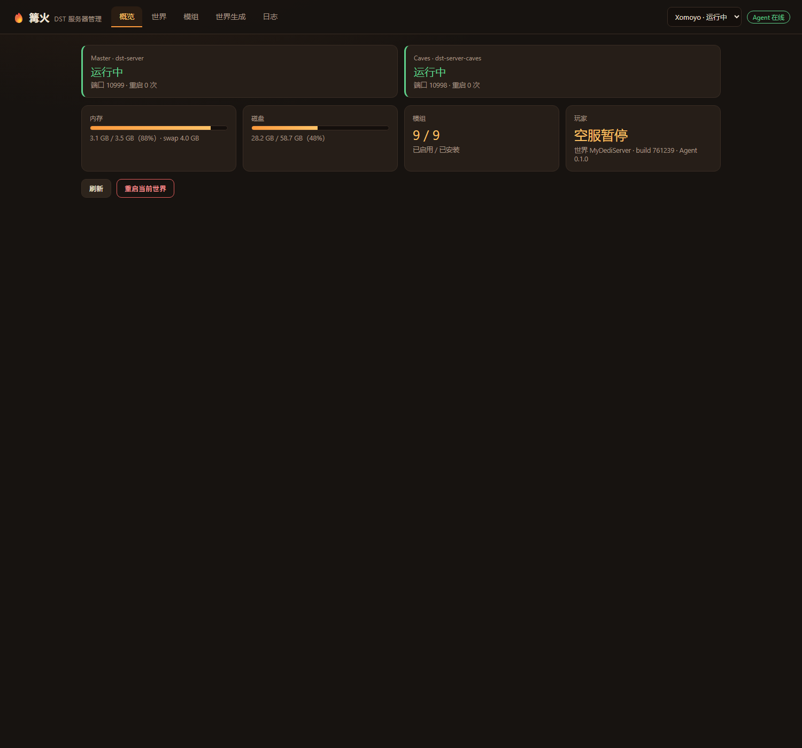
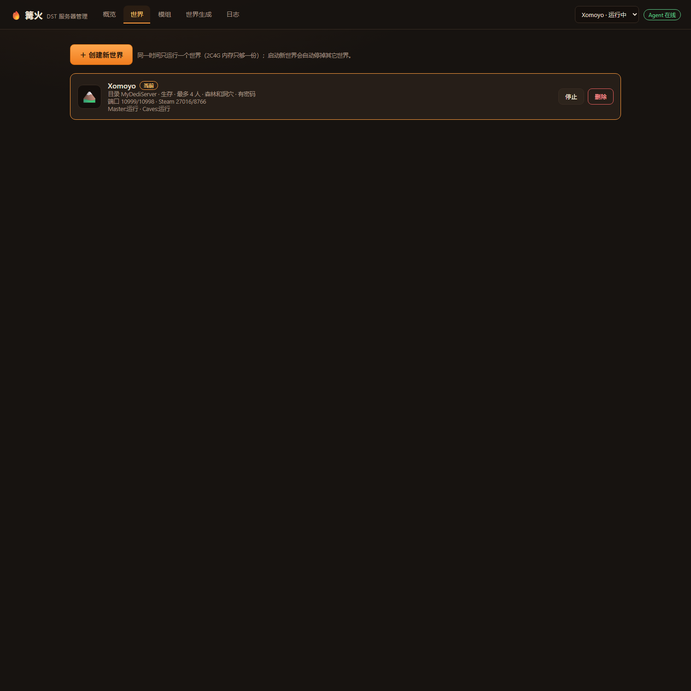
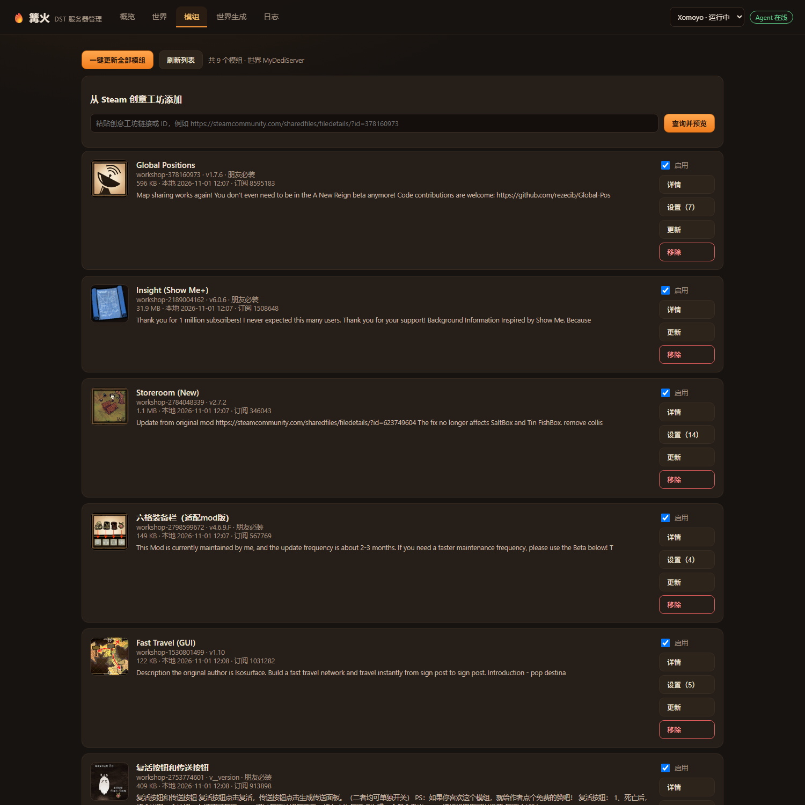
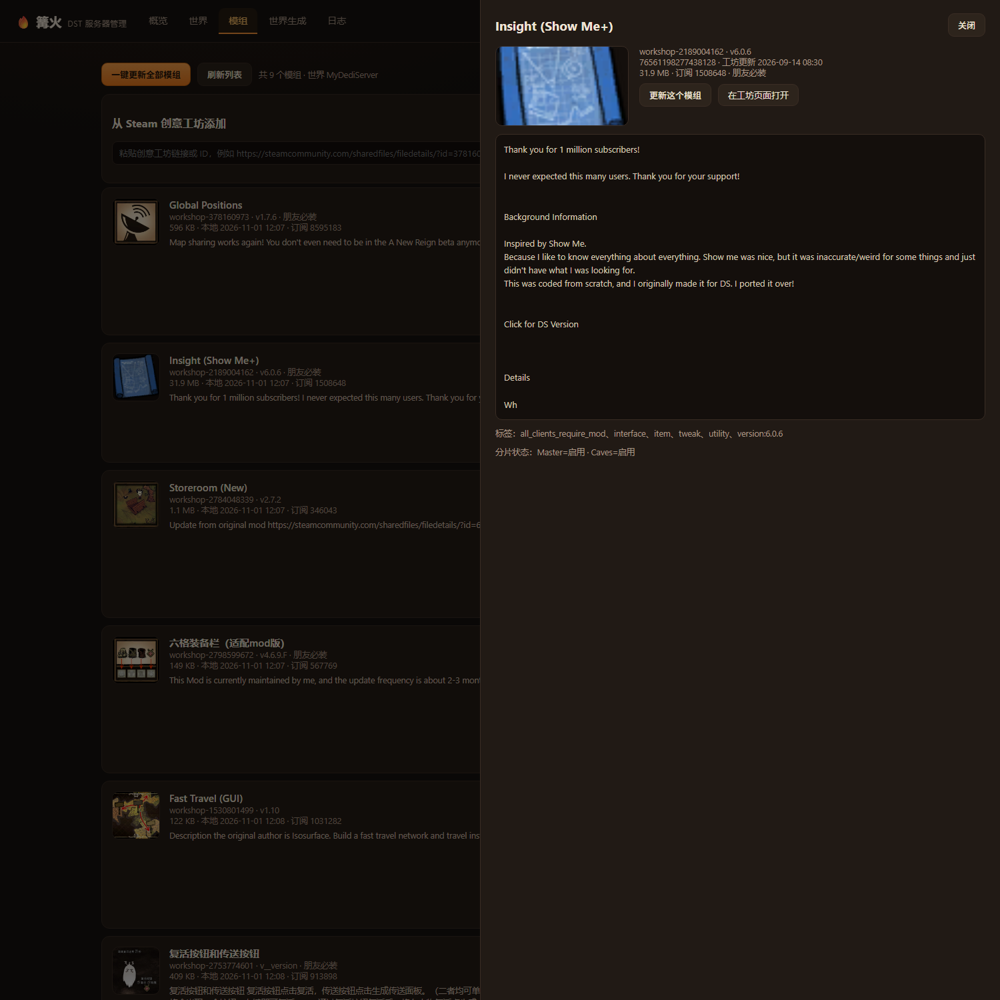
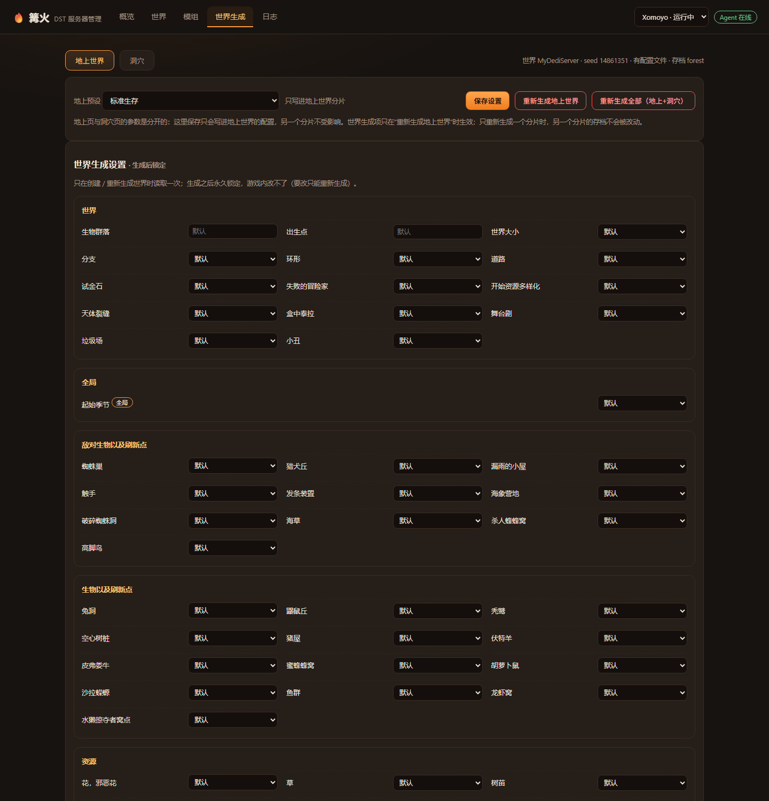
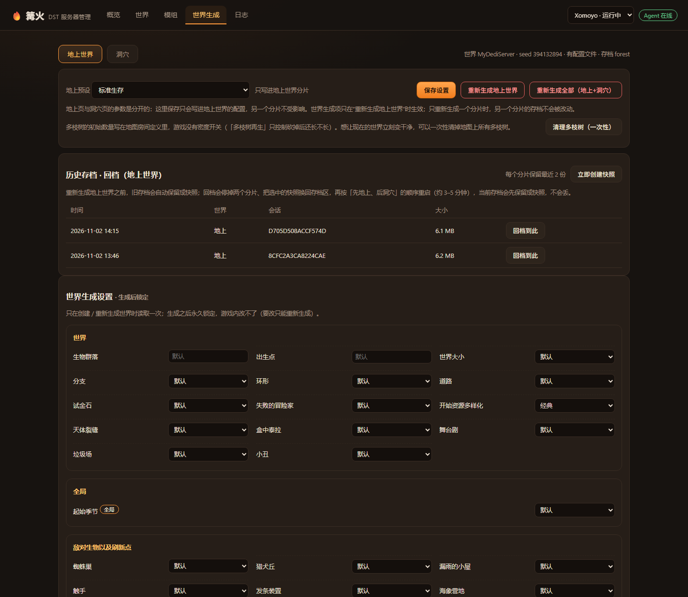

# 篝火 · 饥荒联机版（DST）服务器管理平台 · 用户手册

适用版本：面板 0.2.9 / Agent 0.1.0　|　设计文档 v2.11　|　更新日期：2026-11

本手册面向**服主**：说明每个页面能做什么、怎么做、做完怎么验证、出问题怎么退回去。

---

## 1. 这是什么

篝火是一个 DST 专服管理平台，由两部分组成：

- **本机面板**：Windows 上运行的单文件程序，内嵌 Web 界面，只监听 `127.0.0.1:8717`；
- **云服务器 Agent**：常驻 Linux 的守护服务，负责真正操作游戏进程、存档、模组与 systemd。

面板自己不碰游戏，所有操作经 SSH 交给云上的 Agent 执行。所以**关掉本机电脑，服务器照常运行**；面板只在你需要操作时打开。

开始之前，先记住三条平台无法绕过的游戏限制：

1. DST 没有官方 RCON，所有游戏内指令只能通过服务器的 stdin 控制台下发；
2. 创意工坊没有历史版本，模组更新失败只能靠"更新前快照"回滚；
3. `app_update validate` 会重置模组清单，所以每次更新服务端后必须重建模组。

---

## 2. 使用前提

| 项 | 要求 |
|---|---|
| 本机 | Windows 10/11；已放好 `campfire-panel.exe` 与配置 `%APPDATA%\campfire\panel.json` |
| 云端 | 已部署 DST 服务与 `campfire-agent`（systemd 常驻，socket `/run/campfire/agent.sock`） |
| 网络 | 本机能 SSH 到云服务器（面板配置文件里含私钥路径与 known_hosts） |
| 权限 | 面板以 `ops` 身份访问 Agent socket；游戏进程以 `dst` 用户运行 |

### 2.1 启动面板

双击 `campfire-panel.exe`（或 `platform\start-*.cmd`），出现控制台窗口后浏览器打开：

```
http://127.0.0.1:8717
```

首次启动若未配置，可带参数运行一次：

```powershell
campfire-panel.exe -host <服务器IP> -ssh-key <私钥路径> -known-hosts <known_hosts路径>
```

配置会写回 `panel.json`。之后直接双击即可。

### 2.2 公网只读入口

面板可配置 `public_hosts`，经反向代理暴露一个只读入口（演示实例：`https://dst-demo.example.com`）。

- 访问需要 Basic 认证（用户名 `campfire`）；
- 公网侧**只读**：所有写操作返回 403；
- 本机 `127.0.0.1` 免认证、完整权限。

---

## 3. 界面总览

顶部栏：左侧是导航（**概览 / 世界 / 模组 / 世界生成 / 日志**），右侧是当前世界下拉框与 Agent 在线状态。



所有耗时操作（安装、更新、重建世界、回档、重启）都会以**任务卡**形式显示进度与日志；任务在后台继续，切页不影响。

---

## 4. 功能操作

### 4.1 概览（Overview）

看什么：

| 卡片 | 内容 |
|---|---|
| Master / Caves | 运行中 / 已停止、端口、重启次数 |
| 内存 | 已用 / 总量及百分比、swap |
| 磁盘 | 已用 / 总量及百分比 |
| 模组 | 已启用 / 已安装 |
| 玩家 | 在线人数；空服时显示"空服暂停" |
| 游戏版本 | 本机客户端 build 与云端服务端 build 对比 |
| 运行健康 | 日志大小、一分钟增长量、`Disabling` 行数、ERROR 行数 |

能做什么：

- **刷新**：重新拉取状态。
- **重启当前世界**：先优雅关服（`c_shutdown(true)`，游戏自己存档并注销）再按顺序拉起，约 2 分钟。
- **检查更新 / 更新服务端**：从 Steam 拉取最新 build。会提示"先关服→备份→下载校验→先地上后洞穴重开"，通常 5–30 分钟，期间玩家进不来。
- **截断日志**：当日志被报错模组刷爆时使用；先禁用报错模组再截断，否则会继续涨。
- **禁用并重启**（报错模组列表）：定位到具体模组，一键停用。

> 页面停留时运行健康卡每分钟自动刷新，方便观察日志增长。

### 4.2 世界（Worlds）



每个世界显示：目录名、游戏风格、人数上限、是否含洞穴、PvP、密码、端口（Master/Caves、Steam、Auth）、各分片运行状态。

操作：

| 按钮 | 行为 |
|---|---|
| 启动 | 拉起该世界；**会自动停掉其它世界**（2C4G 只够一份） |
| 停止 | 优雅关服并停止两个分片 |
| 设为当前 | 只切换面板显示与操作对象，不动进程 |
| 删除 | 先把存档备份到 `/home/dst/backups/`，再删世界 |

#### 创建新世界（向导，四步）

1. **设置**：世界名称（同时是服务器目录名，≤20 字符）、描述、游戏风格（生存/无尽/荒野/暗无天日等）、最多玩家（2–16）、是否开启 PvP、是否同时开洞穴分片、密码（可留空）。
2. **地上**：选"地上预设"（只影响地上），再按需覆盖世界生成设置与世界规则。
3. **洞穴**：选"洞穴预设"（只影响洞穴），同样可逐项覆盖。预设按分片隔离，互不影响。
4. **创建**：核对摘要后点"创建世界"。新世界会把**当前已启用的模组**同步过去；第一次启动要生成地图，约 1–3 分钟。

> 世界生成设置（生物群落、出生点、世界大小、分支、道路、试金石、天体裂缝等）**只在生成时读取一次，生成后永久锁定**；要改只能重新生成。世界规则（季节、昼夜、死亡复活、资源再生等）运行时可改，保存后读档生效。

### 4.3 模组（Mods）



列表显示所有已安装模组：启用状态、是否有更新、详情入口。

操作：

- **启用 / 停用**（开关）：切换后自动重启当前世界使其生效。
- **更新**（单个）/ **一键更新全部模组**：更新前自动做存档快照；失败可回档。
- **添加模组**：粘贴创意工坊链接或 ID，例如
  `https://steamcommunity.com/sharedfiles/filedetails/?id=378160973`，
  解析后"添加并安装"；合集可"添加整个合集并安装"。
- **详情**：查看封面、作者、工坊更新时间、各分片启用状态与该模组的参数表单，改完点"保存设置并重启"。



验证是否真的生效：回到概览看运行健康的 `Disabling` 行数必须为 0；不为 0 说明该模组加载失败，需要禁用或换版本。

### 4.4 世界生成（World Gen）



页面顶部有 **地上世界 / 洞穴** 两个分片标签，右侧显示当前世界的种子、是否有配置文件、存档类型（`forest` / `cave`）。

三个区域：

1. **预设与保存**：选择该分片预设（未选择时保存会自动用期望预设），点"保存设置"只写当前分片，另一分片不受影响。
2. **世界生成设置 · 生成后锁定**：地形类参数，只在"重新生成"时生效。
3. **世界规则设置 · 运行时可改** + **全局规则（森林主控，自动同步到洞穴）**：季节、昼夜、死亡复活、节日、坎普斯等跨分片规则只在地上页出现，改这里等于两片一起改。

特殊状态——**红灯修复**：如果该分片配置写错（例如洞穴被写成森林），页面会出现红色提示"这个分片现在生成不出正确类型的世界"，点"改为 DST_CAVE 并保存"一键修正。

生成与重建：

| 按钮 | 行为 |
|---|---|
| 重新生成地上世界 / 重新生成洞穴 | 只重建该分片，另一个分片的存档不动；旧存档自动保留为快照 |
| 重新生成全部（地上+洞穴） | 两个分片一起重建 |
| 清理多枝树（一次性） | 对地上执行 `c_removeall("twiggytree")` 并自动存档；**会删掉玩家自己种的**，不可撤销 |

> 说明：多枝树的**初始数量**硬编码在地图生成逻辑里，游戏没有密度开关；"多枝树再生"只控制砍掉后还长不长。想让世界立刻干净，只能用一次性清理。

#### 历史存档与回档



表格列出该分片最近快照：时间、世界、会话 ID、大小。每个分片保留最近 **2 份**。

- **立即创建快照**：手动留档。
- **回档到此**：停两个分片 → 把选中快照换回存档区 → 按"先地上、后洞穴"重启，约 3–5 分钟；**当前存档会先自动保留成快照，不会丢**。

### 4.5 日志（Logs）

显示当前世界服务日志的最近 200 行，可刷新。

- 正常现象：空服时出现 `Sim paused`；
- 异常：持续刷 `E_ROWID_EXIST`（卡注册）、`Disabling workshop`（模组加载失败）、`PANIC`（世界生成参数非法）。

---

## 5. 典型任务剧本

### A. 第一次开服（约 20 分钟）

1. 世界 → 创建新世界 → 设置（人数/密码/风格）→ 下一步；
2. 地上 → 选预设"标准生存"，按需调生成设置 → 下一步；
3. 洞穴 → 选洞穴预设（默认即可）→ 下一步；
4. 创建 → 等待任务完成（首次生成 1–3 分钟）；
5. 概览确认两个分片"运行中"，把 IP/端口/密码发给朋友。

### B. 加一个模组并确认生效

1. 模组 → 粘贴工坊链接 → 解析 → 添加并安装（自动重启，约 2 分钟）；
2. 概览 → 运行健康 → `Disabling workshop` 应为 0；
3. 进游戏确认模组内容出现。

### C. 模组把服务器搞崩了

1. 概览 → 运行健康里找到报错模组 → "禁用并重启"；
2. 若存档已被污染（例如物品表损坏）→ 世界生成 → 历史存档 → 回档到更新前快照；
3. 回到模组页，把该模组移除或换版本。

### D. 更新服务端版本

1. 概览 → 游戏版本卡片 → "更新服务端"；
2. 确认后等待任务完成（会先关服、备份、steamcmd 下载校验、重建模组、先地上后洞穴重开）；
3. 完成后概览核对 build 号，进服测试。

### E. 想换一张地图

1. 世界生成 → 选定分片 → 调整生成设置；
2. "重新生成"该分片；旧存档自动留快照；
3. 需要回退时用"历史存档 → 回档到此"。

---

## 6. 常见问题

| 现象 | 原因 | 处理 |
|---|---|---|
| 页面打不开 127.0.0.1:8717 | 面板没启动 / 端口被占 | 看面板控制台是否报错；确认 `panel.json` 的 `addr` |
| 右上角显示 Agent 离线 | SSH 不通 / Agent 未运行 / known_hosts 不匹配 | 手动 `ssh ops@服务器` 验证；`systemctl status campfire-agent`；known_hosts 需 LF、无 BOM、含实际主机密钥类型 |
| 任务卡在"等待注册" | 同 Token 秒级重启，Klei 登记行未释放（`E_ROWID_EXIST`） | 等面板 15 分钟提示；或重启面板任务重试。根治手段是停止时走 `c_shutdown(true)` 优雅关服 |
| 洞穴"没生成" | 多半是握手失败，不是没生成 | 看 Caves 日志是否有 `World generated`；再看 Master 是否有 `no available shard` |
| 模组装了不生效 | 运行期加载失败 | 概览看 `Disabling workshop` 行数与报错模组 |
| 内存 87% 以上 | 双分片常态占用约 3.1/3.5 GB | 确认 swap 未被打满；必要时升级到 4C8G |
| 公网入口 401/403 | 未认证 / 只读模式 | 输入 Basic 认证；写操作请在本机 127.0.0.1 操作 |

---

## 7. 安全须知

- 私钥、Klei Token、面板口令**只留在本机与服务器**，不要提交到仓库或发到聊天工具；
- 公网入口默认只读，且同 IP 连续 5 次认证失败锁定 10 分钟；
- 面板只监听回环地址，暴露必须经反向代理 + TLS + 认证；
- 22 端口对公网开放是有意为之（家庭宽带无固定 IP），已用密钥登录 + 禁 root + fail2ban 兜底。

---

## 8. 延伸阅读

| 文档 | 内容 |
|---|---|
| `docs/DST服务器管理平台-设计方案.md` | 为什么这样设计、需求编号、事故复盘 |
| `platform/README.md` | 部署、API、开发向说明 |
| `docs/踩坑与解决办法.md` | 按 A–K 分类的故障手册 |
| `docs/交接说明.md` | 机器状态、日常用法、上线循环 |
| `docs/开发文档.md` | 模块划分与代码结构 |
